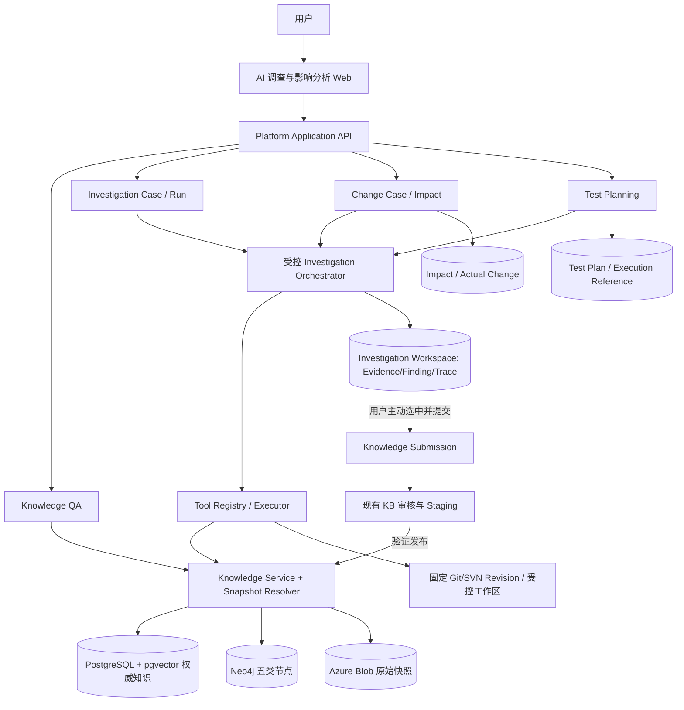
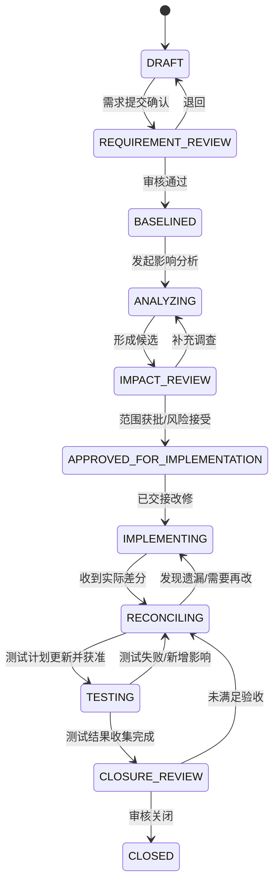
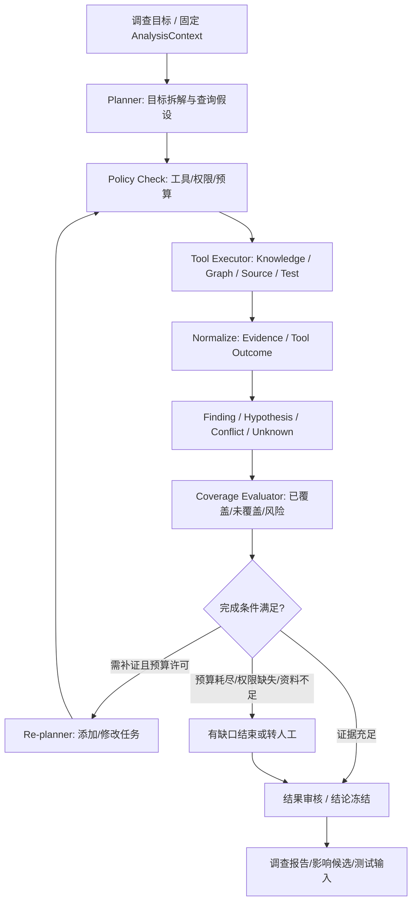
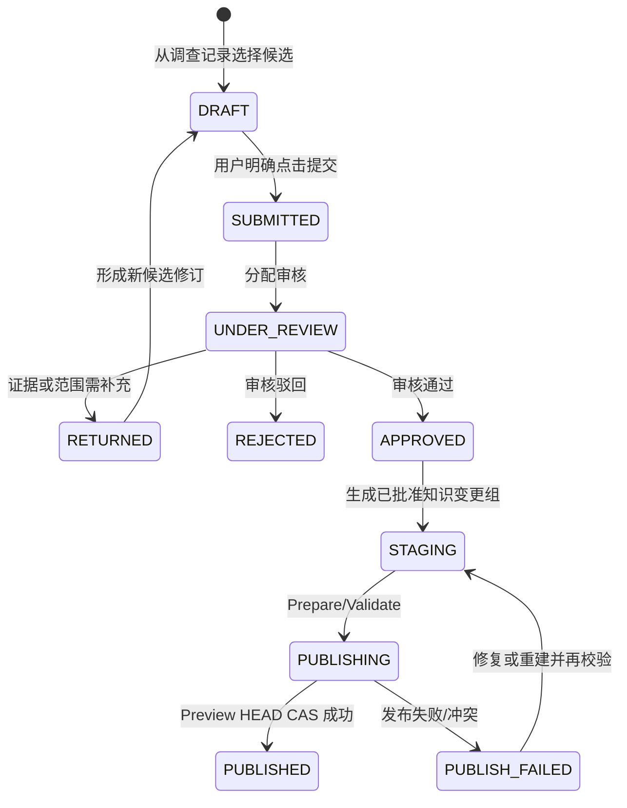
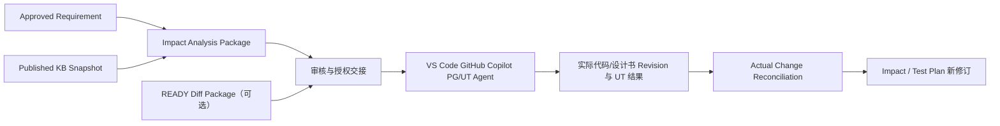

# AI 調査・影響分析プラットフォーム / AI 调查与影响分析平台

## 总体设计 v0.3（审查修订版）

> **状态**：拟议的平台设计基线；不代表已有功能已经实现或通过真实工程验证。  
> **修订日期**：2026-11-23  
> **基础设计**：`電力 Online 知识库平台——详细设计完整汇编 v0.2`、`知识库平台总体架构设计 v0.2（MVP1 基线）`、`電力 Online 系统知识库本体详细设计 v0.4`。  
> **本次修改原则**：不覆盖现有知识库 v0.2 的正式版本/存储/审核设计；本文件定义其上层 AI 问答、自动调查、影响分析及测试计划的业务与技术扩展。任何与原知识库正式发布规则冲突的实现均应按原知识库权威约束处理，并在开发前完成接口评审。

---

# 0. 本次设计评审结论与修订摘要

前一方案已经包括 RAG、Graph、自然语言调查、影响分析与 Test Plan，但缺少多业务域的边界、证据驱动的修改判定、非正式数据隔离、分析版本绑定、可检查的调查完成条件及实际改修反馈。本版将这些问题落实为明确对象模型、数据流、状态机、接口草案与验收用例。

| 编号 | 原问题 | v0.3 修订 | 状态 |
|---|---|---|---|
| R01 | 一切都建模为 ChangeCase | QA Session、InvestigationCase、ChangeCase 分离，共享 InvestigationRun | 本版设计决定建议 |
| R02 | 自然语言直接用于正式改修 | Raw / Interpreted / Approved Requirement 分离；未确认仅可探索 | 本版设计决定建议 |
| R03 | 临时调查知识容易污染正式 KB | Published KB、Investigation Workspace、Change Workspace 隔离 | **必须遵守** |
| R04 | Knowledge Snapshot 与开发中的代码可能不一致 | AnalysisContext 固定 Snapshot + 多仓库 Revision + Workspace Pin | **必须遵守** |
| R05 | “有关联”被误写成“需要修改” | Candidate → Evidence Assessment → Review Decision 的判定过程 | **必须遵守** |
| R06 | AI 自行认定调查结束 | Coverage + Risk + Budget + Review Gate；允许有缺口结束 | **必须遵守** |
| R07 | Graph 边被当作影响传播规则 | 独立 Traversal Policy；关系路径只产生候选 | **必须遵守** |
| R08 | Test Plan 与可执行 Test Case 混淆 | Test Scope / Plan / Case / Execution Feedback 分层 | 本版设计决定建议 |
| R09 | Finding 自动积累 | **仅主动提交**，审核后通过原 KB Staging/Commit/Snapshot 发布 | **用户已明确约束** |
| R10 | 自由工具编排失控 | Tool Registry、权限、只读边界、预算、重试与 Trace | 本版设计决定建议 |
| R11 | 新平台覆盖现有 PG/UT Agent | 平台负责分析；既有 VS Code GitHub Copilot Agent 负责授权后的 PG/UT 执行 | 沿用既有边界 |
| R12 | 缺乏实证验收 | 历史改修金标准、召回/精度/证据/覆盖/成本/重放验收 | **必须 PoC 验证** |

## 0.1 事实、约束和待验证项的区分

- **继承已有设计的约束**：业务文字大版本（如 `3Q上期`、`3Q下期`）及显式前驱；`Current/Preview/Release`、Commit/不可变 Snapshot；PostgreSQL 为权威，Neo4j 为版本化投影；五类 Graph 节点；KnowledgeEntry 不进入 Graph；Git/SVN 作为源数据来源；Azure Blob 不可变快照；知识 Staging 与审核；现有 Diff Package 与 PG/UT Agent 的限定交接。
- **本版平台的设计建议**：三种顶层任务、共通调查引擎、AnalysisContext、ImpactReview、Test Plan 等对象和 API。尚需通过团队评审和 PoC 确认。
- **不能预先承诺的结果**：完整识别所有动态调用、完整生成 IT/ST 可执行场景、无人工参与确认修改必要性、自动证明“无影响”。

---

# 1. 目标、范围与非目标

## 1.1 项目背景

面向日本电力行业大型既存 Online Java Web 系统：300 多个 Function、1000 多个 Screen，文档涵盖 L1 約款、L2 要件定義書、L3 基本仕様書、L4 詳細仕様書、L5 詳細設計書（Excel 居多）；实现含 Java、JSP、JavaScript、JDBC、Properties、自研框架、反射、动态 SQL、Session。设计和代码可能缺失或不一致。Batch 内部分析不作为首期范围；Online 与 Batch/外部接口的边界风险可以列为调查对象。

## 1.2 用户可见目标

1. **知识问答**：输入自然语言问题，基于授权 Knowledge Snapshot 返回带文档/单元格/代码出处的回答；遇到缺口明确说未找到、冲突或无权限。
2. **自主组织调查**：围绕问题生成受控、可修改的 Investigation Plan，调用知识和源码工具，保存 Evidence、Finding、Unknown，展示实际调用记录及覆盖缺口。
3. **自然语言变更影响分析**：从需求文本（无需事先存在 Diff Package）出发，分析需要修改/有可能需要修改的文档、画面、功能、代码文件和具体逻辑；支持审核修改清单。
4. **测试计划**：依据需求、影响结论和真实实现证据生成 UT/IT/ST 测试范围与计划草案；标记缺失的测试数据/前置条件；改修后基于实际差分更新。
5. **可视化**：按局部图谱、路径、清单、来源证据、变更前后对比查看成果，人工决定及导出。
6. **调查知识积累**：从调查工作空间人工**主动选择并提交** Finding，经审核和既有知识入库流程成功发布后供普通问答和后续分析使用。

## 1.3 首期非目标

- 全量构建 Java Class/Method/Field/Variable 图或全部运行时依赖。
- 保证动态调用、Session、SQL 以及跨画面路径的全部影响无遗漏。
- 将所有 L1~L5 文档逐一建立完整上下游父子链；证据不足允许缺失。
- 无人确认地正式修改设计书/代码、执行全部测试或直接发布生产版本。
- 在 Web 平台再造一套代码修改 Agent，替代既有 VS Code GitHub Copilot PG/UT Agent。
- 将调查中产生的 Finding/KnowledgeEntry 自动写入正式 Graph/RAG。
- 用 Test Plan 草案宣称实际 UT/IT/ST 测试已经通过。

---

# 2. 基于现有知识库的职责边界

## 2.1 既有知识库继续作为权威知识底座

| 组件 | 保留职责 | 新平台允许调用的能力 |
|---|---|---|
| PostgreSQL + pgvector | ArtifactVersion、Excel Sheet JSONB、Chunk/Embedding、KnowledgeEntry、版本、关系权威、审核/审计 | 按 Snapshot 检索、读取结构化来源、保存额外业务模块的独立数据 |
| Neo4j | 五类节点 `Document`、`SourceFile`、`Function`、`Screen`、`UIElement` 的已确认、按 Snapshot 查询的关系投影 | 有约束的一跳/有限多跳遍历和证据追踪；不存本次调查的临时事实 |
| Azure Blob | 导入时原始文档和源码不可变快照 | Evidence 来源校验和授权原件读取 |
| Git/SVN | 原始设计资料与代码来源权威 | 指定仓库、Revision 的只读搜索与调查；开发工作区独立处理 |
| Knowledge Service | Snapshot Resolver、权限、RAG、Graph、Excel、Diff、审核发布 | 上层业务模块统一访问入口；客户端不直连存储 |
| Knowledge MCP Server | 按工具单独授权的知识只读能力 | 新平台内部工具适配；现有 PG/UT MCP 权限不自动扩大 |

Graph 只表达经审核确认的重要对象关系；原始源代码中的方法/调用细节可以按需解析为调查证据，但不因此扩展 Neo4j 的五类正式节点。

## 2.2 新增平台边界



上述模块是逻辑边界，**不要求物理上拆分成大量微服务**。PoC 可在单一 Spring Boot 服务及异步 Worker 中实现，避免过度设计。

---

# 3. 三类业务入口与对象关联

## 3.1 不再以 ChangeCase 统一所有行为

| 对象 | 用户目的 | 创建条件 | 关系 |
|---|---|---|---|
| `QASession` | 一般知识问答和追问 | 用户开始问答 | 固定 Snapshot 的查询回合；不要求创建调查案件 |
| `InvestigationCase` | 复杂调查，跨工具、可暂停/恢复 | 用户明确调查或从 QA 升级 | 包含多个 `InvestigationRun`，可独立结案 |
| `ChangeCase` | 正式变更需求、影响审核与实际改修协调 | 用户将变更纳入受控改修流程 | 可关联 0..N 个 InvestigationCase/Run，不依赖其必须存在 |
| `InvestigationRun` | 一次在固定输入上下文下执行的调查 | 被问答/案件触发 | 带计划、工具调用、证据、结果、覆盖记录；重跑创建新 Run |

`QASession → InvestigationCase`、`InvestigationCase ↔ ChangeCase` 为显式转换/关联操作，不暗中改变历史成果的身份。独立调查可以不产生 ChangeCase；正式 ChangeCase 可以因分析不足多次启动调查。

## 3.2 Knowledge QA 两档执行

- **Quick QA**：固定 Snapshot → 精确对象/编号/关键词/向量查询 → 按需有限 Graph 扩展 → 原文证据 → 带引用回答；超出权限不检索，知识缺失/冲突明确展示。
- **Deep QA**：若问题需要跨来源核对或多次工具执行，用户选择升级 InvestigationCase；复杂调查不应在普通 QA 的无限工具循环里隐式执行。
- 会话每轮记录输入、已解析 Snapshot、检索证据 ID、回答及局限。用户更换业务大版本或 Branch 时，清理依赖旧上下文的临时选择；历史回合保留旧 Snapshot 标记。

---

# 4. 需求基线与变更案件

## 4.1 Requirement 分层

| 对象 | 内容 | 约束 |
|---|---|---|
| `RawRequirement` | 用户原始自然语言、附件引用、提交者 | 不可变，原文不被 LLM 替换 |
| `InterpretedRequirement` | AI 提取的对象、Before/After、条件、适用范围、假设 | 带分析版本、候选状态；不能默认为已确认规格 |
| `OpenQuestion` | 歧义/冲突/缺失的业务前提 | 与回答、风险接受、负责人决定关联 |
| `RequirementBaseline` | 业务负责人确认的目标规格及修订号 | 正式修改范围审核和 Test Plan 的依据；变更须新 Revision |

未确认 Requirement 时可执行 `EXPLORATORY` 影响分析；结果标记为假设，不允许升格为批准的正式改修清单。

## 4.2 ChangeCase 状态机（建议）



状态可扩展 `ON_HOLD/CANCELLED`，但关闭时至少记录需求基线、已审核影响、实际修改清单、测试执行引用、未解决风险、关闭责任人。**知识提交/发布不是 ChangeCase 关闭的必要条件**。

## 4.3 修改前、修改后两个分析阶段

1. **Proposal Analysis**：根据已确认或探索性的需求、既有知识/代码产生候选修改范围和测试范围。
2. **Actual Change Reconciliation**：固定实际代码和文档的新的 Revision，比较 Proposal 与实际变更，触发未预计项复核和 Test Plan Revision。
3. 测试反馈后如发现缺陷，重新调查/改修并生成新的 Revision；不得原地修改旧分析结论。

---

# 5. 分析上下文与版本一致性

## 5.1 `AnalysisContext`（强制生成）

示例（均为示例 ID）：

```json
{
  "analysis_context_id": "<UUID>",
  "major_version_id": "<UUID>",
  "branch_or_release": "PREVIEW",
  "knowledge_snapshot_id": "<UUID>",
  "source_revisions": [
    {"repository_id":"repo-java","revision":"<git-commit-sha>"},
    {"repository_id":"repo-design","revision":"<svn-revision>"}
  ],
  "workspace_pin": null,
  "comparison_context_id": null,
  "parser_versions": {"excel":"<version>","source":"<version>"},
  "retrieval_config_id": "<id>",
  "model_config_id": "<id>",
  "tool_registry_version": "<version>",
  "created_at": "<ISO8601>"
}
```

- 既有 Knowledge Snapshot 决定正式知识、Graph/RAG 的生效集合；不能对普通正式查询混入未经审核资料。
- `source_revisions` 是各仓库固定的 Revision 映射，而不是单个全局 Commit；须记录代码/文档来源及授权情况。
- 当调查代码版本不是 Knowledge Snapshot 中 ArtifactVersion 所引用的 Revision，应记录 `SOURCE_DRIFT`，以**版本差异/候选风险**处理，不能认为旧 Graph 关系必然适用新代码。
- 工作区若含未提交变更，必须通过受控快照、不可变文件清单与 Hash 固定内容，否则不能声称可复现；禁止随意读取变化中的活目录并继续沿用旧分析结果。
- 如果需要比较前后两个 Snapshot 或源码 Revision，应建立独立的对比上下文（两个固定输入），不在一次单视图查询内混用其 RAG/Graph。
- 工具、模型和 Prompt 的版本用于审计与实验复现，不保证非确定性 LLM 逐字输出一致；可重放性以固定来源、工具结果、证据和审核成果为准。

## 5.2 三个数据隔离区

| 区域 | 主要内容 | 正式查询可见性 | 修改控制 |
|---|---|---|---|
| Published Knowledge | 审核发布的 ArtifactVersion、KnowledgeEntry、Graph、RAG | 按授权 Snapshot 可见 | 只通过原 KB Commit/发布流程 |
| Investigation Workspace | Tool Trace、Evidence、Hypothesis、Finding、Unknown、分析成果 | 普通 KB QA **不可见**；仅授权调查上下文可使用 | 调查本地版本化，不直接操作知识 HEAD |
| Change Workspace | 未发布代码和设计草案、实际差分、测试结果引用 | 普通 KB QA **不可见**；仅授权改修/核对访问 | 源码仓库和开发流程独立管理 |

严格区分“允许调查工具读取”与“允许作为正式知识被普通检索返回”。允许前者不意味着允许后者。

---

# 6. 自动调查引擎（核心共通能力）

## 6.1 端到端执行



## 6.2 调查计划与执行状态

`InvestigationCase` 管主题与多次 Run；`InvestigationRun` 状态建议 `CREATED → PLANNING → RUNNING ↔ PAUSED → EVALUATING → REVIEW_REQUIRED → COMPLETED / COMPLETED_WITH_GAPS`，并支持 `FAILED/CANCELLED`。

Run 的每个 Step 应记录：目标、依赖、工具输入、上下文 ID、状态、开始结束时间、结果引用、错误/重试、消耗、是否人工介入。**重跑须生成新 Run**；历史计划、证据和结果不可静默覆盖。

## 6.3 工具分层与契约

| 工具组 | 示意工具 | 结果要求 |
|---|---|---|
| Knowledge | `search_knowledge`、`get_document_section`、`get_excel_item`、`get_knowledge_entry` | 返回 KB Snapshot、ArtifactVersion、Locator、权限过滤状态 |
| Graph | `resolve_object`、`graph_neighbors`、`graph_traverse`、`get_relation_evidence` | 返回已确认关系及路径 ID；查询中每个节点/边在同一 Snapshot 有效 |
| Source | `search_source`、`read_source_range`、`find_references`、`scan_source_pattern` | 返回仓库/Revision、路径、行范围、工具方法和静态分析局限 |
| Requirement/Diff | `parse_requirement`、`compare_rules`、`read_diff_package`、`compare_worktree_revision` | Before/After 与固定版本、差异来源、Uncertain |
| Test | `search_test_assets`、`derive_test_conditions`、`fetch_test_execution_refs` | TestPlan/TestCase/Execution 明确分开，禁止虚构执行结果 |
| Quality | `verify_evidence`、`evaluate_coverage`、`detect_conflict` | 明确验证标准、未知项及失败原因 |

上表是**待实现的工具契约草案**，不是既有 KB MCP 已公开的接口。工具返回数据中的任意文档文本视为不可信内容，不允许转为执行权限指令。

共通工具请求至少包含 `analysis_context_id`、工具版本、目标范围、分页/预算限制、调用者身份；响应包含 `outcome_status`（FOUND/NOT_FOUND/INCOMPLETE/DENIED/ERROR 等）、证据定位、诊断、耗时和结果 Hash。`NOT_FOUND` ≠ `NO_IMPACT`。

## 6.4 编排控制

- 默认无破坏性工具；只读源码和知识查询为先。写入代码、执行测试、访问生产 DB 必须经独立权限与明确授权，不由 Planner 自行决定。
- 限制总调用次数、搜索范围、递归深度、模型 Token/费用、并发度及单步时间；按项目规模/角色配置，阈值需实测。
- 遇到数据量过大，应通过业务/画面/文件范围细化调查，而不是全库检索或多跳图无限扩展。
- 工具结果必须标记直接事实、模型推测、静态代码证据、人工审核证据，防止以“多个 AI 结论一致”误当独立事实。
- `FAILED`、`DENIED`、`INCOMPLETE` 不可归为“未发现影响”；必须传播到 Coverage 与最终报告。

## 6.5 完成条件

为每个任务模板定义 `AcceptanceCriteria`：目标对象已解析或明确未解析、重要证据来源已查询、候选已分类、冲突已处理或记录、风险清单完整、覆盖范围明确、运行预算/工具失败可见。

可用结果：`COMPLETE_WITH_EVIDENCE`、`COMPLETE_WITH_GAPS`、`BLOCKED`。不能提供“整个系统无遗漏”的自动保证。若高风险 Unknown 未获审核风险接受，不得进入正式修改清单批准。

---

# 7. Evidence、Finding 与知识权威

## 7.1 证据类型

| 类别 | 示例 | 确认含义 |
|---|---|---|
| PRIMARY_DOCUMENT | Excel L5 Sheet/Cell、L1 条款 | 原文记载某规则，不自动证明实现行为 |
| PRIMARY_SOURCE | 固定 Revision Java/JSP/JS 行 | 源码实现某逻辑，不自动证明业务期望 |
| CONFIRMED_GRAPH | 已审 Graph Relation + RelationEvidence | 存在已确认关联，不自动证明修改必要性 |
| HUMAN_DECISION | 授权人员对规则/影响范围的确认 | 作为审查事实，但需记录适用范围 |
| TOOL_INFERENCE | 结构分析器/代码搜索所得候选 | 需要解释算法局限，未必完整 |
| AI_HYPOTHESIS | LLM 推断关联或变化原因 | 只作为调查假设，不可单独成为正式结论 |

证据必须记录 `evidence_id`、`analysis_context_id`、source_kind、固定版本（ArtifactVersion 或 repo/revision/workspace Hash）、locator、摘录、获取工具、可信来源状态与权限。不能只保存“AI 解释”作为证据。

## 7.2 Finding 与支持/反证

`Finding` 表示一个可审查的命题，例如“输入日期检查由 X 文件的 Y 处理执行”；同一个 Finding 可关联多个支持 Evidence、反证 Evidence 和冲突记录。

Finding 状态建议：`HYPOTHESIS`、`SUPPORTED`、`CONFLICTED`、`NOT_VERIFIED`、`REVIEWED`、`REJECTED_FOR_THIS_RUN`。**此状态仅属于调查结果，不等于知识库正式审核通过**。

调查结束后可选择保留全部 Finding 历史，只有经用户主动选择后才可创建 `KnowledgeSubmission`。调查结果不自动进入正式 RAG/Graph。

## 7.3 不要把置信度当审核决定

可以记录模型估计的置信信息，但 `SUPPORTED`、`CHANGE_REQUIRED`、`APPROVED` 的含义应依赖明确定义的证据规则/人工决定；无证据的高分结论不能绕过审核。

---

# 8. 自然语言影响分析：从“关联”到“改修必要性”

## 8.1 影响分析的输入

可由 `Raw/ApprovedRequirement`、已确认 `design_diff_package`、特定 `Function/Screen/UIElement/SourceFile`、代码/文档实际差分中的任一种或多种发起。

**重要**：自然语言影响分析不要求先有设计书差分。原 `Diff Package` 继续仅表示*同一大版本 Current/Preview 的详细设计书对比*，不可擅自改作通用分析包。

## 8.2 分析步骤

1. `Requirement Resolver`：解释目标行为、变更前后规则、适用对象、例外及未确定前提。
2. `Baseline Lookup`：固定现有 Knowledge Snapshot，定位对应 L1–L5 原文、业务对象、代码引用。
3. `Graph Candidate Expansion`：按受控关系字典获取已知 Function/Screen/Document/SourceFile 候选；路径作为证据，不直接推断影响。
4. `RAG Candidate Discovery`：用业务同义词、规则全文、精确编号检索未在 Graph 中连接的候选，不能把语义相似变成已确认依赖。
5. `Targeted Code Investigation`：从候选源码按需读取具体逻辑、配置/引用、可能共通处理；静态难以还原的 Session/反射/动态 SQL 显示不确定性。
6. `Modification Necessity Assessment`：将需求目标与当前规格/实现逐项比较，判断真正需更改的对象或保持原样的理由。
7. `Impact Review`：人工审核修改候选，必要时补充调查、确认疑问和风险接受。
8. 冻结 `ImpactAnalysisRevision`，输出修改清单、证据/风险、测试范围输入；同一分析上下文重跑建立新 Revision。

## 8.3 关联查询不能直接决定修改必要性

建议的 `ImpactTraversalPolicy`：

| Graph 关系 | 查询用途 | 可直接推断“应修改”？ |
|---|---|---|
| `HAS_SCREEN` | 从功能到画面、或反向范围枚举 | 否 |
| `HAS_ELEMENT` | 从画面到重要控件 | 否 |
| `DESCRIBED_BY` | 定位规格原文和层级 | 否 |
| `IMPLEMENTED_BY` | 定位候选源码文件 | 否 |
| `REFERENCES` | 找到引用资料 | 否 |
| `DERIVED_FROM` | 找到设计依据/细化链 | 否 |
| `RELATED_TO` | 弱关联候选扩展 | 否，须更严格控制深度和证据 |

不需要新增 Neo4j 方法级节点；是否引入 ast-grep、Semgrep 或 Java 定向解析，应取决于真实改修案例的召回表现。

## 8.4 修改必要性状态和审批

| 结论 | 语义 | 进入正式改修清单的条件 |
|---|---|---|
| `CHANGE_PROPOSED` | AI/工具根据证据建议修改 | 尚未正式确认 |
| `CHANGE_REQUIRED` | 修改必要性经审核确认 | 必须有明确需求基线与关联证据、审核决定 |
| `INVESTIGATION_REQUIRED` | 有关联但证据不足 | 不允许当作“无需修改” |
| `RELATED_NO_CHANGE` | 已调查且有证据支持在本次范围内无需修改 | 必须记录已检查对象/条件与判断依据 |
| `NOT_EVALUATED` | 尚未调查 | 不得计作覆盖完成 |

另设 `impact_kind`：`DOCUMENT`、`SOURCE`、`FUNCTION`、`SCREEN`、`UI_ELEMENT`、`EXTERNAL_INTERFACE_BOUNDARY`；与上面的**判定状态**正交。不能把“高置信度”当 `CHANGE_REQUIRED`。

## 8.5 影响结果与路径

每条影响对象至少保存：`analysis_revision_id`、`object_ref`、`object_type`、`impact_state`、`impact_kind`、`before/after`、`suggested_change`、`evidence_refs`、`path_refs`、`unknown_refs`、`review_decision`、`analysis_context_id`。方法/行位置作为附属 locator，不形成正式 Graph 节点。

报告中区分：**已确认需要修改**、**待确认修改**、**仅关联无需修改**、**尚未调查/无法确定**。不可将全部候选混为“需要修改的文件列表”。

---

# 9. Test Scope、Test Plan 与实际测试反馈

## 9.1 分层成果

| 层次 | 内容 | 可用性要求 |
|---|---|---|
| `TestScope` | 哪些功能、画面、规则/接口需验证 | 可从审核后的影响清单生成候选 |
| `TestPlanRevision` | 类型、目的、优先级、测试条件、责任、前置条件、数据需求、通过标准 | 可标记 `DRAFT/REVIEWED/APPROVED` |
| `TestCaseRef` | 指向已有自动/手工测试用例，或新用例草案 | 草案不等于可执行脚本 |
| `TestExecutionRef` | 外部测试平台、CI/UT 结果、IT/ST 执行证据 | 必须来自真实执行，不允许 AI 生成虚假 PASS |
| `TestCoverageMap` | Requirement → Impact → Test Condition → Case → Execution | 显示未覆盖/无法执行项 |

## 9.2 UT/IT/ST 基本原则

- **UT**：按具体代码判断分支、边界、异常、共通处理测试；已存在测试代码时应优先复用/对照。
- **IT**：结合画面、业务状态、Session、DB 及前序操作；缺失测试数据或操作步骤时只形成带缺口的计划。
- **ST**：从业务范围和跨功能/外部接口证据制定回归范围；Batch 内部不在一期范围，可列出接口边界待调查。
- **所有类型**：不把“源码实际行为”自动视为“预期业务正确结果”；预期结果应锚定已确认需求或可靠规格。

## 9.3 三时点更新

1. 修改前：依据 RequirementBaseline、已审 ImpactAnalysisRevision 生成 `TestPlanRevision#1`。
2. 修改后：获取实际源文件/设计书差分，重新执行 `Actual Change Reconciliation`，如果范围变化生成 `TestPlanRevision#2`，保留 #1。
3. 测试后：收集 CI/UT 和 IT/ST 执行结果、缺陷、未执行/阻断项，关联 ChangeCase；若实际结果失败，回到调查或改修；测试过程不自动修改正式 Knowledge Snapshot。

---

# 10. 调查知识的主动提交、审核与增量发布

## 10.1 强制规则

**AI 可以建议哪些 Finding 值得积累，但不能主动替用户提交，也不能因 InvestigationCase 完成、ChangeCase 关闭或测试通过而自动发布知识。** 必须由具有权限的用户发起明确提交动作，选择所需 Finding/证据/目标业务大版本、拟新增/修改/失效的知识对象。

## 10.2 独立状态机



`APPROVED` 与 `PUBLISHED` 严格分开；成功发布到 Preview 不等于执行 Release 或直接改变 Current。

## 10.3 提交对象映射

| Finding 候选 | 可提交为 | 正式位置 |
|---|---|---|
| 已验证的长期业务经验/UT 前置条件 | KnowledgeEntry 新建或修订 | PostgreSQL + pgvector，按 Snapshot 解析有效版本 |
| 新的 Function/Screen/SourceFile 重要关系 | Graph Relation 候选 | PostgreSQL 关系权威，审核/发布后 Neo4j 投影 |
| 旧 Graph 关系失效/改名 | RelationVersion/DELETE 候选 | Snapshot 增量生效；历史保持 |
| 设计书原件/源码更新 | **不**通过 Finding 直接改写 | 原始来源 Git/SVN/导入审核独立完成 |
| 临时推测、单案件特殊背景 | 仅保留 Investigation Workspace | 不入正式知识库 |

知识提交必须带 provenance、原始不可变证据、适用范围/版本、冲突与重复检查。若原 Evidence 对应的文件变更，触发复核候选；**仅标记可能过期，不自动提交知识修订或自动删除正式关系**。

## 10.4 与普通来源导入的区别

原知识库 `Git/SVN/Blob → ImportJob → Staging → 人工审核 → Preview 发布` 保持不变。这里要求“主动提交”的是**从调查发现向正式知识库提出新增/修正/失效的知识建议**；不要错误扩展为所有外部来源扫描都必须由人工逐条提交 Finding。所有正式变更依然需要已有审核流程。

---

# 11. 与既有 PG/UT Agent 和 Diff Package 的关系

1. 已确认的 `Diff Package` 仍只含**同一业务大版本 Current/Preview Excel 詳細設計書差分**，由管理侧生成/审核，VS Code 扩展只负责选择/预览/导出/交付。
2. **新增建议**：引入独立 `ImpactAnalysisPackage`，包含自然语言 RequirementBaseline 引用、固定 AnalysisContext、审核后的 Document/Code Change Candidates、Evidence、Unknown/Risk、TestScope；它与 Diff Package **并存而不是相互替代**。
3. 当没有设计书差分时，也能产生 ImpactAnalysisPackage；当存在 READY Diff Package 时可在新分析包中引用其 ID。
4. PG/UT 执行仍在现有 VS Code GitHub Copilot 环境，由既有 Agent 消费经授权的成果；是否将 ImpactAnalysisPackage 新增为 Copilot 的 MCP 工具，需要另行设计权限和 handoff Adapter，而不能假定旧工具自动支持。
5. 平台不直接替代开发过程，也不自动推定 PG/UT 结果已进入知识库。实际改修 Git/SVN Revision、测试产出通过外部流程回传并校验。



---

# 12. 概念数据模型与存储（DDL 草案范围）

为避免污染已有 `kb_*` Schema，新平台建议使用逻辑 Schema `ai_case`、`ai_investigation`、`ai_impact`、`ai_test`、`ai_submission`；最终 Schema 名称可统一调整，但其权威和生命周期应分离。

| 逻辑表 | 主要字段/关系 | 约束 |
|---|---|---|
| `qa_session`, `qa_turn` | session_id, context_id, question, answer, evidence_refs | 原知识引用固定 Snapshot；不自动创造正式 Finding |
| `investigation_case` | case_id, owner, goal, state, permissions | 可能不关联 ChangeCase |
| `investigation_run` | run_id, case_id(nullable), context_id, plan_version, state, predecessor_run_id | 一次固定上下文的执行；重跑新 Run |
| `investigation_step`, `tool_execution` | step_id, run_id, tool_name/version, input_hash, output_ref, status, costs | 最小授权、日志、重试幂等、结果限制 |
| `analysis_context` | context_id, snapshot_id, source_revision_set_id, workspace_pin_id, model/tool/config versions | 输入不可变；版本绑定不替代原 KB Snapshot |
| `source_revision_set`, `source_revision_entry` | set_id, repository_id, vcs_type, revision, content_manifest_hash | 固定多仓库来源；同名 Revision 不跨库混用 |
| `workspace_pin` | pin_id, workspace_kind, immutable_manifest_ref, content_hash, created_at | 未提交资料必须先固定 Manifest/Hash；未固定不得宣称可重放 |
| `evidence_record` | evidence_id, context_id, source_kind, locator, source_hash, extraction_method | 每项可追溯至固定来源 |
| `finding`, `finding_evidence` | finding_id, run_id, claim, status, evidence_id, support_or_refute | 暂时性，不是 KnowledgeEntry |
| `coverage_record`, `unknown_record` | run_id, dimension, examined, gap, severity, resolution | 明示未调查/失败/不可知 |
| `change_case`, `requirement_revision` | change_id, raw_text_ref, interpreted_json, approval, revision | 需求与解释分离，原文不可变 |
| `impact_analysis_revision`, `impact_item`, `impact_path` | change_id, context_id, item, state, evidence, review | 审核后冻结，不覆盖旧版本 |
| `actual_change_set`, `reconciliation_result` | repository revision before/after, diff_ref, compared_impact_revision | 正式回传实际变更，版本漂移可见 |
| `test_plan_revision`, `test_condition`, `test_coverage_map` | plan_id, change_id, condition, linked_impact, state | Plan 与真实 Execution 分离 |
| `test_execution_reference` | test_ref, run_id/source_system, status, timestamp, evidence | 不允许 AI 自造执行通过结果 |
| `knowledge_submission`, `submission_item`, `submission_review` | submission_id, submitted_by/time, source_finding_revision, target_major_version, decision | 只有显式 SUBMIT 才创建正式审核请求 |
| `analysis_package`, `package_manifest` | package_id, context_id, revision, scope, hashes, evidence refs | READY 后不可变；区别于现有 Diff Package |

**数据库与生命周期原则**：分析历史与调查草稿放在 PostgreSQL 新的逻辑 Schema（必要时大量原始 Trace 放受控对象存储）；现有 `kb_content.knowledge_entry_version`、`kb_graph.graph_relation_version` 只由原知识库 Commit/审核流程写入。`analysis_context_id` 可指向知识快照，但不得凭空假设已经存在相应对象版本。

---

# 13. Web UI/可视化设计（信息架构）

| 页面 | 内容 | 关键交互 |
|---|---|---|
| Home / QA | 搜索与问答、固定业务大版本与 Snapshot、证据来源 | QA → 调查升级、查看原文与冲突 |
| Investigation Center | InvestigationCase 列表、Plan、工具运行树、Evidence、Finding、Unknown、Coverage | 暂停/恢复、范围调整、重跑、标记复核 |
| Change Analysis | Raw/Approved Requirement、影响范围和审核状态、修改建议 | 锁定需求/上下文、影响项确认或退回调查 |
| Impact Graph | 局部 Function/Screen/UIElement/Document/SourceFile 关系与路径，按状态过滤 | 点选路径 → RelationEvidence/代码定位，不能全图无限展开 |
| Evidence Viewer | Excel Before/After、Sheet/Cell、文档章节、源码 Revision/行 | 原文与解读并列、证据冲突并列展示 |
| Test Planning | TestScope、TestPlan、CaseRefs、ExecutionRefs、未覆盖条件 | 计划修订、前置条件/数据缺口、测试结果引用 |
| Knowledge Submission | 选中 Finding、拟新增/修订/失效的对象、提交/审核/发布状态 | **主动提交**；未提交仅保留调查历史 |
| Analysis History | 固定 Run/Package/Context、实际差分核对及历史状态 | 对比 Revision、查看重分析原因 |

全局上下文栏必须显示业务文字版本、`Current/Preview/Release` 或固定 Snapshot、源码 Revision/工作区状态，任何“旧 Knowledge / 新 Code”组合要展示可见警告。Graph 仅展示当前查询范围内的经过授权的节点和关系；候选关系与已确认边应明确区分，候选不得伪装成正式 Neo4j 事实。

**交互模型**：

- 左侧：调查/影响对象列表和筛选。
- 中间：可局部展开的对象关联图或调查任务图（不同 UI 组件）。
- 右侧：原始 Evidence、判断理由、版本和人工审核。
- 底部：Coverage、Unknown、工具失败/权限缺口；不可只展示“AI 结论”。

---

# 14. REST / 工具 API 草案

下述为**新平台提议接口**，不能理解为旧 `/api/v1` 已实现。

| 类别 | API（示意） | 作用 |
|---|---|---|
| QA | `POST /api/v1/ai/qa/sessions`、`POST /.../turns` | 会话与固定 Snapshot 问答 |
| Investigation | `POST /api/v1/ai/investigations`、`POST /.../{id}/runs` | 创建调查/运行；由服务端解析上下文 |
| Investigation Actions | `POST /.../runs/{runId}/pause`、`resume`、`replan`、`review` | 状态变更和人工介入；需授权/幂等 |
| Findings | `GET /api/v1/ai/runs/{runId}/findings`、`/evidence`、`/coverage` | 读取证据/缺口，不进入正式知识搜索 |
| Change | `POST /api/v1/ai/change-cases`、`POST /.../{id}/requirement-revisions` | 原始需求、AI 解释、人工确认 |
| Impact | `POST /api/v1/ai/change-cases/{id}/impact-runs`、`GET /api/v1/ai/impact-revisions/{id}` | 修改对象候选与审核 |
| Test Plan | `POST /api/v1/ai/change-cases/{id}/test-plans`、`GET /api/v1/ai/test-plans/{id}` | 生成与读取固定计划修订 |
| Reconciliation | `POST /api/v1/ai/change-cases/{id}/reconcile` | 传入固定实际源码/文档 Revision，核对原计划 |
| Submission | `POST /api/v1/ai/knowledge-submissions`、`POST /.../{id}/submit` | 创建草稿、**主动提交**正式知识候选 |
| Review & Publish | 与现有 `/reviews`、`/imports`、`/snapshots` 对接 | 不新增绕过原知识审核的直写接口 |
| Package | `POST /api/v1/ai/impact-packages`、`GET /.../{id}` | 冻结审核后的分析产物和交接数据 |

工具权限与用户权限分离，前端不向模型提供原始 DB 凭证；API 必须做服务端对象级授权、审计、请求大小和幂等校验。Knowledge Service 是原知识库查询与发布的唯一权威入口。

## 14.1 典型请求示例

```json
{
  "goal": "调查契約開始日规则变更会影响哪些文档和源码",
  "analysis_mode": "EXPLORATORY",
  "knowledge_context": {
    "major_version_id": "<UUID>",
    "branch": "CURRENT"
  },
  "source_revision_set_id": "<UUID>",
  "scope": {"function_ids":[],"screen_ids":[]},
  "requested_outputs": ["IMPACT_CANDIDATES","TEST_SCOPE"],
  "limits": {"max_steps": 20, "max_graph_hops": 2}
}
```

服务端应在创建 Run 时解析、鉴权并冻结真正的 `knowledge_snapshot_id` 和各来源 Revision。`max_steps=20`/`max_graph_hops=2` 仅作示例参数，不能当作固定验收性能或完整性指标。

---

# 15. 端到端业务场景和失败路径

## 15.1 场景 A：单纯知识问答

用户问“契約変更输入检查是什么” → 固定 3Q下期 Current Snapshot → 精确对象/Graph/RAG/Excel 原文 → 提供出处、冲突和已知缺口 → 用户追问；结束后**不必**创建 ChangeCase、InvestigationCase 或知识提交。

## 15.2 场景 B：自由调查（不发生改修）

用户提出“调查 Session 如何传递” → 创建 InvestigationCase/固定 Run → 计划/知识搜索/按 Revision 搜码 → Evidence/Finding/Unknown → 审核调查报告 → `COMPLETED_WITH_GAPS` 或 `COMPLETED` → 用户可**选择** Findings 并主动提交知识候选；未选择时只保留调查历史。

## 15.3 场景 C：自然语言改修 + 测试闭环

1. 用户输入“契約開始日由允许当日改为次日以后”；系统结构化需求和问出边界条件。
2. 业务负责人确认 RequirementBaseline；未确认时分析仍标 `EXPLORATORY`。
3. 冻结 Knowledge Snapshot/仓库 Revision；查询设计书、五类 Graph、源码及已有测试资料。
4. 形成 Document/SourceFile 修改候选，每项有 Evidence/Unknown；人工审核为 CHANGE_REQUIRED 或待查。
5. 冻结 `ImpactAnalysisRevision`，由已审结果生成 `TestScope + TestPlanRevision#1`；测试数据/操作步骤不足明确标记。
6. 授权后将 ImpactAnalysisPackage（及可选 READY Diff Package）交给既有 VS Code PG/UT 流程；通过外部改修取得真实 Git/SVN Revision 和 UT 结果。
7. 固定实际差分执行 Reconciliation；发现新增代码修改、遗漏对象或新风险时重调查、重新审核并生成 Plan#2。
8. 收集测试执行真实证据与剩余风险，按案件流程审核关闭。
9. **若用户愿意积累调查知识**：在单独 Knowledge Submission 页面选中 Findings，主动提交，审核及 Preview 发布；与变更案件关闭完全解耦。

## 15.4 必须支持的异常路径

- `NO_MATCH`：RAG/Graph 未找到对象 → 返回未解析目标与检索范围，不判无影响。
- `SOURCE_DRIFT`：知识和实际源码 Revision 不同 → 提示版本漂移，可重分析/对比。
- `RELATION_UNCONFIRMED`：只有 LLM/RAG 候选关联 → 不作为正式 Graph 边或确认改修项。
- `ACCESS_DENIED`：无权限读某段代码/文档 → 以覆盖缺口说明，不泄漏内容。
- `TOOL_FAILURE`：静态分析器失败/超时 → 可重试或转人工，不能自动视为无影响。
- `REQUIREMENT_CHANGED`：目标规格改变 → 新 RequirementRevision；旧 Impact/Plan 保留并标记需要重新评估。
- `NEW_ACTUAL_CHANGE`：实际修改超出原定范围 → Reconciliation 创建新的未审核影响候选。
- `TEST_FAILED`：真实 UT/IT/ST 测试未通过 → 返回调查/改修，不得自动关闭。
- `SUBMISSION_REJECTED`：知识提交驳回 → 不改变 Published Knowledge；调查报告仍可作为历史记录。
- `PUBLISH_CONFLICT`：知识 Preview HEAD CAS 失败 → 重建候选、再次验证/审核；不得覆盖其他发布。

---

# 16. MVP/PoC 计划（避免一次性实现全部 ALM）

| 里程碑 | 范围 | 验收重点 |
|---|---|---|
| Foundation Gate | 复用/验证原知识库 v0.2 的固定 Snapshot、原文定位、五类 Graph 已确认关系、权限和审核机制 | 知识来源、版本、证据、RAG/Graph 一致 |
| PoC-A | 自然语言 QA + 一个 InvestigationCase + 三到五类只读工具 + Evidence/Finding/Coverage 工作台 | 能回答真实问题，区分证据、假设、Unknown，记录 Trace |
| PoC-B | 一个真实自然语言改修需求，生成设计书/源码修改候选与人工审核 | 与已完成历史改修的真实变更对象对照，审查漏判/误判 |
| PoC-C | TestScope/Plan 草案 + 实际差分 Reconciliation + 外部测试结果引用 | Plan 版本化、补充范围、失败反馈、无虚假测试结果 |
| MVP | Investigation Center、Impact Graph、Evidence Viewer、独立 Knowledge Submission、包导出与 PG/UT 交接 | 主动提交/审核/发布隔离；私有部署、可复现、审计权限 |

建议先从 **10～20 个已完成的真实历史改修**中挑选具有人工标准答案的代表性样本：仅画面局部规则、共通校验、跨画面 Session、配置、JDBC 动态 SQL、设计与实现不一致、缺失文档等。数字仅是初始样本规模建议，不能作为充分统计保证。

## 16.1 质量与价值指标

- 文档/源码需要修改项的 **Recall/Precision**（分别计算；真实标准答案由人工确认）。
- 关键改修对象漏判数量与风险等级；不能仅以平均分掩盖高风险遗漏。
- Evidence 是否指向正确的固定版本及定位，人工审核可否复核。
- 受控调查覆盖：每类任务的已检查来源、失败、未覆盖、权限缺口、未知项。
- 已确认需求/影响到 TestCondition 的映射覆盖，以及实际执行引用的真实性。
- 单案件调查耗时、工具调用成本、人工复核时间；与纯人工基线比较。
- 不同 Snapshot/多仓库 Revision 的重放与审计一致性。
- 未提交 Finding 不出现在正式 KB 查询；审核批准不等于发布；发布失败不改变 Preview HEAD。

阈值需经过 PoC 真实样本评估后设置，不能在没有数据时宣称“准确率 95%”。

---

# 17. 权限、风险与技术选型的审查结论

## 17.1 授权角色建议

- `QA_VIEWER`：只查询授权 Snapshot 的正式知识。
- `INVESTIGATOR`：建立调查、使用允许的只读工具、查看授权 Evidence；不能提交/发布正式知识，除非单独拥有提交权限。
- `CHANGE_EDITOR/REVIEWER`：维护需求、审核影响、审查 TestPlan 与实际差分，权限细分。
- `KNOWLEDGE_SUBMITTER`：选中 Findings 主动提交知识候选；这不是审核通过的权限。
- 既有 `KNOWLEDGE_REVIEWER / RELEASE_MANAGER`：按原 KB 审核与 Preview/Current/Release 流程负责正式知识发布和操作。
- `PG_UT_AGENT`：只能读取明确授权的交接包与知识工具；不因平台新增能力获得全库访问权限。

权限由服务端按用户、业务大版本、文档来源、对象/文件、工具动作及运行环境综合校验。调查工具结果必须防范外来文档/源码中的 Prompt Injection；任何可写或执行命令的工具都需要独立授权和审计。

## 17.2 可考虑的开源能力（不是既定依赖）

- 工作流/工具：优先 Java 生态下的自定义有状态服务或 Spring AI；复杂恢复/条件分支再验证 LangGraph4j。是否独立使用 Python LangGraph 必须有额外收益证明。
- 代码搜索：Git/SVN 索引及按 Revision 搜索优先；按需验证 OpenGrok、ast-grep、Semgrep、jQAssistant 的适配性。jQAssistant 的代码图不自动合并到正式五类业务 Graph。
- 可视化：对象关联图适合 Cytoscape.js；调查任务执行 DAG 适合 React Flow。两者解决不同问题。
- 可观测性：业务 Evidence 和审核仍由平台自管；LLM 调用 Trace 可评估使用 Langfuse 等，不应以它替代业务审计。

## 17.3 尚待确定的实现决策

1. 标注为提议的状态码与数据 Schema 如何与既有平台开发基线统一；完整 Flyway DDL 和约束仍须专门完成。
2. 具体源码工具如何固定 SVN/多仓库版本、如何处理不可提交工作区，以及权限/索引刷新策略。
3. 历史大型 Snapshot 在 Neo4j 的安全多跳查询性能、RAG 的日文召回及 Excel 结构提取质量。
4. 何种 Evidence 规则足以通过 `CHANGE_REQUIRED` 审核，如何接受低覆盖剩余风险；需真实样本验证。
5. 测试资料是否可访问、能否与现有 CI/管理系统双向关联、哪些 Test Plan 可达到可执行程度。
6. 新 ImpactAnalysisPackage 是否作为独立 MCP 工具交付给 VS Code Copilot，现有交接适配如何落地。
7. 大型业务规模下的并发、任务队列、重试、数据保留、审计与私有部署配置。

---

# 18. 修订后最终设计原则（评审检查表）

- [ ] 问答、调查、变更案件可独立存在，不强制创建 ChangeCase。
- [ ] 原始自然语言与 AI 结构化理解分开保存，正式改修有经授权确认的 RequirementBaseline。
- [ ] 每个调查固定 Knowledge Snapshot、各来源 Revision、必要的 Workspace Pin，以及模型/工具/配置版本。
- [ ] Published Knowledge、Investigation Workspace、Change Workspace 绝不混成统一正式检索空间。
- [ ] Graph 正式节点仍只有 Document / SourceFile / Function / Screen / UIElement；KnowledgeEntry 与 Finding 不进入 Neo4j。
- [ ] 关联路径不能直接推断修改必要性；CHANGE_REQUIRED 需要明确证据与审核。
- [ ] Graph/RAG 未命中、工具失败、无权限、动态调用均不能推断 NO_IMPACT。
- [ ] Investigation Completion 显示 Coverage/Unknown/Risk；可有缺口结束，但不能隐瞒。
- [ ] TestScope、TestPlan、TestCase、Execution 分离；AI 不伪造实际测试结果。
- [ ] 实际改修后按固定 Revision 重分析，保留历史 Impact/TestPlan Revision。
- [ ] 调查中 AI 可形成草稿；**知识正式提交只由用户明确主动发起**。
- [ ] 审核通过不等于 Preview 发布成功；Current/Release 仍遵守既有 KB 发布规则。
- [ ] 知识回写与 ChangeCase 关闭是彼此独立的流程。
- [ ] 原有 Diff Package 严格保持同大版本 Current/Preview L5 Excel 差分语义；新 ImpactAnalysisPackage 与之分离。
- [ ] PG/UT 执行仍在现有 VS Code Copilot Agent；新平台不擅自扩大插件功能或 MCP 权限。
- [ ] 必须在真实改修案例中评估漏判、误判、证据、测试覆盖、时间成本与重放。

---

# 附录 A. 关键术语（中日并用）

| 中文 | 日文／英文建议 | 用法 |
|---|---|---|
| 知识问答 | ナレッジ QA / Knowledge QA | 只基于已发布授权知识进行普通回答 |
| 调查案件 | 調査案件 / InvestigationCase | 可独立存在，不一定涉及改修 |
| 变更案件 | 変更案件 / ChangeCase | 管理正式需求、改修、测试核对与关闭 |
| 调查运行 | 調査実行 / InvestigationRun | 固定上下文的一次执行记录 |
| 证据 | 根拠 / Evidence | 不可变来源与位置、获取方法 |
| 调查发现 | 調査結果 / Finding | 可验证命题，不自动进入正式知识 |
| 未解决项 | 未確認事項 / Unknown | 调查范围缺口、证据不足或冲突 |
| 影响分析 | 影響分析 / Impact Analysis | 对象关联与改修必要性判定分开 |
| 影响清单 | 影響対象一覧 / Impact Items | 明确状态及证据 |
| 测试计划 | テスト計画 / Test Plan | 不等于 Test Case 或 Test Execution |
| 知识提交 | 知識登録申請 / KnowledgeSubmission | 人工主动提交后进入独立审核 |
| 知识快照 | Knowledge Snapshot | 已审核发布内容的统一有效逻辑视图 |

# 附录 B. 示例说明

本文出现的 `契約開始日`、`ContractChangeAction.java`、`3Q下期`、`S100`、`C100` 等仅用于说明数据结构和分析逻辑，**不是已经检索或确认过的真实项目对象**。
