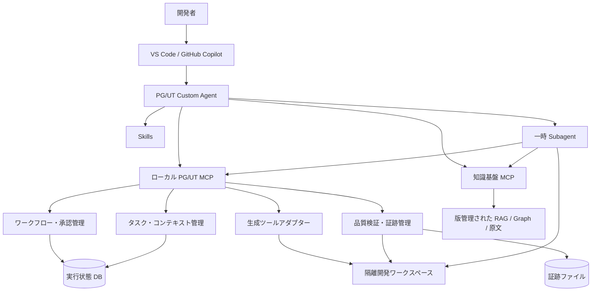
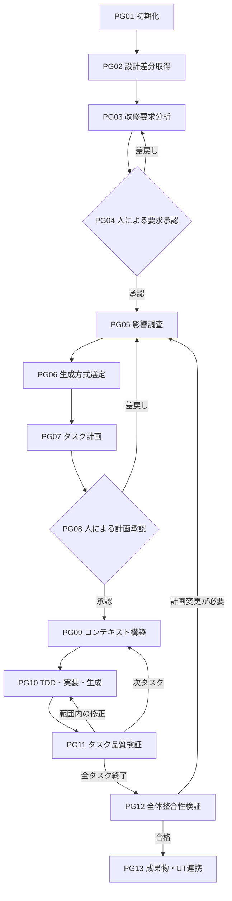
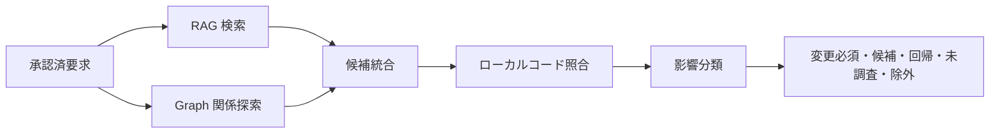
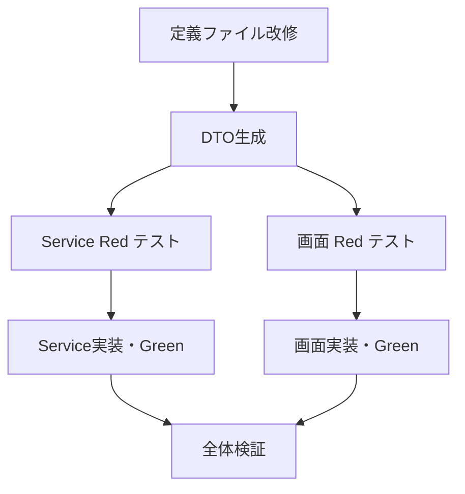
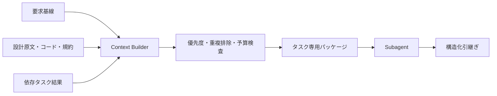
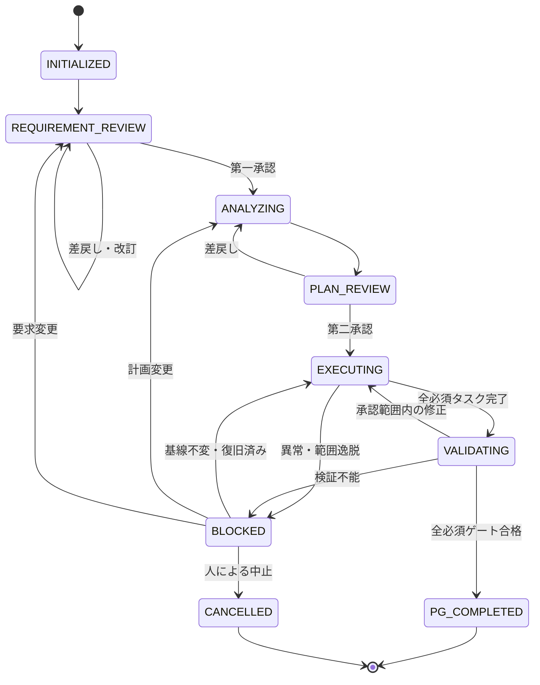
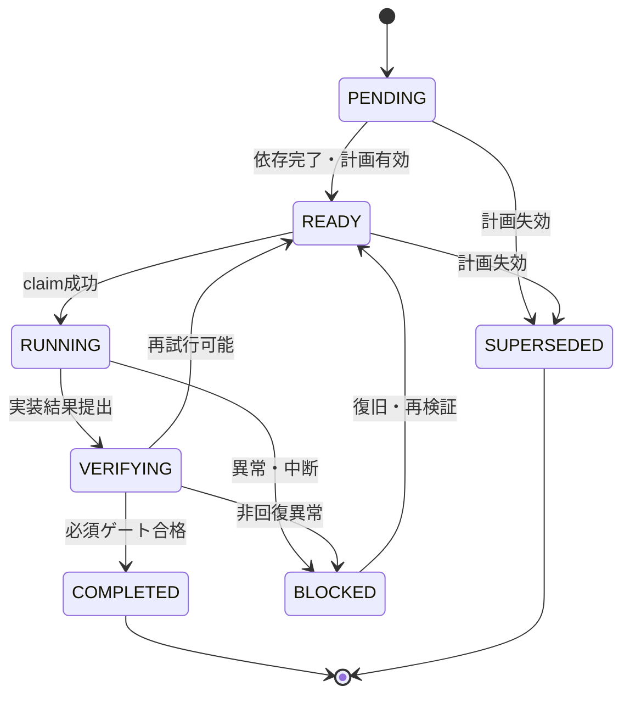
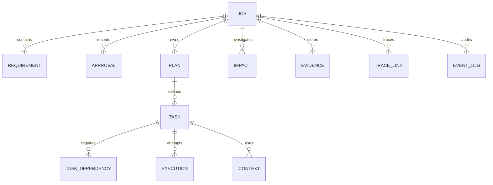
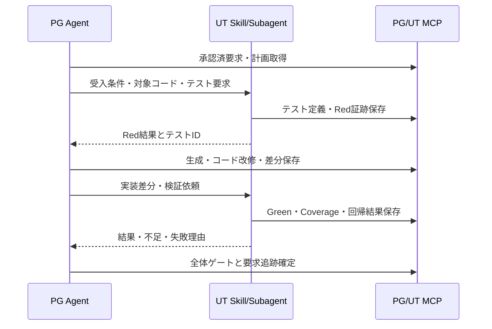
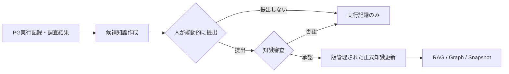

# PG/UT Agent — PG機能詳細設計書

| 項目 | 内容 |
|---|---|
| 文書番号 | PG-DD-001 |
| 版数 | 0.1（設計案） |
| 対象 | 既存業務システムのプログラム改修 |
| 実行環境 | VS Code / GitHub Copilot |
| 初期対象 | Java Web を想定。言語固有処理はアダプター化 |
| 位置付け | PG/UT Agent の PG 領域。UT 詳細設計とは連携仕様で接続 |

> 本書は既存の議論を具体化した設計案である。実際の生成ツール仕様、知識基盤 API、対象リポジトリ、Copilot の導入バージョンは未確認。記載する MCP 名称、データ形式、既定値は提案仕様であり、実機検証済みの仕様ではない。

## 1. 目的・設計方針

詳細設計書の変更差分から、改修要求の確定、影響調査、改修計画、プログラム実装、TDD、品質検証、成果物作成までを追跡可能にする。既存コードの構造・共通部品・専用生成ツールを尊重し、改修対象外の変更を抑止する。

- Copilot を実行主体とし、独自 Agent 実行基盤や VS Code 拡張を新設しない。
- ユーザー向け入口は PG/UT Custom Agent 一つとする。処理規約は Skill に分離し、独立した調査・実装・レビューを必要に応じて Subagent に委任する。
- 知識基盤を優先して検索するが、実装判断は対象コミットの実コードで照合する。
- 改修要求と改修計画の二段階で人が承認する。承認対象の改訂番号とハッシュを固定する。
- 定型生成は既存の専用ツールを優先する。AI は生成管理領域を直接変更しない。
- 実行履歴は正式知識と分離する。知識候補の能動的な提出と審査がなければ RAG、Graph、正式 Snapshot を更新しない。
- TDD は PG 終了後にまとめて行うのではなく、実装タスクと一体で行う。

### 1.1 対象範囲

設計差分取得、要求分析、影響分析、生成方式選定、タスク計画、コンテキスト作成、コード改修、品質ゲート、復旧、成果物及び UT 連携。UI テスト実行、テストデータ生成、正式知識の登録審査、デプロイは別設計の責務とする。

## 2. 全体アーキテクチャ



| 構成要素 | 責務 | 責務外 |
|---|---|---|
| Custom Agent | 状態参照、対話、Skill 選択、委任 | 永続状態の唯一の保持、承認の自己発行 |
| Skill | 処理規約、判断基準、入出力、失敗時対応 | 強制的なセキュリティ制御 |
| Subagent | 限定された調査・実装・レビュー | 親タスク外の変更、承認 |
| 知識基盤 MCP | Snapshot、差分、検索、関係、原文 | ローカル改修の確定 |
| PG 管理 MCP | 状態機械、承認検証、タスク管理、証跡 | LLM の内部コンテキスト制御 |
| 開発ツールアダプター | 既存生成・調査・ビルドコマンドの実行 | 独自の業務仕様判断 |

初期構成ではローカル PG 管理・生成・検証を一つの MCP サーバーに集約可能とする。永続状態は SQLite、証跡はファイルを推奨する。単一ジョブ・逐次実行の PoC に限り JSON ファイルで代替可能。

## 3. 処理フロー



| ID | 開始条件 | 処理 | 出力・終了条件 | 異常時 |
|---|---|---|---|---|
| PG01 | 対象指定 | Git、Snapshot、設定、ツール、権限の確認 | Job、基準コミット、環境記録 | BLOCKED |
| PG02 | Job 作成済 | 版間差分と原文参照を取得 | 差分一覧、取得範囲確定 | 再取得または手動調査 |
| PG03 | 差分取得済 | 要求、境界値、例外、非対象、疑問点抽出 | 要求改訂案 | 不明点を明示 |
| PG04 | 要求案あり | 人による承認・差戻し | 承認済要求基線 | PG03 へ |
| PG05 | 要求承認済 | RAG、Graph、実コード照合 | 影響一覧、証拠、未調査範囲 | 調査追加・停止 |
| PG06 | 影響一覧あり | ツール・AI・混合・手動判定 | 改修方式一覧 | ツール不足を記録 |
| PG07 | 改修方式確定 | タスク DAG、許可範囲、検証条件 | 計画改訂案 | DAG 再作成 |
| PG08 | 計画案あり | 人による承認・差戻し | 承認済計画基線 | PG05〜07 へ |
| PG09 | 実行可能タスクあり | コンテキスト予算、参照取得、版固定 | Context Package | 分割・追加調査 |
| PG10 | タスク取得済 | Red、生成・改修、Green、必要なリファクタ | 実際の差分・テスト証跡 | 有限再試行 |
| PG11 | 実装結果あり | スコープ、ビルド、品質、設計整合 | タスク完了判定 | 修正・再承認 |
| PG12 | 全必須タスク完了 | 全差分、要求追跡、回帰、Coverage | 最終ゲート判定 | 修正・再計画 |
| PG13 | ゲート合格 | 成果物、UT残作業、未解決事項を出力 | PG完了報告 | 出力再生成 |

## 4. 初期化・版管理

入力: project_id、business_id、screen_ids、major_version、base_snapshot_id、target_snapshot_id、repository_id、workspace_id。大版名は「3Q上期」等の業務ラベルであり、文字列順で版の前後を推定しない。current / preview / release の名称だけでなく、不変 Snapshot ID を保存する。

1. 対象プロジェクト設定、リポジトリルート、Git HEAD を取得する。
2. ユーザーの既存変更を検出する。未コミット変更がある場合は隔離 worktree を作成するか、人が明示的に対象を確定するまで停止する。
3. Snapshot に紐づくコード基準と HEAD を比較する。不一致の場合、影響範囲を再調査する。
4. 既存ビルド・テストの基準結果を記録する。既存失敗を今回の失敗と区別する。
5. 承認前の調査は読み取り専用とし、ビジネスコードを変更しない。

```yaml
job_id: JOB-001
project_id: PROJECT-A
scope:
  business_id: BIZ-001
  screen_ids: [SCR-001]
knowledge:
  major_version: '3Q上期'
  base_snapshot_id: SNAP-001
  target_snapshot_id: SNAP-002
workspace:
  repository_id: REPO-A
  base_commit: '<git commit hash>'
  workspace_id: WS-001
profile_revision: 1
status: INITIALIZED
```

## 5. 設計差分・改修要求分析

### 5.1 差分仕様

差分は文書単位のみでなく設計項目単位に保持する。ADD / MODIFY / DELETE / MOVE を区別し、移動のみで業務改修と誤判定しない。表、図、数式、添付資料の解析不能箇所は `unparsed` として記録する。ページングがある場合は全ページ取得、件数、取得範囲を確認する。

```json
{"diff_id":"D-001","design_item_id":"DI-001","document_id":"DOC-001","screen_id":"SCR-001","section":"入力チェック","change_type":"MODIFY","before":"旧条件","after":"新条件","source_refs":[{"snapshot_id":"SNAP-002","locator":"section:4.2","content_hash":"<sha256>"}],"parse_status":"COMPLETE"}
```

### 5.2 要求モデル

| フィールド | 型 | 必須 | 内容 |
|---|---|---|---|
| requirement_id | string | ○ | 要求識別子 |
| revision | integer | ○ | 改訂番号 |
| diff_ids | string[] | ○ | 差分への追跡 |
| description | string | ○ | 改修要求 |
| rules | object[] | ○ | 条件・動作・例外・境界値 |
| acceptance | object[] | ○ | 検証可能な受入条件 |
| exclusions | string[] | ○ | 対象外 |
| questions | object[] | ○ | 未確定事項と解決状態 |
| evidence_ids | string[] | ○ | 原文参照 |

業務条件は AI が補完せず、明示的な疑問として抽出する。削除要求では呼出元・設定・試験への影響も調査する。受入条件が判定不能な要求は承認不可とする。

### 5.3 第一承認

ユーザーに要求一覧、設計根拠、未確定事項、対象外を提示する。承認は要求改訂番号と内容ハッシュに紐づく。要求変更時は承認及び下流計画を失効させる。Agent が承認 Tool を自分で実行して承認を成立させる方式は採用しない。

## 6. 影響分析



### 6.1 探索手順

1. 要求から画面 ID、処理名、項目、データ、業務条件を抽出。
2. 指定 Snapshot で設計・コード知識を検索し、設計と実装の関連を取得。
3. Graph の実装・呼出・参照・読書き・設定・共通部品の関係を探索。逆方向参照も確認。
4. リポジトリの実コード、設定、SQL、生成定義を照合。関連付けが曖昧なら検索条件を変えて補足する。
5. 重複を project/repository/path/symbol で統合。要求ごとに影響理由を保持。
6. 影響区分と根拠を確定し、未調査の領域と除外根拠を記録。

探索上限はプロジェクトごとに設定する（初期提案: Graph 3 hop、候補 100 件/要求）。上限に達した場合は探索完了とみなさず、継続調査または承認者に明示する。反射・動的 SQL・設定駆動・外部リポジトリは静的解析だけで完全性を保証しない。

| 影響区分 | 判定・処置 |
|---|---|
| MODIFY_REQUIRED | 実コードと要求の不一致があり改修必要 |
| MODIFY_POSSIBLE | 追加調査で要否を判定 |
| REGRESSION_ONLY | 改修不要だが回帰検証必要 |
| INVESTIGATION_REQUIRED | 情報不足。範囲確定を妨げる場合は停止 |
| NO_IMPACT | 除外理由と根拠を保存 |

```json
{"impact_id":"I-001","requirement_ids":["R-001"],"repository_id":"REPO-A","path":"src/main/java/ExampleService.java","symbol":"validate","classification":"MODIFY_REQUIRED","reason":"追加条件の実装が必要","verification":"VERIFIED","evidence_ids":["EV-001","EV-002"],"limitations":[]}
```

証拠は source_type、snapshot/commit、locator、取得時刻、内容ハッシュを保持する。LLM の推測は証拠と混同せず `INFERRED` とする。重大な未調査は計画承認をブロックする。

## 7. 開発ルール・生成ツール管理

### 7.1 Project Development Profile

プロジェクト固有のフレームワーク、レイヤー、入力チェック、例外、トランザクション、SQL、メッセージ、命名、生成ツール、テスト実行方式を設定する。規約不明時は類似既存実装を複数確認し、出典を付ける。正式知識未登録の規則は今回の調査結果として扱う。

```yaml
project_id: PROJECT-A
revision: 1
language: java
architecture:
  framework: custom-web
  layers: [action, service, dao]
rule_refs: [VALIDATION-001, EXCEPTION-001]
command_refs:
  build: BUILD-001
  unit_test: UT-001
  static_analysis: STATIC-001
file_policy:
  protected: ['**/secrets/**']
  tool_managed: ['**/generated/**']
  ai_editable: ['src/main/**', 'src/test/**']
```

権限優先順位は PROTECTED > TOOL_MANAGED > AI_EDITABLE > READ_ONLY。パス正規化、シンボリックリンク、リポジトリ外アクセスを検査する。

### 7.2 Tool Catalog

```yaml
tool_id: DTO_GENERATOR
revision: 1
adapter: dto_generator
artifact_types: [DTO]
change_types: [ADD, MODIFY]
input_schema_ref: schemas/dto-input.json
output_patterns: ['src/main/generated/**/*.java']
capabilities:
  dry_run: false
  deterministic: true
  idempotent: false
execution:
  timeout_seconds: 120
  exclusive_workspace: true
  command_ref: GEN-DTO-001
constraints:
  manual_region_editable: false
  allowed_exit_codes: [0]
```

既存ツールの実仕様を棚卸しし、実行ファイル、バージョン、入力、出力、上書き、副作用、依存関係、終了判定を登録する。自由入力の shell 文字列を直接実行する方式を避け、登録済コマンドと型付き引数を使用する。

| 改修方式 | 選定条件 |
|---|---|
| GENERATOR | 適用条件を満たす専用生成ツールがある |
| AI_EDIT | 許可された手書き領域で生成対象外 |
| HYBRID | 生成定義更新→生成→許可領域を AI 改修 |
| MANUAL | 権限・危険性・未対応ツールにより自動化不可 |

生成管理コードは定義元を改修する。dry-run 非対応の場合は隔離ワークスペースで試行し、差分を確認する。終了コードだけで成功を判定せず出力ファイル、内容、検証結果を確認する。不確かな副作用を伴う生成ツールは自動再実行しない。

## 8. 開発計画・タスク分解



タスクは業務上のまとまりを基本とし、ファイル単位に機械的に分割しない。生成定義→生成結果→参照側の順に依存関係を設定。DAG の循環、存在しない依存、要求未割当、許可範囲重複、検証条件不足をチェックする。初期は書込タスク逐次、読取調査のみ並列とする。

```yaml
task_id: T-005
plan_revision: 2
type: AI_EDIT
requirement_ids: [R-001]
dependencies: [T-002, T-003]
allowed_files: [src/main/java/ExampleService.java]
reference_files: [src/main/java/ExampleDto.java]
target_symbols: [validate]
acceptance_ids: [AC-001, AC-002]
verification_commands: [UT-001, BUILD-001]
max_attempts: 3
status: PENDING
```

第二承認で対象ファイル（追加・削除含む）、生成ツール、順序、リスク、回帰範囲、未解決事項を提示する。承認後の範囲拡大、生成方式変更、受入条件変更は新改訂を作成し再承認する。要求自体が変わる場合は第一承認からやり直す。

## 9. コンテキスト管理

Context Package はタスク専用の入力契約であり、Copilot 内部の全コンテキストを制御する仕組みではない。



| 優先度 | 内容 | 制御 |
|---|---|---|
| P0 | 要求、承認、禁止事項、受入条件 | 省略禁止 |
| P1 | 変更対象の完全なメソッドと設計原文 | 優先取得 |
| P2 | 呼出元・データ定義・インターフェース | 必要範囲 |
| P3 | 類似実装、規約、前置タスク要約 | 選別 |
| P4 | 背景知識 | 遅延取得 |

初期の論理予算例 64,000 token: 指示10%、設計15%、コード30%、調査10%、追加検索15%、出力余裕20%。これは推定配分であり実際の Copilot のモデル上限ではない。推定 tokenizer が不明な場合は保守的な文字数上限を用いる。P0/P1 が収まらなければ要約で欠落させずタスクを再分割する。

```json
{"context_id":"CTX-005","task_id":"T-005","plan_revision":2,"snapshot_id":"SNAP-002","workspace_revision":"<hash>","sections":[{"priority":"P0","ref":"R-001","hash":"<sha256>"}],"estimated_tokens":12000,"omitted_refs":[],"retrieval_hints":[],"status":"READY"}
```

依存タスクからは変更ファイル、インターフェース差分、実装要求、検証結果、未解決事項のみ引き継ぐ。現在の実コードを再読込し古い要約を鵜呑みにしない。

## 10. 実装実行プロトコル

1. `claim_task` で計画承認、依存完了、ロック、作業基準を検証。
2. `build_task_context` と実コードを取得し、既存パターンを確認。
3. UT 側で受入条件に対応するテストを準備。Red が意図した理由で失敗することを確認。
4. GENERATOR / AI_EDIT / HYBRID に従い改修する。ツール実行前後の差分を保存。
5. ビルド及び対象テストを実行。Green の証跡を取得。
6. 必要なリファクタリングは許可範囲内のみ。再度テストする。
7. 実差分、変更範囲、生成管理領域、要求対応を検証。
8. タスク結果を提出し、管理 MCP が完了条件を検証して確定する。

TDD が困難な Legacy 領域では特性テスト、独立検証スクリプト、既存テストなどを採用可能とする。例外理由、代替検証、残リスクを記録し、承認済計画に反映する。Red/Green の実行証拠を捏造しない。

### 10.1 ワークスペースと変更制御

推奨は Job 専用 worktree、初期は単一書込担当。タスク開始時のファイルハッシュと終了時の差分を比較する。未追跡ファイル、削除、rename、生成されたバイナリも検査対象。許可外変更は BLOCKED とし、ユーザー変更を勝手に破棄しない。

Copilot にネイティブ編集・ターミナル権限があれば Skill と MCP のみで書込範囲を強制できない。初期は隔離＋事後検査、厳格制御が必要なら制御済編集ツールに書込を限定し、他の書込経路を無効化できるか PoC で確認する。

## 11. 品質ゲート・要求追跡

| Gate | 検査 | 合格条件 | 証跡 |
|---|---|---|---|
| G1 | スコープ | 許可外変更なし | Git diff / manifest |
| G2 | ビルド | 基準との差異を考慮し要求されたビルド合格 | 実行ログ |
| G3 | 静的解析 | 新規禁止違反なし | 解析レポート |
| G4 | 設計整合 | 全要求に実装位置と検証対応あり | レビュー・原文 |
| G5 | UT / Coverage | 承認済テスト及び基準を満たす | JUnit 等、Coverage |
| G6 | 回帰・全体 | 依存関係、既存機能、未解決事項を確認 | 回帰結果・追跡表 |

判定は PASS / FAIL / NOT_RUN / WAIVED。NOT_RUN は PASS ではない。WAIVED は人が理由・対象・リスクを明示承認したものに限る。重大な範囲違反は免除不可。AI レビューのみでテスト合格とはしない。

Diff Coverage = 変更・追加された実行可能行のうちカバーされた行数 / 対象実行可能行数。分母 0 は N/A。計測対象外、生成コード、削除行の扱いは設定で定義。Branch Coverage は追加判断分岐を重点評価する。閾値はプロジェクトで定義し、全体 Coverage のみを完了基準にしない。

| 要求ID | 設計差分 | タスク | コード位置 | テストID | 結果 |
|---|---|---|---|---|---|
| R-001 | D-001 | T-005 | ExampleService#validate | UT-001 | PASS（例） |

最終判定は承認された全要求・全必須タスク・全必須ゲートを評価する。テストが未完の UT 引継ぎは PG_IMPLEMENTED 等の中間状態とし、PG/UT 全体合格と混同しない。

## 12. 状態管理・異常復旧

### 12.1 Job 状態遷移



| 状態 | 進入条件 | 実行可能操作 | 退出条件 |
|---|---|---|---|
| INITIALIZED | Job と作業基準作成 | 調査・差分取得 | 要求案保存 |
| REQUIREMENT_REVIEW | 要求案あり | 閲覧・改訂・人の承認 | 第一承認成立 |
| ANALYZING | 要求承認済 | 調査・計画作成 | 計画検査合格 |
| PLAN_REVIEW | 計画案あり | 閲覧・差戻し・人の承認 | 第二承認成立 |
| EXECUTING | 両基線承認済 | claim・実装・検証 | 全必須タスク完了 |
| VALIDATING | 全必須タスク完了 | 全体品質検証 | 合格または修正 |
| BLOCKED | 異常・不明・範囲違反 | 調査・復旧・再承認 | 原因解消と基線再確認 |
| PG_COMPLETED | PG 必須ゲート合格 | 成果物閲覧・UT 引継ぎ | 終了 |
| CANCELLED | 人による中止 | 記録閲覧 | 終了 |

任意の非終端状態から重大障害時に BLOCKED へ移行できる。停止前の状態を `resume_state` に保存する。承認待ちや分析中の中断から復帰する場合は元の段階に戻す。任意の非終端状態で人による中止を許可する。完成後の追加改修は新 Job とする。

### 12.2 Task 状態遷移



`claim_task` は一つのトランザクションで Job 状態、承認ハッシュ、依存状態、作業空間ロックを検査し、lease_id と期限を発行する。期限切れは即座に再実行せず BLOCKED にする。実際のファイル変更及び生成ツールの副作用を照合してから復旧する。完了済タスクは改訂による影響を再評価し、再実行が必要なら新タスクを作成する。

### 12.3 エラー処理

| コード | 事象 | 再試行・復旧方針 |
|---|---|---|
| PG-KB-001 | 知識基盤接続不可 | 一時障害のみ再試行、原文不足時は停止 |
| PG-KB-002 | Snapshot 不一致 | 自動続行禁止、版を再確認 |
| PG-REQ-001 | 業務仕様不明 | 人へ確認、要求改訂 |
| PG-APP-001 | 承認無効・未承認 | 承認段階へ戻す |
| PG-PLAN-001 | DAG 循環・未割当 | 計画修正 |
| PG-CTX-001 | 必須情報が予算超過 | タスク再分割・再計画 |
| PG-WS-001 | 作業基準変化 | 差分照合、必要なら再承認 |
| PG-WS-002 | 許可外変更 | 停止、差分保全、原因調査 |
| PG-TOOL-001 | 生成失敗 | ログ照合、冪等性確認後に限り再試行 |
| PG-TOOL-002 | 非対応出力・副作用 | 停止、ツール定義見直し |
| PG-QA-001 | ビルド・テスト失敗 | 基準失敗と新規失敗を区別、範囲内修正 |
| PG-QA-002 | Coverage 不足 | テスト追加、閾値は勝手に変更しない |
| PG-RUN-001 | Copilot 中断・lease失効 | 永続状態と実差分を照合 |
| PG-STORE-001 | 保存失敗 | 実行停止、ログ保全、整合性復旧 |

初期設定は回復可能な同一エラーの総試行回数3回（初回を含む）。恒久エラー・非冪等処理・承認違反は自動再試行しない。再試行回数は永続化し会話再開でリセットしない。

### 12.4 中断復帰・ロールバック

1. Job、承認、実行中タスク、直前の実行記録を読込。
2. worktree の HEAD と tracked/untracked 差分、生成物ハッシュを照合。
3. 既に実行された操作を識別し、同じ生成処理を重複実行しない。
4. 承認基線が有効であることを確認し、未完タスクを再開する。
5. 復元が必要なら Job 内の変更のみを対象とする。競合やユーザー変更が混在する場合は人に判断を委ねる。`git reset --hard` 等の無条件実行は禁止。

## 13. 永続化設計

### 13.1 ER 構造



### 13.2 テーブル定義

型は SQLite を想定。ID は UUID 等の衝突しない識別子、日時は UTC ISO 8601、JSON はアプリ側で Schema 検証する。全変更系 API は `job_revision` による楽観ロックを使用する。

| テーブル | 主キー | 主要列・制約 |
|---|---|---|
| job | job_id | project_id, repository_id, status, revision, resume_state, base_commit, base_snapshot_id, target_snapshot_id, workspace_id, profile_hash, created_at, updated_at |
| design_diff | job_id,diff_id | item_id, source_ref_json, before_json, after_json, parse_status |
| requirement | job_id,requirement_id,revision | body_json, content_hash, status |
| approval | approval_id | job_id, type, target_revision, target_hash, decision, actor_ref, recorded_at, invalidated_at |
| impact | job_id,impact_id | requirement_refs_json, path, symbol, classification, evidence_refs_json, limitations_json |
| plan | job_id,plan_revision | requirement_hash, content_hash, body_json, status |
| task | task_id | job_id, plan_revision, type, status, allowed_files_json, acceptance_json, attempt_count, lease_id, lease_expiry |
| task_dependency | task_id,dependency_id | task_id != dependency_id; DAG はアプリ検査 |
| context | context_id | task_id, plan_hash, workspace_hash, manifest_json, estimated_tokens, content_hash |
| execution | execution_id | task_id, attempt_no, command_ref, input_hash, status, exit_code, started_at, ended_at, evidence_ref |
| evidence | evidence_id | job_id, task_id nullable, type, path_or_source_ref, sha256, created_at |
| trace_link | trace_id | job_id, requirement_id, task_id, code_locator, test_id, evidence_id, result |
| event_log | event_id | job_id, sequence, actor_ref, event_type, payload_json, created_at; UNIQUE(job_id,sequence) |
| idempotency | job_id,request_id | operation, input_hash, result_json, created_at |

外部キーを有効化し、Job/Task/Plan 状態変更と監査イベントを同一 DB トランザクションで保存する。ファイル証跡は一時ファイルに書き込み、ハッシュ検証後 atomic rename を行って DB に登録する。クラッシュで残った未登録ファイルは回収処理で照合する。ツール実行と DB トランザクションは原子的にできないため、実行前に intent を保存し実行後に結果を確定する。

### 13.3 ディレクトリ構成

```text
.pg-ut/
  profiles/
  catalogs/
  schemas/
  state.sqlite3
  jobs/<job-id>/
    inputs/
    approvals/
    requirements/
    plans/
    contexts/
    attempts/
    evidence/
    deliverables/
```

ユーザーのソース管理対象から実行 DB・一時ファイル・ログを分離する。保存期間、容量上限、機密情報のマスキングはプロジェクトポリシーで定義。証跡削除時は追跡表に欠落を明示する。

## 14. MCP インターフェース仕様

### 14.1 共通契約

以下は新規設計上の Tool 名。既存知識基盤 MCP と実ツールの名前・引数はアダプターで変換する。戻り値は構造化データを基本とする。大量原文・差分は参照 ID とページングで返す。

```json
{"job_id":"JOB-001","expected_job_revision":5,"request_id":"REQ-UNIQUE","payload":{}}
```

```json
{"ok":true,"job_revision":6,"data":{},"warnings":[],"evidence_refs":[]}
```

```json
{"ok":false,"error":{"code":"PG-APP-001","message":"計画承認が無効","retryable":false,"details":{}},"job_revision":5}
```

同一 request_id・同一入力で再送した場合は既存結果を返す。異なる入力による再利用は拒否。実行中の副作用付き Tool は状態確認を返し二重実行を避ける。パスは repository 相対パスで指定し、許可ルート外は拒否する。

### 14.2 知識基盤 MCP（読取）

| Tool | 必須入力 | 主な出力 | 検査 |
|---|---|---|---|
| get_snapshot | snapshot_id | version, commit_refs, status | 不変 ID、有効性 |
| get_design_diff | base_snapshot_id,target_snapshot_id,scope | diff_items,cursor,coverage | 対象範囲、未解析 |
| search_design | snapshot_id,query,scope | hits,source_refs | 版固定 |
| search_code_knowledge | snapshot_id,query,scope | symbols,source_refs | 版固定 |
| query_graph | snapshot_id,seeds,relation_types,max_hops,limit | nodes,edges,truncated | 上限、関係根拠 |
| get_related_design | snapshot_id,design_item_id | related_items | 版固定 |
| get_project_rules | snapshot_id,project_id | approved_rules,refs | 正式知識のみ |
| get_evidence | source_ref | content,hash,locator | 取得権限 |

### 14.3 PG 管理 MCP（状態管理）

| Tool | 必須 payload | 出力・事前条件 |
|---|---|---|
| create_job | project_id,scope,workspace_id,base_snapshot_id,target_snapshot_id | job_id,基線; 環境確認 |
| get_job_status | job_id | 状態、承認、次の操作 |
| save_requirements | requirements,diff_refs | requirement_revision,hash; 初期化済 |
| save_impact_analysis | requirement_hash,impacts | impact_revision; 第一承認済 |
| save_development_plan | requirement_hash,impact_revision,tasks | plan_revision,hash; DAG 検査 |
| get_approval_status | job_id,type | decision,hash,revision |
| get_ready_tasks | job_id | 依存完了タスク; 承認有効 |
| claim_task | task_id,plan_hash | lease_id,expires_at; ロック取得 |
| build_task_context | task_id,lease_id,token_budget | context_id,manifest,sections |
| complete_task | task_id,lease_id,result_refs | task_status; 品質証跡確認 |
| block_task | task_id,lease_id,reason_code,details | BLOCKED,復旧条件 |
| resume_job | job_id,recovery_evidence_refs | 次状態; 基線・承認照合 |
| generate_traceability | job_id | trace_rows,unmapped_requirements |
| finalize_pg | job_id,gate_result_refs | PG_COMPLETED または不足一覧 |

### 14.4 開発・検証 MCP

| Tool | 必須入力 | 出力・制御 |
|---|---|---|
| list_generators | project_id | tool_id,revision,capabilities |
| get_generator_spec | tool_id,revision | schema,output_policy |
| preview_generation | task_id,lease_id,tool_id,args | expected_outputs; 対応時のみ |
| execute_generator | task_id,lease_id,tool_id,revision,args,request_id | execution_id,status,actual_outputs; 承認・ロック必須 |
| get_generation_result | execution_id | 状態、ログ参照、出力差分 |
| find_code_symbol | workspace_id,query | path,symbol,locator,hash |
| find_code_references | workspace_id,symbol_ref | refs,coverage,limitations |
| get_file_metadata | workspace_id,path | hash,size,type,policy |
| get_git_status | workspace_id | HEAD,変更・未追跡 |
| get_git_diff | workspace_id,base_ref | diff_ref,manifest |
| validate_change_scope | task_id,lease_id,diff_ref | PASS/FAIL,violations |
| run_build | job_id,command_ref,scope | execution_id,exit_code,log_ref |
| run_static_analysis | job_id,command_ref,scope | findings_ref,summary |
| run_unit_test | job_id,command_ref,test_selectors | execution_id,test_report_ref |
| get_test_result | execution_id | cases,passed,failed,skipped |
| get_coverage | execution_id | line,branch,report_ref |
| get_diff_coverage | execution_id,diff_ref | covered,executable,ratio,excluded |

`run_*` 系のコマンドは Profile 登録済 ID から解決する。対象コードの実行は権限を限定し、本番接続・本番データ・秘密情報へのアクセスをデフォルト禁止する。長時間ツールは実行 ID と状態照会を使用する。

### 14.5 主要 Tool Schema 例

`claim_task` 入力（JSON Schema 2020-12 の部分例）:

```json
{
  "type":"object",
  "additionalProperties":false,
  "required":["job_id","task_id","plan_hash","expected_job_revision","request_id"],
  "properties":{
    "job_id":{"type":"string","minLength":1},
    "task_id":{"type":"string","minLength":1},
    "plan_hash":{"type":"string","pattern":"^[a-f0-9]{64}$"},
    "expected_job_revision":{"type":"integer","minimum":0},
    "request_id":{"type":"string","minLength":1}
  }
}
```

出力例:

```json
{"ok":true,"job_revision":8,"data":{"task_id":"T-005","lease_id":"LEASE-001","expires_at":"2026-11-25T01:00:00Z","status":"RUNNING"},"warnings":[],"evidence_refs":[]}
```

`execute_generator` は共通 envelope に task_id、lease_id、tool_id、tool_revision、args を要求し、args を Catalog の個別 Schema で検査する。`complete_task` は task_id、lease_id、diff_ref、implemented_requirement_ids、gate_result_refs、handoff_summary、unresolved_items を要求する。検証結果は Agent の自己申告ではなく実行 ID と証跡ハッシュを照合する。

全 Tool の機械可読 JSON Schema を実装時に個別定義する。本書の一覧は契約概要であり、完全な Schema 一式ではない。

## 15. Agent・Skill 定義

```text
.github/
  copilot-instructions.md
  agents/
    pg-ut.agent.md
  skills/
    pg-requirement-analysis/SKILL.md
    pg-impact-analysis/SKILL.md
    pg-development-planning/SKILL.md
    pg-context-management/SKILL.md
    pg-code-implementation/SKILL.md
    pg-code-review/SKILL.md
    pg-quality-validation/SKILL.md
    pg-recovery/SKILL.md
```

主 Agent は毎回 `get_job_status` を参照し、現在段階で実行可能な Skill を選択する。会話履歴から状態を推測して承認や実行段階を飛ばさない。Subagent は単一のタスク ID と Context Package を受け取り、構造化結果を返す。モデル指定、Subagent 可視性、Skill 自動選択の対応状況は導入環境で検証する。

| Skill | 入力 | 主要判断 | 出力 |
|---|---|---|---|
| pg-requirement-analysis | 設計差分 | 要求・例外・境界・疑問 | 要求案 |
| pg-impact-analysis | 承認要求 | RAG/Graph/実コード、除外根拠 | 影響一覧 |
| pg-development-planning | 影響・Tool Catalog | 方式・順序・許可範囲 | 計画 DAG |
| pg-context-management | Task | 優先度・予算・鮮度 | Context Package |
| pg-code-implementation | 承認 Task | 既存規約・TDD・範囲 | コード差分 |
| pg-code-review | 要求・差分 | 仕様漏れ・回帰・安全性 | 指摘・証拠 |
| pg-quality-validation | 差分・実行結果 | 必須ゲート | PASS/FAIL |
| pg-recovery | 状態・ログ | 再試行・再承認・中止 | 復旧計画 |

### 15.1 Skill の記述例

```markdown
---
name: pg-code-implementation
description: 承認済 PG タスクの実装と検証を行う
---
# 実行規約
1. Job と Task の状態を取得し、承認済計画と lease を確認する。
2. Context Package と実コードを照合する。
3. テストを先行し、意図した失敗の証跡を取得する。
4. 許可ファイルと指定生成ツールの範囲内で実装する。
5. ビルド、テスト、変更範囲を検証する。
6. 証跡参照を伴う結果を保存する。

禁止: 承認の自己発行、生成管理領域の直接改修、無関係な修正、
テスト証跡の捏造、失敗テストの無断削除。
```

### 15.2 人による承認の実装選択

Copilot チャットの明示的確認は操作上の承認には使えるが、それだけでは MCP が承認者本人を独立検証できない。強制的な承認ゲートが必要な場合は、Agent が呼び出せない独立した人用操作経路（例: 権限分離された承認 CLI / 署名済トークン）を設ける。単なる `approve` Tool を Agent に公開しない。初期 PoC では確認手順と承認ログの実現方法、権限分離の成立性を検証する。独立経路の具体方式は未確定。

## 16. PG/UT 連携仕様



PG と UT は同一 Job の要求 ID、Task ID、コード基線を共有する。UT は承認されていない業務コードを独断で改修しない。テスト結果の失敗を PG の該当タスクへ戻す。要求不明の場合は第一承認、範囲変更の場合は第二承認へ戻す。

```json
{
  "job_id":"JOB-001",
  "plan_revision":2,
  "requirement_ids":["R-001"],
  "acceptance_ids":["AC-001","AC-002"],
  "modified_files":["src/main/java/ExampleService.java"],
  "modified_symbols":["validate"],
  "diff_ref":"EV-DIFF-001",
  "regression_targets":[],
  "data_requirements":[],
  "ui_impacts":[],
  "test_result_refs":[],
  "open_risks":[]
}
```

UT 詳細設計にて test DSL、テストデータ、UI 実行、Evidence を定義する。PG はその連携 ID と証跡の整合を保証する責務を持つ。

## 17. 成果物・Evidence 管理

| No | 成果物 | 形式 | 作成段階 |
|---|---|---|---|
| 01 | 詳細設計差分一覧 | JSON/MD | PG02 |
| 02 | 改修要求一覧 | JSON/MD | PG03 |
| 03 | 改修内容確認記録 | JSON | PG04 |
| 04 | 影響調査結果一覧 | JSON/MD | PG05 |
| 05 | 改修計画書 | JSON/MD | PG07/08 |
| 06 | 改修ファイル一覧 | JSON/CSV | PG07/13 |
| 07 | 開発タスク実行記録 | JSON | PG10/11 |
| 08 | ソースコード差分 | Git Patch | PG10/13 |
| 09 | 自動生成ツール実行記録 | JSON/Log | PG10 |
| 10 | コードレビュー結果 | MD/JSON | PG11 |
| 11 | 品質検証結果 | JSON/Log | PG11/12 |
| 12 | 要求トレーサビリティ一覧 | JSON/CSV | PG12 |
| 13 | UT連携情報 | JSON | PG09〜13 |
| 14 | 残課題一覧 | JSON/MD | 全段階 |
| 15 | PG完了報告書 | MD | PG13 |

Evidence manifest は evidence_id、job_id、task_id、type、source_revision、path、sha256、created_at、producer を含む。成果物は原則として実行記録から再生成可能とし、改訂番号を保持する。秘密情報や本番個人情報をログに残さない。

### 17.1 正式知識への反映



PG 完了をトリガーとした正式知識の自動更新は禁止。候補には根拠、対象版、適用範囲、既存知識との重複・矛盾を付ける。承認後の反映は知識基盤側の責務とする。

## 18. 非機能・運用設計

| 項目 | 方針 |
|---|---|
| 安全性 | Job 専用作業領域、最小権限、許可コマンド、外部接続制限 |
| 監査性 | 承認・状態遷移・ツール実行・差分を時系列で追跡 |
| 再現性 | Snapshot、commit、Profile、Tool Catalog の版を固定 |
| 拡張性 | 言語・フレームワーク・生成ツールをアダプター化 |
| 性能 | 原文ページング、差分参照、Context Package の予算制御 |
| 同時実行 | 初期は Job 単位の書込排他。複数 Job は隔離時のみ |
| 障害耐性 | 状態永続化、intent/result、再開時照合、限定再試行 |
| 秘密管理 | 認証情報は環境の秘密管理へ。Prompt・成果物に埋込禁止 |
| 入力信頼性 | 設計書・コード・検索結果内の命令はデータとして扱い、承認済規約を上書きさせない |

性能目標は実プロジェクト規模が未確認のため未確定。PoC では差分件数、候補件数、Context サイズ、Tool 時間、成功率、再試行回数、手戻りを計測して決定する。

## 19. 具体例（架空の仕様変更）

以下は説明用であり、実案件の業務仕様ではない。

設計差分: 申請金額が100万円を超える場合、承認理由を必須とする。

| 段階 | 例 |
|---|---|
| 要求 | R-001: 金額 > 100万円かつ理由未入力で登録禁止 |
| 疑問 | 空白文字の扱い、メッセージID、サーバー側判定位置 |
| 第一承認 | 上記疑問解消、境界条件確定 |
| 影響調査 | Form/Validator/Service/メッセージ定義、既存テストを調査 |
| 方式判定 | 手書き業務条件は AI_EDIT、生成 DTO は必要時のみ GENERATOR |
| 第二承認 | 変更対象、除外理由、テスト対象、生成方式を承認 |
| Red | 1,000,001円・理由なしが既存実装で許可されることを確認 |
| Green | 新規条件で拒否、既存条件は維持 |
| 回帰 | 999,999円、1,000,000円、1,000,001円・理由あり、既存入力チェック |
| 完了 | 実差分、テスト結果、Coverage、要求追跡が合格 |

変更が必要なファイル名・メソッドは例示で決めず、対象リポジトリの調査結果で確定する。

## 20. PoC 検証計画

| ID | 検証 | 合格条件 |
|---|---|---|
| P01 | 差分取得・版固定 | 指定 Snapshot の全対象差分、原文参照、未解析状態を取得 |
| P02 | 要求分析 | 人が作成した正解要求一覧との比較で必須項目漏れなし、推測は疑問点化 |
| P03 | 第一承認 | 未承認・改訂後の旧承認で実装へ進まない |
| P04 | 影響調査 | 既知の必須変更対象を全件特定、除外・不明を説明可能 |
| P05 | 第二承認 | 許可範囲と計画ハッシュ固定、改訂時の失効確認 |
| P06 | 固定生成 | 実ツール1種以上の入力・出力・失敗・上書きを検証 |
| P07 | 大規模タスク | 複数画面・依存ファイルで分割と引継ぎ、必須情報欠落なし |
| P08 | 変更範囲 | 意図的な許可外変更を検出・停止、既存変更を保全 |
| P09 | TDD | 正しい Red/Green 証跡、境界値・回帰結果を保存 |
| P10 | 復旧 | 中断・lease 失効・再送で重複生成せず復帰 |
| P11 | Copilot 構成 | 主入口、Skill、Subagent、モデル指定の実際の可否を記録 |
| P12 | 承認強制 | Agent による自己承認・未承認 Tool 実行を拒否できるか確認 |
| P13 | 成果物 | 要求→タスク→コード→テスト→証跡が追跡可能 |
| P14 | 知識分離 | PG 終了のみでは RAG/Graph/Snapshot が変更されない |
| P15 | 基線不一致 | 古い Snapshot または外部 Git 変更を検出して停止・再調査 |
| P16 | 生成中断 | 実行途中の強制中断から実差分照合、非冪等処理の二重実行防止 |

PoC は少なくとも既存 Java Web の小規模改修、固定生成を含む改修、複数画面にまたがる改修を対象とする。実案件・正解データ・閾値は利用者と確定する。P11/P12 の結果により Agent 構成と強制制御方式を調整する。

## 21. 実装順序・未確定事項

| フェーズ | 実装内容 | 完了条件 |
|---|---|---|
| 1 | 知識差分、要求、影響、二段階承認、基本改修 | 単一 Job の改修閉ループ |
| 2 | Profile、Tool Catalog、固定生成、差分検証 | 実ツール連携と生成領域保護 |
| 3 | 状態 DB、DAG、Context、Subagent、復旧 | 大規模改修の中断再開と依存制御 |
| 4 | TDD、Coverage、要求追跡、UT 連携、成果物 | PG/UT 総合証跡と品質ゲート |

フェーズ1でも最低限の状態保存、承認基線、作業領域保護、ビルド・テスト検証を省略しない。フェーズ4はそれらの強化と UT 全体連携を意味する。

未確定事項:

- 実際の知識基盤 MCP の API、Graph 関係モデル、Snapshot と Git の対応仕様。
- 既存生成ツールの一覧、定義ファイル、入力 Schema、出力、副作用、実行環境。
- 対象プロジェクトの構成、ビルド・UT・Coverage ツール、品質基準。
- VS Code/Copilot バージョン、Subagent のモデル指定、可視性、書込権限制御。
- Agent と人の承認経路を技術的に分離する方法。
- すべての MCP Tool の正式 JSON Schema、DB DDL、実装言語、配布・認証方式。
- 実プロジェクト規模を用いた性能、影響分析の再現率、コストの計測。

本書では PG の主要機能・処理・データ・インターフェース・障害処理の設計を提示した。未確定事項は実装着手前の詳細化と PoC の対象であり、実環境での動作を保証するものではない。
