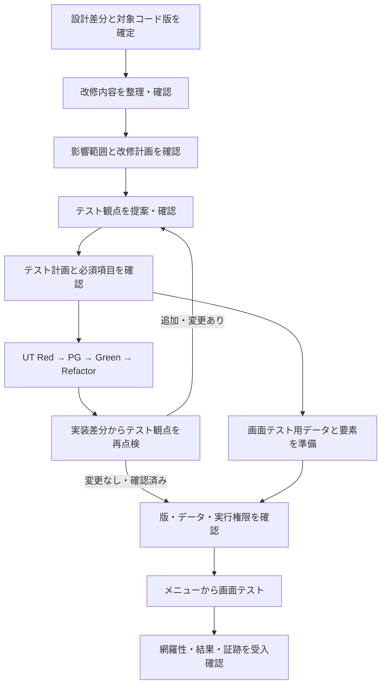
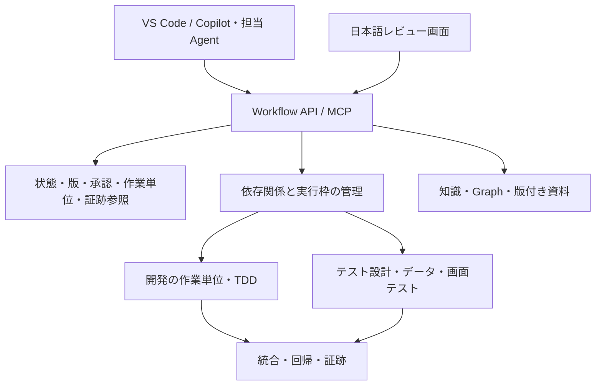
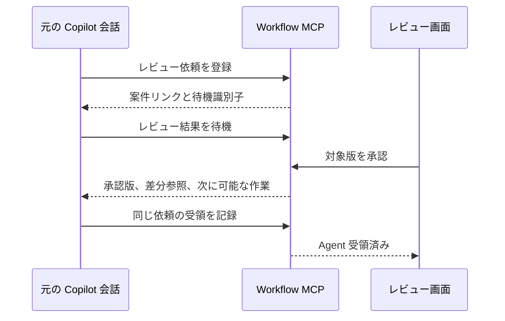
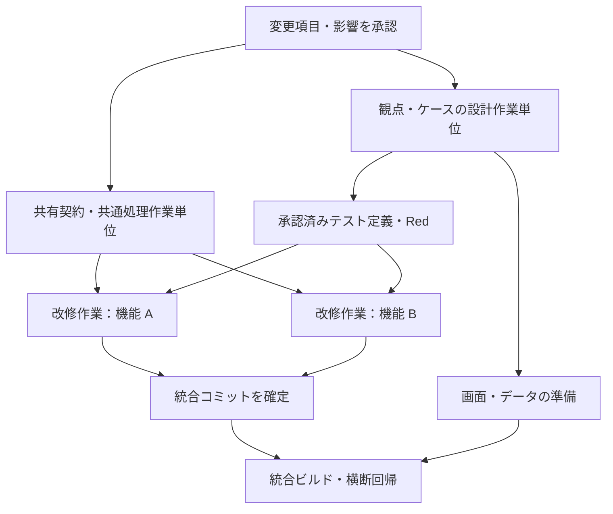

# PG/UT Agent 統合詳細設計書・開発実施仕様

| 項目 | 内容 |
|---|---|
| 文書版 | v0.5.2 · 2026-11-25 |
| 対象 | 既存の Java Web システム。フレームワーク、ビルド、画面遷移およびトランザクション処理は対象リポジトリと検証環境で確認する |
| 利用環境 | VS Code の GitHub Copilot。既存の生成ツール、デバッグ用 MCP、Playwright MCP を活用する |
| 表示言語 | 画面、通知、操作ガイド、レビュー資料、テスト成果物は日本語。コード、識別子、ツール名は原表記を使用する |
| 文書の位置付け | 本体開発の基準。PG 内部の追補、対象環境の接続、受入結果を管理する |

**主要な参照箇所**。テストデータの L1～L5 は §5.4、同じ Copilot 会話への返却は §10、開発とテストの作業の分け方、時間・コンテキスト管理は §12、実装契約・依存順・受入は §13 を参照する。

> v0.5.2 では、画面テストの工程、ケース契約、数量変更の設計例、判定・復旧と実機受入を §6.5～§6.10 に追加した。画面と帳票に表示する作業名と実行条件を §9.4・§12 に明記した。

## 1. 実施方針と優先順位

メニューから複数画面へ遷移する既存業務を一つ選び、同じ設計差分を起点に「改修内容の確認 → 影響調査 → テスト設計 → TDD → 画面テスト → 証跡確認」を通す。業務入力規則、確認可能な結果、前提データ、ラベルのない画面項目を含む業務を選ぶ。前工程の業務で作られるデータは、初回は条件を満たす検証データで代替する。前工程の自動連鎖は単一業務の検証結果を踏まえて判断する。

利用者の入口はメイン Agent 一つとし、必要に応じて五つの担当 Agent に委譲する。まずテスト計画担当への実際の委譲を検証し、影響分析、テストデータ、UT、PG を追加する。ワークフローの状態、承認、版、証跡参照は Rust の Workflow MCP と SQLite で管理する。改修とテストのレビューは同じワークスペースから行い、承認結果を元の Copilot 会話へ戻す。初回の画面操作は Playwright MCP で検証し、再現性が必要なケースには小規模な Playwright スクリプトを使う。専用 DSL と汎用データ生成は実績を見て判断する。

| 確認論点 | 対応方針 | 実施判断 |
|---|---|---|
| 人による確認と再開 | 改修内容・影響範囲の二つの確認を維持する。テスト定義と実行許可は対象版にひも付ける | 状態遷移、旧版拒否、再起動後の復帰を検証する |
| 会話との連携 | 画面は承認結果を保存し、同じ会話で待機中の MCP 呼び出しが受け取る。受領と処理開始は別々に記録する | 対象環境で待機、取消、期限、再取得まで確認する |
| テスト観点の網羅性 | 必須テスト条件、テストレベル、検証項目の組み合わせで網羅性を算出する | 必須条件の一部を意図的に欠落させて確認する |
| 既存システムの実構造 | 実コード、設定、実行結果から入口、検証、業務処理、データ操作を特定する | 実行経路と入力チェックの確認が必要 |
| 人による編集 | 同じ画面で観点と計画を編集し、根拠・差分・波及先を確認する | 変更影響と承認状態が画面と Agent で一致することを確認する |
| TDD と画面準備 | テスト定義の確認後に TDD と画面テスト準備を並行する | 単体テスト用データで成立する作業は先行できる |
| Copilot の運用 | 担当 Agent、モデル、Skill、MCP の実呼び出しを対象環境で確認する | 設定確認と実際の呼び出し確認を別々に記録する |
| 画面要素とデータ | 要素の同一性と一意性、データの業務前提、書込み権限を検証する | ラベルなし項目とデータ復旧を受入条件とする |
| 知識の出典 | 承認済み知識を優先する。未接続時は版付きの設計書とコードを使用する | 業務 PoC と正式な知識基盤接続の判定を記録する |

### 1.1 開発範囲と設計確定方針

本書は PG/UT Agent の開発着手に使用する統合設計書とする。対象は、変更の受付と調査、依存関係を持つ開発の作業単位、テスト観点とケース、テストデータ、画面テスト、レビュー画面、元の Copilot 会話への結果返却、証跡、知識候補の統制、運用と受入である。小規模な変更も一つ以上の作業単位として扱う。複数作業単位の変更に対し、計画、並行実行、再計画、統合確認を提供する。

PG 内部の自動実装方式、生成ルール、共通部品の変更方針は追補する。本書で確定する PG の範囲は、作業単位に渡す入力、許可された変更範囲、TDD の開始条件、成果物、統合・差戻しの契約とする。対象リポジトリ固有の画面、業務データ、実行コマンド、権限は実機から確認して設定に登録する。

## 2. 全体フローと人による確認



画面テストの開始前に、実装差分の再点検と画面テスト準備の両方が完了していることを確認する。追加のテスト観点は使用範囲と根拠を確認し、影響を受ける計画と結果だけを再点検する。証跡は取得時の版で保存する。

| 人による確認・実行前確認 | 担当 | 判断対象 | 変更や問題への対応 |
|---|---|---|---|
| 改修内容を確認 | 業務レビュー担当者または権限を持つ責任者 | 変更点、仕様根拠、適用範囲、除外理由、未決事項と担当 | 仕様・範囲の変更に合わせて再確認する |
| 影響範囲を確認 | 技術レビュー担当者または権限を持つ責任者 | ファイル、画面、共通処理、データ、テスト範囲、含有・除外の根拠 | 未調査部分を補う。許可範囲の拡大を再確認する |
| テスト定義を確認 | 業務・テストレビュー担当者。対応関係はシステムで検証する | テスト観点、必須条件、期待結果の根拠、レベルとテストケース。観点と計画はそれぞれ対象版を記録する | 未確定の期待結果や未充足の必須条件は関連ケースの開始を保留する。業務仕様の変更は改修内容の確認へ戻す |
| 画面テストの実行条件を確認 | Workflow。業務書込みは権限者が対象行為を承認する | 現行のケース版、実行環境、アカウント、データの予約・復旧、操作対象の同一性 | 一意に特定できない対象の操作は中断する。書込みの成否が不明なら状態を確認する |
| 結果を受入確認 | Workflow が機械確認し、受入担当者が判定する | UT、必須の画面ケース、分母、証跡、データの解放または復旧、障害の処置 | 失敗、保留、代替実施の事実と課題を記録する |

調査結果や実行証跡は業務の作業データとして格納する。利用者が再利用候補を明示的に提出し、承認された場合に正式知識として公開する。公開処理で承認済みの候補と版を確認し、RAG・Graph・Snapshot に反映する。

### 2.1 論理構成と責務



| 構成 | 権限と責務 |
|---|---|
| メイン Agent | 受付、根拠説明、担当 Agent への委譲、元の会話での待機と再開。業務上の承認は担当者が行う |
| Workflow | タスク、依存、承認版、予算、実行枠、受領、失敗と復帰を唯一の状態として扱う。SQLite に永続化する |
| 担当 Agent・外部ツール | 割り当てられた作業単位、版付き入力、許可範囲を処理する。結果を同じ試行に返す |
| 日本語レビュー画面 | 改修・テスト計画、作業単位の依存、処理時間、結果と証跡を表示する。草稿・差分・人による承認を扱う |
| 知識・ツール連携 | 知識・Graph、DB、既設の生成ツール、Debug MCP、Playwright MCP はアダプターごとに接続する。未接続の知識はローカル資料と確認済み根拠で補完する |

### 2.2 変更差分から実行可能な依頼を組み立てる

差分の基準・比較先、対象コードのコミット、業務・画面を固定する。設計書の章・シート・項目を含む差分を変更項目へ変換し、変更前後、期待する動作、根拠、未決事項を保存する。影響分析は業務、画面・イベント、共通処理、ファイル、データ、Check、既存テストを結び付ける。各候補に該当・非該当・未調査と根拠を付ける。

承認済みの変更項目と影響一覧から、開発の作業単位とテストの実行単位の依存関係を作る。各作業単位に対象、成果物、対象外、前工程、対象版、上限時間、必要コンテキストを持たせる。業務仕様、対象範囲、書込み権限が変わった場合は該当する承認を取り直す。順序変更だけのときも依存と同時編集の可否を再計算する。

## 3. Agent・Subagent・Skill の実行設計

| 担当 | 起動条件と作業 | 成果物・権限 |
|---|---|---|
| メイン Agent | 開始時と再開時に Workflow の現行状態を読む。`pg-ut-workflow` で委譲、状態表示、レビュー連携を行う | 進行と取りまとめを担当。成果物の登録と確認依頼を行う。承認は担当者が行う |
| 影響分析 | 改修内容の確認後に `impact-analysis` を呼ぶ。公開済み知識と関係を検索し、対象コード・設定・テストを確認する | 影響一覧、許可対象、除外理由、未確認事項。コードと知識は参照権限 |
| テスト計画 | 影響範囲の確認後に `test-perspective` と `test-plan-coverage` を呼ぶ。PG 後に実差分を再確認する | 観点、根拠、ケース、網羅性、レビュー対象。コードと業務データは参照権限 |
| テストデータ | 承認されたケースの前提から L1～L5 の準備方式を選定する。画面準備を TDD と並行する | 方式、候補、前提確認結果、予約、実施保留理由。Agent の DB は読取専用 |
| UT | テスト定義確認後に対象仕様の単体テストを作り、Red を記録する。PG 後は Green、回帰、網羅率を確認する | 許可されたテストパスに書き込む。失敗した検証、コミット、実行結果を記録する |
| PG | 有効な Red が登録され、改修内容と影響範囲の確認が有効な場合に実装する。既存の固定生成ツールを使う | 許可された本体コードと生成物の修正、規則・ツールの実行記録 |
| 臨時の担当 | メイン Agent が独立レビュー、失敗調査または追加観点の確認を委譲する | 一件ごとに目的、参照範囲、権限、時間を指定し、検証可能な結果を返す |

Copilot のネイティブな `task` で委譲する。`user-invocable: false` で担当 Agent を選択一覧から隠せる。対象環境で実際に利用できるツール、依頼モデル、確認できた実行モデルを記録する。指定の有効性が確認できない場合は `UNVERIFIED` とする。委譲不可の場合は同じ出力仕様でメイン Agent が補助し、`MAIN_FALLBACK` を記録する。委譲の検証結果は別に残す。[VS Code の Subagent](https://code.visualstudio.com/docs/agents/run/subagents) · [カスタム Agent ファイル仕様](https://code.visualstudio.com/docs/agents/reference/custom-agent-file-reference)

### 3.1 Skill の配置と運用

`.github/skills/<name>/SKILL.md` に実施条件、入力と版、利用可能なツール、作業手順、出力スキーマ、証跡、エラー、完了条件、正例と反例を置く。ワークフロー定義から、工程ごとに担当、Skill、入出力、確認内容、再開地点を指定する。完了判断には構造化成果物と証跡を使う。Skill の適用は対象環境の実際の呼び出しで確認する。[VS Code の Agent Skills](https://code.visualstudio.com/docs/agent-customization/agent-skills)

初回は `pg-ut-workflow`、`test-perspective`、`test-plan-coverage` を接続し、`impact-analysis`、`tdd-cycle`、`ui-testing` を順次加える。データの確認と証跡、コード生成、成果物格納は既存ツールの最小接続から始める。委譲時には、変更点、画面または共通部品に必要な入力と版付き参照を渡す。画面をまたぐ場合、遷移の前提、受渡データ、セッション状態を記録し、当該画面と前後の工程に必要な資料を読む。

### 3.2 タスクと成果物の契約

| 対象 | 必須項目 |
|---|---|
| タスク依頼 | `job_id`、`task_id`、`stage`、`role`、`expected_job_revision`、`input_refs`、`scope`、`output_schema`、`budget` |
| タスク応答 | `task_id`、`attempt_id`、`status`、`input_refs`、`output_refs`、`evidence_refs`、`blockers`。観測可能なモデル・ツール実行記録 |
| 成果物参照 | `artifact_id`、`revision`、`digest`。対象コードのコミット、設計差分版、知識版またはローカル資料のハッシュ |
| 確認結果 | `review_type`、`subject_revision` またはハッシュ、決裁者、判断、時刻、備考。業務書込みを伴う場合は環境、操作、期限 |

現在の試行番号と入力版に一致する結果だけで工程を進める。範囲や承認対象の変更は後続依存を再検証する。遅延した旧タスクの結果は監査証跡として保存する。

### 3.3 設定と作業間の引継ぎ

`AgentProfile` に利用可能モデル、代替方針、ツール、担当、同時数を、`WorkflowProfile` に工程、実行枠、時間とコンテキストの予算を、`QualityProfile` に網羅性と合否基準を定義する。モデル指定は対象環境で確認し、確認できない場合の扱いを記録する。実測に基づきプロファイルを版管理して変更できる。承認、許可、版の検証と未承認知識の隔離は共通ルールとする。

各担当には第 12 節のコンテキストパックを渡す。次の担当は会話の要約と承認済み成果物の参照を受け取り、必要な範囲だけ取得する。複数作業単位の結果を取りまとめる際も、根拠と期待値を含む構造化結果を使う。

## 4. テスト観点・テスト計画・網羅性

1. **仕様から提案する。** 設計差分、既存入力チェック、影響調査、既存テストを照合し、変更ごとに規則、イベント、画面状態、副作用を整理する。テスト観点には検証目的、理由、対象、根拠、期待結果案、リスク、テストレベルを記録する。
2. **漏れを別の視点で点検する。** 境界、送信の阻止、共通入力チェック、セッション、重複送信、トランザクションのロールバック、動的行などから該当するものを選ぶ。確認対象と適用外理由を記録する。規則、条件、検証結果、レベルが重なる項目をまとめ、独立した必須条件と根拠の不一致を保持する。
3. **人が観点と期待結果を確定する。** 採用、修正、見送り、対象外、根拠確認待ち、仕様確認待ちを記録する。期待結果の根拠は設計、承認済み知識または権限者の確認とする。現行コードと実画面との差異は確認事項として扱う。
4. **必須項目をケースへ割り当てる。** `CoverageTarget = (perspective_id, condition_id, required_level, assertion_id)`。ケース、検証項目、結果と証跡をひも付ける。代替可能な複数ケースは同じ対象に結び付ける。すべて実行すべき条件は個別に定義する。必要な検証が走っていない対象は実行済みに数えない。
5. **実装後に点検する。** 実装差分の新しい分岐、例外、共通部品、副作用を確認する。追加候補を `IMPLEMENTATION_DISCOVERED` として提示する。承認後に計画を補い、影響範囲や仕様変更が生じる場合は該当箇所を再確認する。新旧の版と結果を残す。

**参考例。** 数量の入力上限を 99 から 999 に変更する。規定外の値では登録を止める。メニューから入力、確認、完了へ遷移する仮想業務とし、個別のエラー文言は別途確認する。

| テスト観点 | 必須条件とレベル | 検証・証跡 |
|---|---|---|
| 新しい上限が有効 | 100 と 999 の UT、999 の画面テスト | UT で値を受理する。画面はメニューから完了まで進め、業務キーで保存値を読み戻す |
| 上限超過で登録を阻止 | 1000 の UT と画面テスト | UT で拒否を確認する。画面では指定箇所で止まり、登録前の状態が残る。エラー文言が必須なら個別項目として確認する |
| 既存の下限を維持 | 0 と 1 の UT | 既存範囲を根拠に、0 を拒否し 1 を許可する |
| 共通処理を利用する他機能の回帰 | 同じ処理を呼ぶ機能が見つかった場合、呼出境界ごとに定義 | 対象機能の制御条件と期待結果を確認する |

上から三つの観点で必須項目は **7 件**。999 の画面テストのみでは上限観点の二つの UT が未対応となる。新たに受理される 100 または 999 は、旧上限による Red を確認する。1000・0 は旧版でも成立しうる回帰確認となる。

| 指標 | 分子 / 分母 | 初回の判定 |
|---|---|---|
| 観点の確認率 | 判断済み候補 / 対象の全候補 | 100%。根拠確認待ち・仕様確認待ちも分母に残す |
| 計画網羅率 | 有効なケースと検証可能な期待結果を持つ必須項目 / 全必須項目 | 100%。必須項目単位で判定する |
| ケース実施率 | PASS または FAIL が付いた必須ケース / 実施対象の必須ケース | 100%。保留、スキップ、未実施を別掲する |
| 必須項目実施率 | 該当する検証項目を実行した必須項目 / 全必須項目 | 100%。確認対象に適合する版の結果を使う |
| ケース合格率 | PASS ケース / 結果が確定したケース | すべての必須ケースの合格を確認する |
| コードカバレッジ | Java の対象行または分岐の実行数 / 対象行または分岐数 | 基準値と変更範囲を記録する。閾値は対象プロジェクトで決める |

分母がゼロの場合は「対象外」と表示する。件数と除外理由、未調査範囲、例外判定を報告する。差分行の網羅率は同じコミットの Git 差分と JaCoCo レポートを対応させる。Maven の通常の閾値には `jacoco:check` を検討する。例外と永続化の副作用は個別のテストで確認する。[JaCoCo カウンター仕様](https://www.jacoco.org/jacoco/trunk/doc/counters.html) · [JaCoCo Maven プラグイン](https://www.jacoco.org/jacoco/trunk/doc/check-mojo.html)

### 4.1 画面単位のテスト知識と調査完了

| 対象 | 管理項目 |
|---|---|
| 画面・画面項目 | 業務、メニュー、画面状態、論理項目、入力種別、表と行キー、物理要素の候補 |
| イベント・遷移 | 発火条件、遷移元・先、前提、セッションと引継ぎデータ |
| Check | ID、画面・項目、起動イベント、適用条件、先行条件、失敗時の画面挙動、メッセージとデータ条件 |
| 根拠 | 設計書の版と位置、コードコミットとシンボル、実画面の観測、承認者による確認 |
| 調査単位 | 対象画面・項目・イベント、調査済み資料、未確認・矛盾・確認済みの判断、追加確認先 |

設計書、チェック仕様、画面定義、コード、設定を照合し、必要に応じ対象環境で画面を確認する。`get_screen_test_knowledge` は確認済み内容と出典、範囲、未確認項目、ページング情報を返す。検索ゼロ件は「未確認」または「根拠付きで該当なし」と明示する。画面イベント、条件、メッセージ、DB 反映が未確定の場合は期待値と分けて記録する。画面観測やコードとの差異で、承認済み仕様を更新する場合は人が判断する。

### 4.2 ケースの分割と計画の確定

ケースは業務上の検証目的と必須項目に結び付け、前提、入力、操作、期待結果、根拠、対象作業単位を持たせる。正常、異常、境界、条件組合せ、状態遷移、画面イベント、更新有無と関連回帰を対象にする。条件組合せの選定は業務規則とリスクを明示する。画面を操作する前に範囲と期待値を承認する。PG の実装差分で判明した追加候補は再レビューする。

コード行・分岐の目標は対象ファイルや差分を指定して決める。変更範囲内で 100% を要求する場合も、コードの目標と必須条件・実行の分母を別々に表示する。保留、対象外、未調査の件数と根拠を見えるようにし、実行できない項目を合格として扱わない。

UI テストの判定レベル、ステップ定義、画面上の境界値と書込み結果の確認は §6.5～§6.10 を参照する。

## 5. 既存 Java Web システム・TDD・テストデータ

### 5.1 実際の処理経路を確認する

メニュー権限と URL から、リクエスト処理、パラメーターと入力チェック、画面テンプレートやスクリプト、業務ロジック、トランザクション境界、データ照会までを調べる。セッション、リダイレクト、画面間の業務キーも記録する。設計書とコードを照合し、動的 SQL、リフレクション、共通処理の未確認経路には `PARTIAL` または `UNKNOWN` と根拠を付ける。

知識基盤を利用できる場合は対象版の知識と関係を優先する。未接続の場合は、設計差分、版付き設計書、対象コミット、確認済みの関係をローカル資料にまとめる。検索結果が空の場合は追加調査の対象として扱う。

### 5.2 TDD の進め方

対象リポジトリの Maven、Gradle 等の実行入口で既存テストの基準状態を確認する。JUnit または既存のテスト基盤を使用する。

1. **Red**。新仕様のケースを先に作成し、既存実装で業務上の検証が失敗することを確かめる。期待と実測を記録する。コンパイル、依存関係、環境の失敗は作業保留として扱う。
2. **Green**。Red を起点に許可された最小の改修を行い、同じケースの合格、関連回帰とカバレッジを確認する。
3. **Refactor**。必要な場合はリファクタリングして同じテストで再検証する。実施しない場合は判断理由を記録する。
4. **テストレベル**。業務規則は UT、ルート、バインド、フィルター、リダイレクト、セッションは対象環境の Web テスト、トランザクション境界や実 DB の状態は結合テストまたは画面テストで扱う。

### 5.3 テストデータの準備と復旧

| 工程 | 処理 |
|---|---|
| 前提定義 | ケースごとに業務キー、担当ロール・組織、状態、有効期間、関連データ、状態変更の可否、確認・復旧方法を記録する |
| 候補の照会 | 確認済みテストデータを優先する。承認済み照会定義を読取専用の DB 接続で実行し、対象、入力値、行数、実行時間を制限する。証跡はマスキングする |
| 業務前提の確認 | 仕様と現行システムに照らして状態、権限とセッションを確認する。動的 SQL の場合も観測できる条件を照合し、必要時は画面の参照操作で確認する |
| 予約 | 環境と業務キーに対して持ち主と期限を登録する。操作直前に状態を再検証する。予約は同じサービスからの利用を調整する。隔離され初期化可能なデータを優先する |
| 復旧と解放 | 前後の状態を記録し、承認済み復旧手段または検証環境の初期化で戻す。業務キーで結果を確認する。書込みが不明の場合は参照で状態を確定する |
| データ不足または権限不足 | `DATA_NOT_READY` と不足条件を記録する。UT と成立する参照確認は先行する。書込みケースは復旧可能なデータと実行条件が整うまで保留する |

### 5.4 データ準備方式 L1～L5

| 区分 | 方式 | 選定・実施条件 |
|---|---|---|
| L1 | 既存データの照会・選定 | 優先する。業務キー、関連、状態、画面到達、利用権限と更新・復旧可否を確認する |
| L2 | 完全性を確認した既存業務データの複製 | 必要な関連データ、制約、識別キー、複製・復旧手順が確認済みで個別に承認されていること |
| L3 | 正式な業務 API・既存のデータ準備ツール | 利用可能な場合は安全性が確認できない DB 複製より優先する。許可以内の入力、実行環境、結果確認と復旧を定義する |
| L4 | 管理された SQL によるデータ構築 | 初期設定では無効。承認済みの構築手順、対象・制約・整合性、監査と復旧を確認した場合だけ専用の実行経路を許可する |
| L5 | 他業務の前置処理 | 必要で許可された前置処理だけを実施する。成果を対象業務の入力に使用し、対象業務のテスト範囲を記録する |

L1～L5 は方式の識別子で、連番の順にすべて実施する工程ではない。最初に既存データの可用性を確認し、目的、権限、関連データの完全性、復旧可能性で方式を選ぶ。L2～L5 の書込みはテストデータ Agent の読取権限から分離する。初期の標準は L1。条件が確認できない場合は `DATA_NOT_READY` とし、不足の条件、調査範囲、次に必要な情報を返す。

出典は [PG/UT Agent UI Test Design v0.3 の §6.3「データ準備レベル」](https://chatgpt.com/library?file_id=libfile_e2e59b44d8bc8191b88208a87d0005de&account_id=personal)。

### 5.5 探索範囲、使い回し、排他

まず通常の画面検索と業務条件で候補を絞り、必要時に許可済みの DB メタデータと読取専用照会を利用する。共通 JDBC の静的調査は限定的に行い、型、フィールド、マッピング、フィルターは確認したものを使う。任意の Debug MCP は利用可能な検証環境のみで使用する。既存アプリや共通 JDBC にランタイム SQL の採取機構を追加しない。

| 用途 | 候補の成立条件 |
|---|---|
| 初期表示・検索 | メニューから到達でき、ロールと検索条件を満たす |
| 入力・確認まで | 到達、編集可能、事前 Check を満たす。遷移に伴うロックや更新の扱いを確認する |
| 登録・取消などの書込み | 独占利用または確実に復旧でき、関連データ、権限、影響範囲、更新前後の確認が成立する |

読取専用と確認できたデータのみ条件付きで共有する。更新を行う場合や副作用が未確認の場合は、環境・業務キー・予約状態で並行利用を制限する。一連の同じデータを使うケースはグループ化して順に実行する。別の業務キーに隔離できた場合は並行を許可する。前提不足、候補ゼロ、権限不足、調査時間超過は区別して記録する。

## 6. 画面テストの実行

### 6.1 ラベルのない項目の特定

Playwright MCP のスナップショットは画面構造と一時的な要素参照を提供する。Copilot は自然言語の操作をブラウザの呼び出しに変換する。操作前に対応する論理項目、状態、操作後の確認を定義する。初回、画面構造の変化、対象候補の不一致時は必要箇所だけ DOM を調査する。[Playwright MCP](https://github.com/microsoft/playwright-mcp) · [Playwright の対象指定](https://playwright.dev/docs/locators)

| 優先 | 特定方法 | 照合内容 |
|---|---|---|
| 高 | 確認済みの `id`、ロールと名前、既存のテスト属性 | 画面、経路、フレーム、フォーム、表示と操作可否 |
| 次 | 対象フォーム内の `name`、`type`、安定属性の組合せ | 一件に絞れること、項目の所属とイベントの意味 |
| 行の操作 | 業務キーで行を特定し、列・行内の操作を指定 | 表、行キー、列と操作対象の一致 |
| 個別調査 | 候補と周辺構造を保存する | ゼロ件・複数件・項目不一致は中断し、確認後に対象指定を更新する |

`ScreenProfile` に画面 ID、版、経路、フレーム、状態、出典を記録する。`ElementBinding` に論理項目、指定候補、範囲、項目の属性、版、根拠を記録する。画面遷移、ダイアログ、フレーム切替の後は参照を取り直す。座標は調査の補助とし、繰り返し実行では確認済みの指定を使う。正常系は業務結果と必要な読戻し、異常系はエラー、画面状態、書込みが生じないことを検証する。スナップショットとログの機微情報はマスキングする。

### 6.2 実行方法

- **自然言語操作**。メイン Agent が確認済みケースをもとに Playwright MCP を呼び、操作、対象特定、検証結果を記録する。専用検証テナント、検証アカウント、初期化可能なデータを使用する。一般的なクリック操作で個別の書込み許可を証明できない場合は、書込み操作を別の管理されたスクリプトまたは権限者が実施する。手動補助の有無は結果に記録する。
- **固定回帰テスト**。繰り返し実行が必要な少数のケースをパラメーター化した Playwright スクリプトにする。確認済みの観点、要素、検証項目を再利用し、ケース版、環境、権限、予約を開始時に確認する。実行ごとに実行番号と証跡を保存する。複数担当者の維持や作業単位運用が必要になった場合に DSL を検討する。[Playwright Trace Viewer](https://playwright.dev/docs/trace-viewer-intro)

### 6.3 ブラウザ調査・録画・自然言語定義

通常のケースは Playwright MCP と確認済みの画面知識から操作する。新規画面、状態の変化、重複要素、複雑な表などで対応が不足する場合は、必要な DOM と属性を限定取得する。表の `rowspan` と `colspan` を論理座標へ展開し、多段の見出しを列の意味パスにそろえる。入れ子の表、フレーム、フォームを別の対象として扱う。動的行は表示位置に加え業務キーと行・列の意味を照合する。確認済みの要素情報は対象版を付け、業務上再利用する知識としては明示的な提出後に承認する。

録画は実操作の採取と検証項目の指示を分ける。クリック、入力、遷移などから手順候補を作り、操作したという観測と期待結果を別々に記録する。認証情報や機微値は収集対象から外す。自然言語の編集は日本語で行い、明示された操作・対象・引数・前後状態・期待値の根拠を構造化する。表記を修正しても意味が変わらない変更は履歴だけ更新する。意味の変更は再検証後にレビューする。

### 6.4 実行契約と復帰

| 確認点 | 実行時の処理 |
|---|---|
| 実行開始 | 承認済み定義、環境、対象コミット、データ予約、実行権限、同一キーによる重複を照合する |
| ステップ開始 | 版、画面状態、フレームと対象一意性を確認する。操作意図、試行 ID、書込みの有無をイミュータブルな実行履歴へ記録してから実行する |
| ステップ完了 | 実測、期待結果、画面と必要な読取検証、証跡、所要時間を保存する。依存を満たす場合に次を実行する |
| セッション消失 | ブラウザ、画面状態、データを再検証する。再構築できるチェックポイントから再開し、別実行が必要な場合は関連 ID を保持する |
| 結果不明の書込み | 再操作を止め、`RECOVERY_REQUIRED` としてデータを隔離する。業務キーで処理結果を確認し、復旧してから解除する |

計画の構造化表現は `Case → Step → Binding / Assertion` とする。操作にはメニュー遷移、入力、選択、行選択、画面確認、メッセージ確認、許可済み読取確認を含む。テストケースや実行単位をまたいで安定して反復する手順は承認済みの固定化方式で実行する。DSL は構造化定義の正規形として検討し、必要性を判断して専用ランタイムへ拡張する。録画、デバッグ、単発の自然言語操作の記録は正式な合否と別に記録する。

### 6.5 UI テストの設計単位と開始条件

UI ケースは、**メニューから対象業務に入り、対象画面を通過して、業務結果または阻止状態を確認する単位**で作る。前置業務は対象業務の入力状態を成立させるために使う。前置業務全体の回帰は、それが変更・影響範囲に含まれる場合に別のケースとする。共通入力規則の数値・組合せは UT や API テストでも確認し、画面テストはメニュー権限、画面遷移、表示、入力時の制御、保存または非更新といった UI 上の確認を担当する。両レベルの合否と証跡を別々に記録する。

| 工程 | 担当と入力 | 完了条件 |
|---|---|---|
| テスト設計 | Test Plan が承認済みの改修差分、Check、対象画面とイベントを使用 | 各ケースにメニュー、ロール、遷移、期待状態、必須検証、根拠、実行版がある |
| データ準備 | Test Data が L1～L5 を選ぶ。必要な関係、業務状態、使用権限を確認 | 目的を満たすデータを特定。書込みは予約・許可・復旧条件を確認。成立しなければ保留 |
| 画面と要素の確認 | 初回または変更時に画面・フォーム・行の組合せを確認 | 各操作対象が一意に定まり、画面遷移や動的行の確認方法がある |
| 実行前レビュー | テスト定義、入力、前後状態、許可、データ予約と対象ビルドを確認 | 期待値が根拠付きで承認され、対象版と実行環境が一致する |
| 実行と受入 | メイン Agent が Playwright MCP を利用。繰り返す安定した回帰は固定手順を選択可能 | 全必須ステップの評価、実測証跡、書込み・復旧の確認、関連ケースと必須条件へのひも付けがある |

### 6.6 ケース・ステップ・検証の実装契約

| 単位 | 必須フィールド | 記述規則 |
|---|---|---|
| ケース | `case_id`、`case_revision`、`screen_flow_ref`、`start_menu_ref`、`actor_role`、`coverage_target_refs`、`data_request_refs`、`steps`、`approval_ref` | ケース版を固定する。テスト定義を変える場合は別の版で扱う |
| ステップ | `step_id`、`action`、`pre_state_ref`、`binding_ref`（対象がある場合）、`input_ref`（入力がある場合）、`post_state_ref`、`assertion_refs`、副作用区分、待機条件と時間上限 | 画面遷移後は要素を再取得する。固定時間の待機より、画面・要素・業務状態の成立を確認する |
| 検証 | `assertion_id`、検証種別、対象、比較条件、期待値または期待状態、`expected_source_ref`、必須区分 | 代表種別は画面到達、表示／非表示、活性／非活性、値、メッセージ、許可済み読戻し・非更新 |
| 実行 | `run_id`、ケース版、対象コードコミット、環境、ロール、`lease_id`、実行方式、`attempt_id` | 同一試行を重複開始しない。処理結果と必要な復旧結果を記録する |
| 結果・証跡 | `step_id`、`assertion_id`、期待値、実測値、判定、時刻、証跡とマスク状態、失敗・未実施の理由 | 合否は期待値との差し合わせで決める。録画から得た観測値には出典を付け、レビュー前は期待値として扱わない |

状態は `ScreenProfile` の画面 ID と期待要素、画面モード、対象行の業務キーなどで確認する。URL が同一の入力・確認画面では、画面固有の項目とボタン状態も比較する。セッション有効性と権限もケースの前提として検証する。画面遷移、ダイアログ、動的再描画の後は対象一意性を再確認する。画面探索は必要時に限定し、DOM は権限内で必要な範囲だけ調べる。

### 6.7 数量変更を検証する画面シナリオ（設計例）

例示範囲は §4 の数量上限 999。業務メニュー、画面 ID、項目、メッセージ文言、データ ID の実値は対象業務の設計と画面確認で確定する。

| 手順 | 正常系：数量 999 | 異常系：数量 1000 | 保持する証跡 |
|---|---|---|---|
| 0. 前提 | 更新可能な検証データを予約。変更前の数量を取得し、書込み・復旧を承認 | 操作後に非更新を確認できるデータを用意。別の業務キーまたは復旧済み状態を使用 | 対象環境、ケース版、データ予約または利用条件、変更前の値 |
| 1. メニューを選択 | 対象ロールでメニューから対象業務へ入る | 同じ入口から対象業務へ入る | メニューと画面の識別子、ロール、遷移結果 |
| 2. 対象行と入力欄 | 業務キーで対象行、フォーム等で数量欄を特定し、999 を入力 | 同じ方法で対象を特定し、1000 の入力を試みる | 項目の一意性、識別根拠、画面に入力された実値 |
| 3. 確認・登録 | 確認画面に 999 が引き継がれ、承認済みの登録操作で完了画面に到達 | 根拠のある仕様どおりに入力規制、遷移阻止または規定エラーを確認。成立した登録には進まない。仕様上の起動操作が必要な場合は許可済みの経路に限定する | 確認値、遷移状態、阻止の状態または実際のエラー |
| 4. 業務結果 | 許可済みの参照操作で保存値 999 を読み戻し、復旧・解放 | 許可済みの参照で対象データが更新されていないことを確認 | 更新後／非更新、ケースと実行の ID、復旧確認 |

異常系で UI により入力自体が阻止された場合、仕様が要求する入力制御を画面テストとして検証する。仕様がサーバー側の拒否を要求している場合は、UT／API テストに関連付け、別の未実施項目として追跡する。画面を責任範囲外の手段で書き換えて対象状態を作らない。未確認の文言は仮定して合格判定せず、「仕様確認待ち」と記録する。

### 6.8 判定、再実行、証跡

| 状態 | 判定条件 | 次の操作 |
|---|---|---|
| 合格 | 該当する必須検証をすべて行い、期待値・期待状態と一致。必要な復旧も確認済み | 実行結果を保存し、ケース版、必須条件、集計へ反映 |
| 失敗 | 対象と事前条件が成立し、操作または確認結果が期待と異なる | 原因候補と最初に外れたステップを記録。修正後は関連ケースを再実行 |
| 保留／未実施 | データ、権限、根拠、対象一意性、環境の前提が未成立。または未着手 | 保留理由、解消担当、再開条件を記録。対象外の判断には承認と理由を付ける |
| 復旧待ち | 登録・更新後の通信切断等で書込み結果が不明 | データを隔離し、自動再試行を止める。許可済みの読取で結果を確認し、復旧する |

ケース・ステップ・必須検証ごとに期待と実測、画面状態、対象識別根拠、マスキング済み画像またはログを保存する。書込みでは変更前・後、業務キーと復旧結果を追跡する。対象が限定される再実行は以前の証跡を保存したうえで別の実行として登録する。画面・データ・仕様の変化により必須項目が再評価になった場合は旧版の合格を現行版の合格として集計しない。読み取りのみの前提確認は、状態・版・データを再確認できた場合に継続できる。

### 6.9 Studio から実行までの使い分け

| 操作 | 利用場面 | 実装上の扱い |
|---|---|---|
| 画面調査 | 初回、無ラベル、重複、DOM の変化 | 確認した画面と要素の対応を版付きで表示する |
| 操作録画 | 再現手順の収集 | 観測と期待値を分けて草稿を作る。録画した操作が実際に行われる場合は事前の権限・副作用確認が必要 |
| 自然言語の編集 | 条件、操作、日本語の検証記述を確認 | `Case / Step / Binding / Assertion` の差分を作り、業務上の意味が変われば再承認 |
| 実行開始 | 承認版、対象コミット、環境、データ、権限が一致 | メイン Agent が Playwright MCP を利用。安定した回帰は承認済みの固定経路でも実行 |
| 結果・復旧 | 必須検証の確認と再実行 | 該当ステップの期待・実測・証跡、復旧状態を表示する |

### 6.10 画面テストの実機受入

まずメニュー起点で複数画面に遷移する一つの代表業務を対象に、正常系と異常・境界系を実施する。少なくとも、無ラベル項目の一意指定、確認画面への値の引継ぎ、保存値の読戻し、非更新の確認、セッション再取得、書込み結果不明時の隔離・復旧を確認する。録画と編集で作った草稿については、変更後の承認と実行版を突合する。代表業務の実績を基に、並行数、データ予約、待機時間と継続可否を確定する。

## 7. 実装構成と異常時対応

| 構成 | 実装範囲 |
|---|---|
| VS Code | `.github/agents/*.agent.md`、`.github/skills/*/SKILL.md`、対象 Copilot が実際に読む MCP 設定。ワークスペースとホストの設定経路を実機で確認する。[VS Code の MCP 設定](https://code.visualstudio.com/api/extension-guides/ai/mcp) |
| Workflow MCP と SQLite | 単一利用環境ではローカルの Rust サービスと SQLite を使用する。`job`、`task_attempt`、`artifact`、`approval`、`event`、`review_wait` を管理する。必要に応じて `data_lease` と `test_run` を追加する |
| レビュー画面 | 日本語のローカル Web UI。画面側と MCP は同じ Workflow の状態を利用する。画面は利用者の権限で承認を行い、Agent は成果物と受領を登録する |
| 承認者の識別 | 既存の認証・承認基盤または Agent から利用できない認証情報を使う。OS ユーザーと自由な端末操作を共有する場合、コマンドの引数だけでは人による承認を証明できない |
| 既存ツール | 知識、Graph、DB、Debug、生成、Playwright の入出力と版を確認する。生成やテストの受付側で命令、対象ディレクトリ、生成結果を確認する |
| 成果物 | タスク別に承認対象、版付き資料、許可ファイル、テスト結果、網羅率、マスキング済み証跡を保持する。対象コミットを対応させる |

SQLite 内で状態、イベント、版を同じトランザクションで更新し、`expected_job_revision` で並行更新を検出する。同じ `idempotency_key` と同一入力には既存結果を返し、同じキーで入力が異なる場合は競合を返す。不変の成果物を格納し、ハッシュを算出してから参照を登録する。再起動後は最新状態と未処理イベントを読み直す。PG/UT の担当範囲と実際の Git 差分を照合する。外部の書込みと Workflow の状態更新をまたぐ場合は試行、意図と確認状態を保存し、復帰時に外部結果を確認する。

| 事象 | 対応 |
|---|---|
| 版変更、遅延応答、並行更新 | 関連工程を保留し、現行版、依存、比較元を取得する。失効部分だけを再処理し、過去版を残す |
| 期待結果や根拠が未確定、影響が拡大 | 該当する改修内容、影響範囲またはテスト定義の確認へ戻る。テスト開始前に実行条件を再確認する |
| Copilot の委譲・モデル・Skill に問題 | 最小タスクで再現し、実行環境、役割、入力とツール活動を確認する。代替実施は結果に明記する |
| 生成やテストの失敗 | 結果と差分を保存し、ツール、環境、テスト定義、コードの原因を切り分ける |
| データ不足、セッション切断、要素の変化 | データ再確認、メニューからのセッション準備、要素再特定へ戻る。再実行前に版、環境、副作用を確認する |
| 書込み後のタイムアウト等 | `SIDE_EFFECT_UNKNOWN` とし、操作の繰返しを停止する。データ予約を維持し、承認済みの方法で実際の結果を確認する |
| レビュー待機の取消、期限切れ、切断 | レビューの結果と未受領状態を保持する。元の会話で再接続可能な場合は、同じ案件の結果を取り直す。受領が確認できるまで実行を開始しない |

## 8. 代表業務での先行検証

| 作業 | 成果と完了条件 | 工数目安 |
|---|---|---|
| 環境確認・業務選定 | 対象業務、設計差分、コミット、権限、データ復旧手段、Copilot の実委譲を確認 | 0.5–1 人日 |
| ワークフロー基盤 | メインと担当の骨格、Skill、状態管理、承認・再起動・旧版拒否を確認 | 1.5–2 人日 |
| テスト設計と TDD | 観点、必須項目、ケース、Red/Green、回帰、意図的な欠落の検知 | 1–2 人日 |
| レビュー画面 | 4 タブ、下書き、差分、影響、網羅表、承認と競合 | 2–3 人日 |
| 同一会話への返却 | 待機中の MCP 呼び出しに結果を返し、元の会話で受領、再開、取消・期限切れを確認 | 1–2 人日 |
| 実業務の画面テストと再検証 | 無ラベル要素、データ、メニューからのテスト、復旧と手順変更の比較 | 2–3 人日 |

代表業務の先行検証は **8–13 人日** の暫定値。全体開発の見積りは第 12 節の作業計画で別途算出する。既存ビルド、検証環境、必要なツールと業務担当者、認証・承認の入口を利用できることを前提とする。組織の環境準備・権限付与・判断待ちは別に扱う。レビュー画面のデザイン確認時点で、実業務や VS Code の動作を合格扱いにはしない。

| 受入項目 | 通過条件 |
|---|---|
| Agent と Skill | 実呼び出しと出力スキーマを証跡化する。実行モデルと代替実施の状態を明記する |
| 人による確認・再起動 | 旧版や権限外から実行できず、重複操作で二重に進まず、状態を復元できる |
| 同一会話連携 | 起点の会話と承認後の応答の対応を表示・記録する。新規会話が生成されず、承認版を一回だけ受領し、差分と次の処理を返す |
| 連携障害 | 切断後に承認しても結果を保持する。画面は「承認済み・未受領」を表示し、旧版や別案件へ返さない |
| 観点提案 | 人が用意した参照観点と比較する。追加、漏れ、重複、保留を判断し、意図的に埋め込んだ観点の欠落を検出する |
| TDD | 同じケースの Red と Green、関連回帰と同じコミットで取得した証跡を残す |
| ラベルなし画面 | 独立する二回のブラウザで、正常・異常または境界ケースの結果が一致する。有害な誤操作が発生せず、複数候補時に停止する |
| データ利用と復旧 | 業務前提、前後確認、予約解除、成否不明時の停止と復旧を証跡化する |
| 知識公開 | 明示的に提出して承認された候補だけが正式検索に反映される。接続前の試験は作業データとの分離を確認する |
| レビュー画面 | 観点・計画双方の編集、影響と網羅性、ケース追加、日本語表示、権限、競合、必要箇所のみの再確認を操作で確認する |
| 設定の変更 | 同じ入力と環境で一要因を変更し、差異、指標と切戻しを確認する |

判断は合格、条件付き、保留を使い、適用範囲と理由を記録する。正式知識基盤の接続、実システムの権限、実行の自動化と手動補助、委譲可否はそれぞれ実測範囲を明示する。テスト観点の採用・修正・見送り・手動追加と漏れ、網羅不足、委譲、リトライ、対象特定の失敗、データ候補と復旧、承認から受領までの時間を集計する。同じ入力で一要因ずつ改善し、プロフィールを切り戻せるようにする。

初回成果物はレビュー画面、改修・影響確認、テスト観点と計画、網羅表、データ、TDD・画面の証跡、連携と再開の結果、制約と設定とする。

## 9. 画面の設計と使い方

### 9.1 作業画面の構成

日本語の「改修・テストレビュー」を一画面にまとめる。上部に業務名、対象版、結果の受領状態を置く。中央は選んだタブの作業に使用し、右側の「次に行うこと」には現在の作業に対応する主ボタンを一つ置く。根拠、変更前後、影響先、履歴は必要時に展開する。狭い画面では中央の下に詳細を表示する。状態は文字で明記し、キーボード操作と読み上げにも対応する。

| タブ | 主表示 | 編集内容と確認 |
|---|---|---|
| 改修内容 | 改修点と仕様根拠、未決事項 | 改修観点の最新版として、現行、変更後、適用・除外範囲、仕様根拠、リスクを編集する。追加、分割、統合、差戻しを扱う。「改修内容を確認」で確定する |
| 改修計画 | 依存順の作業一覧、対象ファイルまたは画面 | 改修方法、影響先、順序、依存、生成ツール、完了条件を編集する。範囲追加時に差分を示し「影響範囲を確認」へ戻る |
| テスト観点 | 改修点や画面ごとの観点、根拠、必須条件 | 検証目的、適用条件、期待結果、テストレベルを編集する。採用、対象外、根拠待ちを判断する。「テスト観点を確認」で計画の入力版を確定する |
| テスト計画 | 必須条件とレベルの網羅表、ケース表示、メニューからの遷移表示 | ケースの追加・複製・並替え・廃止、入力、前提データ、操作、期待結果、検証項目、対応する画面要素を編集する。確認時に網羅不足を表示する |

画面は修正箇所を示し、タブや項目を切り替えても未保存の編集を保持する。通常の操作は「下書きを保存」「変更の影響を見る」「レビューに提出」「承認して Agent に返す」の順に案内する。参照権限、編集権限と承認権限をサーバーで検証する。利用者が確認する画面や成果物では、技術用の工程番号を表示せず「影響範囲を確認」などの行動名を表示する。

### 9.2 画面操作の例

1. **Chat で「レビューを開く」**。対象タスクの「テスト観点」を開き、「数量の入力規則」を選ぶ。
2. **「条件を追加」**。「空白のみの入力」と「拒否する」という期待結果を、仕様根拠とともに保存する。
3. **「変更の影響を見る」**。追加した項目に対応する単体テストがないため、計画網羅率は承認版の 7 / 7 件から下書きの **7 / 8 件**になる。
4. **「テスト計画を開く」**。対象行からケースを追加し、検証と対応を確認する。計画網羅率は **8 / 8 件**、追加のテスト結果は「未実施」と表示する。
5. **「レビューに提出」**。レビュー担当者が根拠と変更の影響を確認し、同じ画面の **「承認して Agent に返す」**を押す。
6. **元の Chat に応答が続く**。Agent は受領した版、追加条件、再確認・実行対象を表示する。レビュー画面も「Agent 受領済み」に更新される。

### 9.3 変更の影響と版管理

| 変更 | プレビュー | 確認後の処理 |
|---|---|---|
| 説明、表示順、レビュー備考 | 説明上の差分と履歴 | 業務定義と実行状態を維持する |
| 業務期待結果、適用条件、改修範囲 | 関連仕様、ファイル、画面、テスト | 改修内容を再確認し、影響を受ける成果物を再点検する |
| 改修の実施順序、方法、出力 | 後続作業、生成結果、許可範囲への影響 | 範囲内は計画差分を確認する。対象や権限の追加は該当する確認へ戻す |
| テスト観点・条件・期待結果・レベル | 追加、廃止、再検証の必須項目。廃止理由と判断者 | 変更対象の観点と計画を再レビューする。該当するケースと検証結果を再点検する |
| データ、ステップ、操作対象 | 対象ケース、予約、許可、既存結果 | ケースと実行条件を確認し直す。既存結果を取得時の版で保持する |

下書きと承認版の参照を別々に保存する。下書き保存だけで実行対象は変わらない。業務上の変更がレビューへ提出された場合は、関連する新規実行を止める。すでに開始した実行は開始版を保持し、許可が取り消された場合は次の管理対象操作の前に止める。過去結果を再利用するには、検証、対象コード、環境、入力、版の適合性を確認する。複数人の編集が競合した場合は元の版、自分の変更、最新の下書きを提示する。

| 画面側の操作 | バックエンド契約 |
|---|---|
| `get_review_workspace` | 4 種の成果物について承認版、下書き、版、次に可能な操作、受領状態を返す |
| `save_draft_revision` | `artifact_type`、`base_revision`、`expected_job_revision`、変更内容を受け取る |
| `preview_review_impact` | 差分、影響関係、確認・再実行対象、分子と分母、`preview_digest` を返す |
| `submit_review`・`record_review_decision` | 対象版とプレビューのハッシュを検証する。承認済みの版、必要な再確認、実行状態、送信イベントを同じトランザクションに入れる |

初回は単一業務の 4 タブ、編集、差分、確認、網羅表、同一会話への返却を実装する。改修計画の依存は順序付き一覧と参照で表示する。共同編集の拡張や自由なフロー作図は初回結果を踏まえて判断する。

### 9.4 作業計画、進捗、影響の表示

| 起点 | 主に表示する内容 | 操作 |
|---|---|---|
| 改修計画 | 開発の作業単位、依存先、共有ファイル、許可範囲、担当、予定と実績 | 作業単位の開閉、依存・競合確認、許可範囲の差分確認 |
| テスト計画 | テスト設計の作業単位、ケースと網羅表、未割当・未確定、影響元の開発の作業単位 | 検索、ページング、自分の担当、変更影響、作業ごとのレビュー |
| 実行状況 | テストの実行単位、待機理由、環境・データロック、進捗、残り時間の目安 | 実行詳細、中断、承認済みの再実行、結果不明の復旧画面 |
| 結果・証跡 | 対象コミット、テストケース、ステップ、網羅結果、保留理由 | ケースや影響元へのジャンプ、証跡参照、承認済み範囲の出力 |

500 件規模の一覧はサーバー側で検索・ページングする。件数、未確定、現在の操作、対象版を見出しに出す。承認・却下を一括で行う場合は、対象件数と内容、未解決の必須項目を表示し、除外や変更について理由を記録する。改修・テストの両方で、担当者は作業ごとの根拠、依存、次に可能な操作を同じ画面で確認できる。

## 10. 同じ Copilot 会話への結果返却

### 10.1 通信経路

Chat は作業の継続と要点の説明を担当し、ワークスペースは編集、影響表示、人による確認を担当する。Agent がレビューを開始した同じターンで `wait_for_review` を呼ぶ。ワークスペースの承認操作を Workflow が永続化すると、その待機中のリクエストへ承認イベントと最新版の参照を返す。メイン Agent は差分と実施条件を確認し、受領を記録してから同じ会話で次の作業を行う。



利用可能な場合は、リンクを開きやすくするため Copilot の実行中ターン向け URL elicitation を検証する。URL を開く操作は承認とは独立する。MCP Apps のメッセージ送信は VS Code の入力欄に入る動作であるため、結果の自動返却には待機中のツール応答を使う。会話を生成する CLI はこの経路で使用しない。[VS Code の MCP 統合と画面応答の制約](https://code.visualstudio.com/api/extension-guides/ai/mcp)

### 10.2 同一会話の判定と通信契約

| 操作 | 主な項目と効果 |
|---|---|
| `request_review` | `job_id`、`subject_revision`、`expected_job_revision`、`attempt_id` を照合し、`review_id`、レビュー URL、期限、待機識別子を返す |
| `wait_for_review` | 依頼元の試行に関連付いた `review_id` と待機識別子で待機する。承認後の即時応答にも対応し、他の案件や版には返却しない |
| 承認・差戻し | 承認対象と判断者、変更差分、影響対象、次に可能な作業を永続化する。永続化後に待機を解除する。差戻しは理由と必要な修正を返す |
| `ack_review_delivery` | `review_id`、`release_revision`、`attempt_id`、返却イベント ID を照合する。同じ組合せの受領を重複登録しない |
| `get_workflow_status` | 承認版、受領、待機中・切断、次の作業と実行許可を読み直す。新しい版が出た場合は古い返却内容で実行しない |

同一会話は「開始した MCP 呼び出しが同じターン内で応答を受け取る」構造で担保する。ホストが会話 ID を提供する場合は検証記録に照合用として加える。ホスト内部の会話 ID がツールに渡ることを前提としない。受領後も実行権限、対象環境、成果物ハッシュを確認する。書込み開始には別途有効な許可が必要となる。承認操作を利用して権限や検証対象を追加しない。

### 10.3 待機、切断、重複の扱い

| 状態 | 画面表示 | Chat / Workflow の挙動 |
|---|---|---|
| レビュー待ち、接続あり | 「Agent がレビュー結果を待機中」 | 待機中の呼び出しを維持し、利用可能な場合は進捗を通知する |
| 承認済み、受領待ち | 「承認済み・Agent 未受領」 | 承認結果は保存済み。受領が登録されるまで待機または接続状態を表示する |
| 受領・継続 | 「Agent 受領済み」 | 元の会話で版、差分の要約と次の作業を表示する。実行開始は受領と別に記録する |
| 期限切れ・停止・接続消失 | 「元の会話との接続が切れました」 | 承認と処理待ちを保持し、新規会話や処理を開始しない。元の会話で再取得できる操作と復旧手順を対象環境で確認する |
| 別版への切替または重複 | 「最新版を確認してください」または既存の状態 | 版とイベントを突合し、同じ処理を二度開始しない |

待機時間と延長の可否は Copilot 側の実測値で設定する。明示的な取消やツールの失敗は待機の解除として扱い、承認を取り消さない。会話ターンが終了した場合、現行方式が自動継続できるのは接続可能な元の実行に限られる。元の会話が終了した後の自動投稿は機能として保証しない。画面に未受領を残し、同じ会話の復旧まで処理を保留する。

ブラウザは Workflow に対して承認イベントを送信し、読み取り API の定期照会またはサーバー送信イベントで表示を更新する。Agent との通信は MCP の呼び出し・応答で行う。短時間のネットワーク断を挟んでも、SQLite に保存された承認、イベント、受領から状態を復元できる。

### 10.4 連携の試験パッケージ

添付の試験パッケージでは、架空の数量入力案件を用い、日本語のレビュー画面、ループバックの HTTP、SQLite、標準入出力の MCP を同じ試験プロセスに接続する。業務アプリやリポジトリには書き込まない。承認の操作が、開始済みの MCP リクエストの応答として版と差分を返し、受領後に画面が変わるところまでを検証した。

検証範囲は MCP クライアントと HTTP クライアントを用いた通信、重複、競合、取消、期限超過と再起動後の状態復元。対象の VS Code と業務リポジトリは利用できていないため、Copilot 上でのリンク提示、組織ポリシー、待機の時間制限、元の会話の応答表示は対象環境での受入項目として残る。試験用の Python 実装は通信の検証に使用し、本体の Rust 実装と業務承認への接続は第 7 節の設計に従う。

## 11. 成果物・監査・知識への還元

| 成果物 | 開発で共通化する必須項目 |
|---|---|
| 改修要求・影響一覧 | 設計差分、対象コミット、理由、ファイル・画面・データ・既存テスト、除外と未確認 |
| 作業計画・実績 | 作業単位 ID、計画版、依存、対象、権限と実行枠、見積り、実績、承認と試行、成果物、保留理由 |
| テスト観点・計画・ケース | 観点、Check、根拠、必須レベル、前提、入力、手順、明示的な期待値、全体と作業単位をまたぐ追跡 |
| テストデータ準備記録 | 準備方式 L1～L5、候補、業務条件、検証結果、使用・予約範囲、復旧・解放 |
| 承認済みテスト定義・試験結果 | 対象版・コミット・環境、関連するケースと実行、期待・実測、判定、再実行元、未実施理由 |
| 証跡と監査履歴 | 操作者とロール、対象・取得時刻、版とチェックサム、マスク済み画面・ログ・許可済み読取結果、公開範囲 |
| 網羅性・残課題 | 指標ごとの分子と分母、必須不足、保留・未確認、統合前の証跡と統合版の証跡の区別 |

成果物の正本は版付きの構造化データとする。必要に応じて日本語の Markdown、HTML、所定の帳票へ出力する。ログ、画面画像、データ候補はアクセス権とマスキングを適用する。実行の記録は業務タスク側に保持する。再利用したい画面要素、業務条件、準備手順、既知の問題は利用者が候補として提出し、承認後に正式知識へ反映する。未提出、差戻し、未承認の候補は正式検索と公開 Snapshot から隔離する。

## 12. 大規模変更の作業分割と進行管理

### 12.1 作業の種類と切り分けの基準

作業単位は、担当・着手条件・完了条件・途中保存を割り当てる計画上のまとまりである。画面と帳票には「開発の作業単位」「テスト設計の作業単位」「テストの実行単位」「統合・横断回帰」のいずれかと、具体的な作業名を表示する。テストの実行単位は、同じビルド、環境、権限、データ条件で実行するケースのまとまりである。各単位は変更項目、Check、成果物版、依存関係で結ぶ。開発とテストの対応は多対多とし、同一の統合版が必要な回帰は統合・横断回帰に割り当てる。

| 作業の種類 | 切り分け | 主な依存と完了条件 |
|---|---|---|
| 開発 | 変更項目、モジュール・画面、共有契約、編集対象ファイル、検証可能な完了条件で分ける。競合する変更は同じ作業単位または順序付きにする | 承認済み範囲と TDD 入力を使用する。差分、コミット、許可範囲照合、Red・Green、単体と関連回帰を記録する。PG 内部の設計はこの契約に接続する |
| テスト設計 | 業務フロー、画面・イベント、Check、リスク、レベルで分ける。共通条件と共通セットアップを再利用する | 対応する仕様・影響を確認後に先行可能。必須項目ごとにケース、期待、根拠、データ要件がそろう |
| テスト実行 | 同じビルド、環境・ロール、データ予約、セッション、書込みの有無と所要時間で分ける。画面をまたぐケースは実行単位を維持する | 対象ビルド、承認定義、データと権限が有効。結果と証跡を記録する |
| 統合・横断回帰 | 共通契約の利用先、前後画面、作業間のデータ流、既存重要機能でまとめる | 統合した同一コミットを対象にする。対象版でビルド、全体または対象の UT、横断ケースを実施し、未解決事項を表示する |

共有契約を変更する作業単位は先に登録し、利用側との合意が必要な出力を明記する。依存循環は契約を先に固定する作業と利用側の作業に分解する。解消できない場合は一つの同時変更作業単位に戻し、分割不能の理由を明示する。独立した作業は隔離された作業領域で実行する。共用コード、共通スキーマ、生成先が重なる作業はファイル単位または資源単位で直列化する。

テスト設計の作業単位は観点・ケースを一件ずつ永続化し、案件・版・関連項目で突合する。キーは「必須項目、前提・入力の区分、レベル、期待結果、操作の意味」を使用し、理由のある別条件と単なる重複を区別する。共通証跡と共通テスト手順は参照で持つ。ケース数は仕様とリスクから導出し、必要件数を機械的に固定しない。

### 12.2 依存関係と優先順位



共有契約の合意と改修の実装は分けて登録できる。共有契約のコード変更にも対象テストの Red を先行させる。図の「承認済みテスト定義・Red」は関連作業単位ごとの承認と失敗証跡を表す。テスト設計やデータ準備、独立した UT の実行を別作業単位にすることで、対象作業単位だけを待たせる。

1. **計画登録**。Workflow が有向非巡回グラフを検証し、循環、重複 ID、承認範囲外、ファイル・生成先の共有とデータ隔離を確認する。
2. **実行可能判定**。すべての前提作業単位の合格、要求された版、承認、権限、実行時間帯、領域・データ・環境の空きを満たしたものを `READY` にする。必要な条件を満たしていない場合は理由を表示する。
3. **計画の優先順位**。残りのクリティカルパスと関連する後続数、期限までの余裕、障害の影響度で優先する。同順位は登録順とし、長時間待機は見える化する。人が変更する場合は、依存を検証して理由を残す。
4. **割当て**。メイン Agent は `list_ready_batches` の結果から担当 Agent を呼ぶ。Workflow は `claim_batch` で作業版、試行 ID、実行枠、競合資源を原子的に確保する。ランナーは同じ契約で実行枠を取得する。
5. **途中保存と完了**。担当は作業コミット、ケース、実行結果と根拠を小単位で保存する。完了は必須成果物が有効な試行・版でそろった場合に記録する。失敗や不足を別作業単位へ伝える。
6. **統合と再計画**。前提の版が変わったときは影響のある後続を特定して再計画する。独立した作業は継続する。統合は作業単位のコミットと承認範囲を照合し、統合コミットを登録して横断確認を行う。

人の確認、書込み権限、実環境利用条件はスケジューラーの先送り・再開にも適用する。利用者の元の Copilot 会話は進捗と承認の入口であり、状態の正本は Workflow に置く。Copilot の委譲可否、同時数は対象環境で測り、実測に合う実行枠を設定する。固定枠が少ない場合も同じ依存情報で順次実行できる。

### 12.3 時間の見積り・実行枠・再予測

| 管理項目 | 方針 |
|---|---|
| 開発の作業単位 | 調査、計画、Red、実装、Green、レビュー、統合、共有資源の待ちを記録し、各担当の作業時間とカレンダー時間を分離する |
| テスト設計の作業単位 | 根拠確認、ケース生成、重複・網羅確認、人のレビュー、修正に分ける。人の確認待ちを AI の処理時間から分ける |
| テストの実行単位 | ブラウザ起動、データ準備、ケース所要時間、復旧、証跡、再実行を加える。実行並行数は端末数・実行枠・環境性能・独立データ予約で制限する |
| 予算 | 各作業単位に予定時間、上限、必要枠、優先度、チェックポイントを設定する。本番の値は計測から設定する |
| 再予測 | 実測の中央値と遅いケースの分布、残件数、停止・承認待ち、ロック、復旧確率を反映する。見積りを更新した理由を保存する |

案件全体の最短目安は依存上の最長経路と作業量を有効枠で割った値の大きい方を下限とする。実際の見通しは、作業領域の競合、統合待ち、人の確認、環境予約、稼働時間帯を入れた依存付きの予定表で算出する。着手時は小規模の実測で初期値を作り、各作業単位完了時に更新する。速度が優先でも網羅性、復旧、仕様確認の必須条件を維持する。

**ケース 500 件の計算例（仮定値）。** 320 件を UT・API、180 件を画面テストとする。画面 1 件平均 90 秒なら画面操作量は 270 分。独立データと実行枠が三つ確保され、均等化できた場合の操作だけの下限は 90 分。データを共用する書込みケースなどで並行数が一つなら 270 分。前後処理、予約待ち、エラー、再実行、レビューと開発工数を追加する。500 件を埋める目的で作業を分割せず、実測・依存で再編成する。

**開発とテストを合わせた予定の例（仮定値）。** 承認後、共通処理の作業 3 時間、並行可能な機能 A・B 各 4 時間・6 時間、統合 1 時間とすると、開発枠が二つある場合のこの経路は 10 時間。対応するテスト設計、Red とデータ準備は依存の範囲で先に開始する。例として統合後に画面テスト 90 分の操作枠が必要なら、この経路の下限は 11.5 時間となる。Red の確定が共通処理の作業より遅い、データ予約が間に合わない、レビューの稼働時間をまたぐ場合は重ねられない時間を足す。実作業が始まったら各作業単位の実績と残作業から同じ方法で再算出する。

### 12.4 コンテキストと引継ぎ

作業単位ごとに `context_pack_id` を発行する。共通規約は版付きで一度格納し、各作業単位には参照と該当部分のみを渡す。影響先が多い場合は優先順位とページング付きで取得する。副作用と前提、承認版、未確認事項は省略しない。

| コンテキストパック | 内容 |
|---|---|
| 共通範囲 | 案件、対象ブランチ・コミット、設計基準版、用語、承認条件、今回の目標・対象外 |
| 作業ごとの情報 | 変更項目や Check、対象コード・画面、テストとデータ条件、承認済み期待値、禁止事項、実行方式、前提作業単位成果 |
| 追加調査 | 出典の位置・ハッシュ・利用条件、未確認、重複関係。必要なときに取得する参照 |
| 引継ぎ出力 | 成果物と版、着手・完了した範囲、確認根拠、課題、次の作業単位、再開地点 |

予算は対象モデルとホストで使える量から、システム・ツール、会話を保持する分、生成する回答、追加調査の余裕を引いて設定する。例として有効枠 32,000、共通・会話等 8,000、出力と追加余裕 6,000 の仮定で、作業単位入力は 18,000 トークンまで。数値は固定仕様ではなく、実測で調整する。上限に近付いた場合は承認情報を維持したうえで参照を遅延取得する。それでも超える場合は責務・規則・画面単位で再分割し、既に得た結果と根拠をチェックポイントに保存する。

メイン Agent は全ケース本文や全コードを会話へ貼り戻さず、サマリーと必要な根拠への参照を扱う。委譲先のメッセージは試行単位とし、元の利用者会話と状態を引き継ぐ。コンテキスト上限や処理予算超過は検知し、分割前後の追跡 ID を保存する。

### 12.5 停止、再試行、変更の伝播

| 事象 | 再開方法 |
|---|---|
| 調査・生成が遅い | 完了済みの単位を保存して残りを分割する。滞留、推定残時間、分割理由を表示する |
| 同じファイル・データに競合 | 必要な資源を明示し、権限を保った順序に変更する。競合のない仕事を先行させる |
| 書込みの成否が不明 | 自動再試行を停止して資源を隔離し、結果を読み取って復旧する |
| 上流の仕様、共通処理、データ条件が変更 | 変更された承認済み参照を起点に依存を追い、関連する作業単位、ケース、結果を再確認対象にする。すでに実行した結果は取得版で保存する |
| 実行者の切断・再起動 | 試行とチェックポイントを読み直す。既存の外部実行結果を照合し、確認できた操作の重複実行を防ぐ |
| 個別作業の成功、統合時に競合 | 統合を止め、差分の解決、許可範囲確認、必要な Red・Green・横断回帰を再実施する |

依存の変更には計画版を付ける。再計画前に登録した試行の遅延結果は現在版の状態を更新できない。作業内の一部成功を全体合格にしない。実行対象、失敗、保留、影響により再実行する件数を別々に示す。

### 12.6 作業の分け方と依存関係の具体例

登録画面と変更画面が共用する数量入力ルールの変更例。画面の見出しは「登録画面の数量上限を変更」「登録画面の確認テスト」のように具体的な作業名とする。各作業には前提、対象版、担当、予定と実績、次にできる操作を表示する。作業単位 ID は詳細画面から参照できる。

| 作業単位 | 状態例 | 依存する作業 | 完了条件 |
|---|---|---|---|
| D-COMMON | 作業中 | 共通契約・範囲の確認、共通規則の Red | 共通実装の差分・Green・契約版を登録 |
| D-ENTRY | 前提待ち | D-COMMON、登録画面の Red | 登録画面差分と関連回帰 |
| D-CHANGE | 前提待ち | D-COMMON、変更画面の Red | 変更画面差分と関連回帰 |
| T-PLAN-ENTRY / T-PLAN-CHANGE | 作業中・並行 | 各範囲の確認と仕様の根拠 | ケース、網羅表、データ条件の受入 |
| T-RUN-ENTRY / T-RUN-CHANGE | 実行条件待ち | 対応ビルド、ケース承認、別のデータ予約 | 指定ビルドとケースの結果・復旧 |
| INTEGRATION | 前提待ち | D-ENTRY、D-CHANGE、統合ビルド、対象データ | 統合コミットで横断回帰と必須条件を確認 |

共有契約が再改訂された場合は D-ENTRY と D-CHANGE の対象版を再評価し、双方に関連するケースまたは期待値を再確認する。対象分岐に関係しない作業単位を継続し、統合版と個別版の結果を区別する。

## 13. 永続化・API・開発着手と受入

### 13.1 永続化モデル

永続化モデルと MCP の技術識別子には `batch` を使用する。画面、レビュー資料、操作ガイド、出力帳票には §12.1 の日本語名と具体的な作業名を表示する。

| モデル | 主キー・参照と必須情報 |
|---|---|
| `job`・`job_revision` | 案件、業務、対象コード・設計版、現行計画版、承認参照、状態。改訂履歴を保持する |
| `change_item`・`impact_ref` | 変更 ID と根拠、画面、コード、業務、Check、関連成果物。判定と未確認を保持する |
| `batch`・`batch_dependency` | `batch_id`、案件・計画版、種別、対象 ID、依存先、順序制約、資源、時間・コンテキスト予算、受入条件、状態 |
| `context_pack`・`batch_attempt` | 入力の版・ハッシュ、当該試行、担当とモデル、取得資源、時間、チェックポイント、結果、再開元 |
| `artifact`・`approval`・`review_wait` | 成果物と対象版、ハッシュ、決裁者、会話起点と待機識別子、差分イベント、承認と受領 |
| `check`・`perspective`・`coverage_target`・`test_case` | 仕様、観点、必須項目、ケース、根拠、関連作業単位と有効版。複数ケースの対応を持てる |
| `data_request`・`data_candidate`・`data_lease` | 準備方法、必要条件、環境、業務キー参照、検証結果、排他、期限、復旧方法と証跡 |
| `test_run`・`step_attempt`・`evidence` | 対象コミット、ケース版、環境、予約、試行、意図、結果、実測、証跡、取得時刻、秘匿区分 |
| `event`・`resource_lease` | 状態遷移履歴、送達待ち、排他の所有者と期限、外部の結果が未確定な操作 |

業務データの実値と秘密はエージェント依頼、ログ、来歴に含めず、必要時に権限付き参照で取得する。更新は比較更新とトランザクションで保護する。実行中・書込み不明の資源は期限だけで自動開放せず、復旧結果を確認する。

### 13.2 インターフェースと状態契約

Workflow の HTTP と MCP は同じアプリケーション処理を呼ぶ。HTTP の編集・承認はユーザー認証と権限を確認する。MCP は役割に許可されたツールを公開する。共通の応答は `request_id`、`job_revision`、`status`、`data` または `error{code,message,related_refs}` を持つ。変更操作は `expected_job_revision`、対象成果物版、冪等性キーを受け取る。外部実行結果は環境・対象版・試行に結び付ける。

| 用途 | 主な操作と戻り値 |
|---|---|
| 変更・計画 | `create_job`、`get_workflow_status`、`save_batch_plan`。案件、固定された基準、変更と対象、依存の検証結果、計画版 |
| 作業の実行 | `list_ready_batches`、`claim_batch`、`save_batch_checkpoint`、`complete_batch`。担当、試行、確保資源、状態、判断理由 |
| 影響・再計画 | `preview_batch_impact`、`apply_batch_replan`。旧版・新版、関連成果物、再レビュー/再実行、進行中タスクの処置 |
| 知識と Check | `get_design_diff`、`get_screen_test_knowledge`、`get_screen_checks`、`get_check_detail`。固定対象の差分、出典、ページング、未調査 |
| データ | `get_db_metadata`、`query_candidates`、`validate_test_data`、`reserve_test_data`、`release_test_data`。方式、候補、検証、排他、復旧 |
| 画面・ランナー | `inspect_screen`、`resolve_locator`、`validate_locator`、`execute_test_batch`、`get_test_result`、`export_evidence`。対象、候補数、実行枠、結果、証跡 |
| レビューと通信 | 第 9 節の編集・承認、第 10 節の `request_review`、`wait_for_review`、`ack_review_delivery`。版差分、権限、送達と受領を分離する |

| 対象 | 遷移の原則 |
|---|---|
| 作業単位 | 草稿 → 前提待ち → 実行可能 → 実行中 → 成功。失敗、保留、レビュー待ち、依存変更による再計画は状態と理由を持たせる |
| テスト実行・各ステップ | 受付 → 前提確認 → 実行中 → 合格、失敗、未実施、判定不能。結果不明の書込みは復旧待ちとして隔離する |
| レビュー | 草稿 → 提出 → 承認または差戻し。別イベントで Agent 未受領、受領、処理開始を記録する |

エラーは `REVISION_CONFLICT`、`APPROVAL_REQUIRED`、`KNOWLEDGE_GAP`、`DATA_UNSAFE`、`AMBIGUOUS_TARGET`、`RESOURCE_BUSY`、`BUDGET_EXCEEDED`、`SIDE_EFFECT_UNKNOWN`、`SESSION_LOST` 等。画面で日本語の原因、現在版、解消する操作を示す。詳細な例外や秘密情報は表示から除外する。

### オーケストレーション用の最小データ例

```json
{
  "job_id": "QTY-014",
  "plan_revision": 7,
  "batch_id": "D-ENTRY",
  "kind": "DEVELOPMENT",
  "depends_on": [
    {"batch_id": "D-COMMON", "required_output": "COMMON_CONTRACT@3"},
    {"batch_id": "T-RED-ENTRY", "required_output": "ENTRY_RED@2"}
  ],
  "scope_refs": ["CHANGE-12", "SCREEN-ENTRY"],
  "resources": ["worktree:entry", "file-scope:quantity-entry"],
  "estimated_minutes": 90,
  "max_minutes": 180,
  "max_input_tokens": 18000,
  "context_pack_id": "CTX-ENTRY-07",
  "completion_refs": ["code_diff", "green_evidence", "scope_check"]
}
```

上記の時間とトークン数は例示。`claim_batch` は `job_id`、`batch_id`、`expected_job_revision`、`worker_id`、`idempotency_key` を受け取る。依存出力の版と承認、実行枠、資源ロックを同一トランザクションで確認する。資源を一定の順序で取得し、一つでも空きがなければ取得を取り消して `RESOURCE_BUSY` と理由を返す。成功時は `attempt_id`、`lease_expires_at`、`context_pack_id` を返す。`complete_batch` は同じ `attempt_id` と成果物の参照を照合し、完了イベントと後続作業単位の候補を登録する。重複の完了要求は最初の結果を再利用する。

### 13.3 開発の作業単位への割当てと依存

| 開発対象 | 先に着手できる範囲 | 結合完了の根拠 |
|---|---|---|
| データ層・Workflow | 案件、版、承認、作業単位、依存、排他、履歴、復旧 | 競合、再試行、遅延結果、途中停止、再起動のテスト |
| 連携・Agent・画面 | 共通 API、モック、権限、四タブ、作業単位と詳細、日本語表示 | モデルとツールの実委譲、版一致、同じ会話から承認・受領・再開の一連の確認 |
| 知識・影響・テスト計画 | コネクター契約、根拠、Check、観点、網羅性、重複検出 | 対象の版付き設計差分と実リポジトリで確認 |
| テストデータ | L1～L5 の許可判定、候補、予約、復旧のモデルと機械テスト | 代表業務の候補と復旧。L2～L5 は許可された方式のみ接続 |
| 画面調査・Recorder・Runner | バインディング、記録、計画の構造化、実行・証跡 | ラベルなし、表・フレーム、条件、権限、負荷と書込み不明の演習 |
| PG の接続 | 入力・出力契約、TDD、差分検証、統合確認の作業単位 | プロジェクト固有の PG 設計追補と既存生成ツールの実行結果 |
| リリース・運用 | 版管理、バックアップ、環境設定、監査、障害順序、成果物形式 | 実行環境で復旧・切戻し、権限・性能と統合テスト |

更新順は、共通契約と永続化 → 並行できる各機能 → 代表業務の接続 → 大規模変更の総合試験 → 運用受入とする。実作業も依存・資源を持つ開発の作業単位として投入する。対象プロジェクトの規約に従って PR・作業領域を分け、共通契約の変更を先に統合する。PG の内部設計の追補とターゲット環境への接続が必要な機能には、担当と着手条件を計画に登録する。

### 13.4 完成判定と実機で確定する項目

| 確定が必要なもの | 固定する入力と実証方法 |
|---|---|
| 対象業務・コード | リポジトリ、対象版、ビルドとテストコマンド、代表フロー、無ラベル項目、許可ファイル、共通処理をレビューする |
| 実行環境・認証 | 検証環境、利用者ロール、データ権限、承認者の分離、テスト後の復旧、同時利用枠を確認する |
| Copilot・MCP | モデル、担当 Agent、ツール名と構成、元の会話へのレビュー返却、停止・期限切れを実機で確認する |
| スケール | 500 件の代表データで作成・検索・ページング・部分承認・差分検知・再実行を確認する。別途、実業務の代表ケースで UI、TDD、データ、復旧、統合を確認する |
| 非機能と運用 | 実枠での所要時間・コンテキスト消費・最大待機、監査、マスク、バックアップ・復元、運用当番と再開手順を承認する |

画面テストの実機受入は §6.10 に従い、必須検証・版付き証跡・データ復旧までを対象とする。

負荷試験では 500 件を複数の開発、テスト設計、テスト実行の単位に対応させ、一つの共有変更で対象作業単位だけが再計画されること、他の独立した作業を続行できること、結果不明の書込みが重複しないことを確認する。各指標の閾値は環境と業務に合わせて合意し、初回計測との差を計画に反映する。

完全開発の起点は本書の共通契約、設計範囲、受入基準とする。単一業務での通信・操作の成立確認と、複数作業単位を含む本体の総合受入は別々に記録する。実機検証とプロジェクト固有の PG 追補が必要な項目は明記し、承認・実行証跡がそろった範囲について出荷を判断する。

### 13.5 旧版・議論との整合

| 既存資料・議論 | 統合設計での扱い |
|---|---|
| UI テスト設計 v0.3 とデータ詳細 | L1～L5 を同じ意味で復元。テストデータの選定、権限、復旧に接続した |
| 個別詳細設計 01～15 | 共通の案件、業務、画面、Check、ケース、版を使用する。画面知識、自然言語、DSL、画面調査、録画、レビュー、ランナー、MCP、担当、成果物、検証を本書に接続した |
| 初期の画面版・実行案 | 日本語四タブと Playwright MCP を初期経路とし、構造化テスト定義を保持する。固定回帰と専用 DSL ランタイムは必要性を確認して実装する |
| PG 詳細設計 | 関連資料として扱う。PG の実装技法や生成・ルールの詳細は意図的な追補範囲とし、本書は作業単位・TDD・統合の接続を規定する |
| 実現性レビュー v0.4 | 元の Copilot 会話への返却、承認と受領の分離、実機確認を維持。大きな変更と約 500 ケースのために開発・テスト両方の作業分割、時間・コンテキスト制御を追加した |
| 初期文書の承認番号・システム仮定 | 画面では「改修内容を確認」等の操作名を表示する。実装調査は既存 Java Web の対象構成を使う |

## 14. 参照資料

- [PG/UT Agent・Subagent・Skill・テスト観点管理の詳細設計 v0.1](https://chatgpt.com/library?file_id=libfile_032064fb02a08191a880522099fd4711&account_id=personal)
- [PG Agent 詳細設計書](https://chatgpt.com/library?file_id=libfile_ce411a5357f081919eedbff22b025bef&account_id=personal)
- [PG/UT Agent 処理フロー設計書](https://chatgpt.com/library?file_id=libfile_066cb7ca66a88191a4f71276bf17af36&account_id=personal)
- [テスト計画 Agent 詳細設計書](https://chatgpt.com/library?file_id=libfile_fc2521c27ce48191b17d608adddda4d9&account_id=personal)
- [テストデータ Agent 詳細設計書](https://chatgpt.com/library?file_id=libfile_82783fe7f9988191b975115c2c9237cc&account_id=personal)
- [画面単位テスト知識モデル設計書](https://chatgpt.com/library?file_id=libfile_ada3485e24308191a46f39aa75b26c82&account_id=personal)
- [MCP インターフェース仕様書](https://chatgpt.com/library?file_id=libfile_d3201145ccc8819199ed83d021ec8357&account_id=personal)
- [Agent / Skill 定義書](https://chatgpt.com/library?file_id=libfile_b0b48df86bbc819197893a4da0786cc0&account_id=personal)
- [PoC 検証計画書](https://chatgpt.com/library?file_id=libfile_7fb6180a32dc819182ae873b733e61d9&account_id=personal)
- [UI Test Studio 画面設計書](https://chatgpt.com/library?file_id=libfile_cfeade49aec48191a07c51e9a0ee7ad5&account_id=personal)


- [UI テスト全体設計 v0.3](https://chatgpt.com/library?file_id=libfile_e2e59b44d8bc8191b88208a87d0005de&account_id=personal)
- [全体アーキテクチャ設計書](https://chatgpt.com/library?file_id=libfile_ad7abd101498819182e13012e3de55a9&account_id=personal)
- [自然言語テストスクリプト仕様書](https://chatgpt.com/library?file_id=libfile_9bed49c73b008191b8d55c24baa01883&account_id=personal)
- [テスト DSL データ構造設計書](https://chatgpt.com/library?file_id=libfile_ecca0d6e9a6c8191904597e123bc2dc1&account_id=personal)
- [Legacy UI Inspector 詳細設計書](https://chatgpt.com/library?file_id=libfile_bbdaf222eeac8191a9f3e7bd68574633&account_id=personal)
- [UI Recorder 詳細設計書](https://chatgpt.com/library?file_id=libfile_739278714c64819182d3b266e15c329a&account_id=personal)
- [Test Runner 詳細設計書](https://chatgpt.com/library?file_id=libfile_180b649ce6f08191844e1eca4c997644&account_id=personal)
- [テスト成果物・証跡設計書](https://chatgpt.com/library?file_id=libfile_0e6b3d23e0e88191a5486f45f582f26d&account_id=personal)
