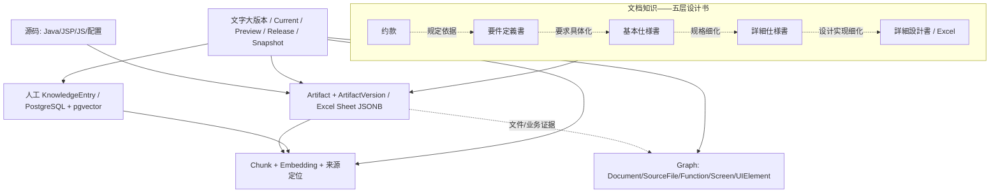
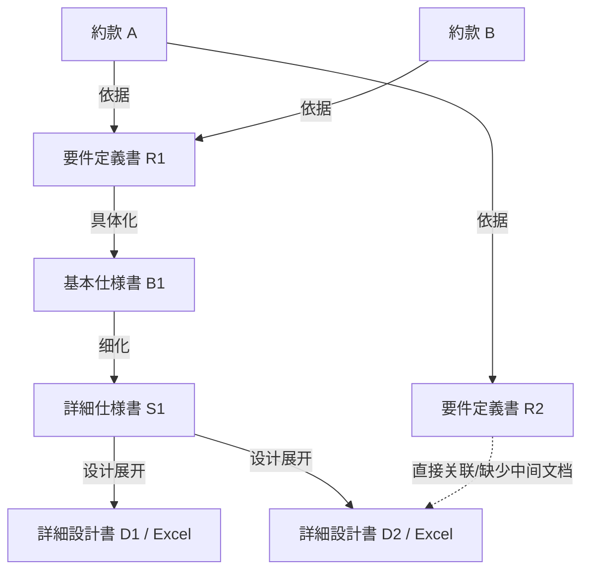
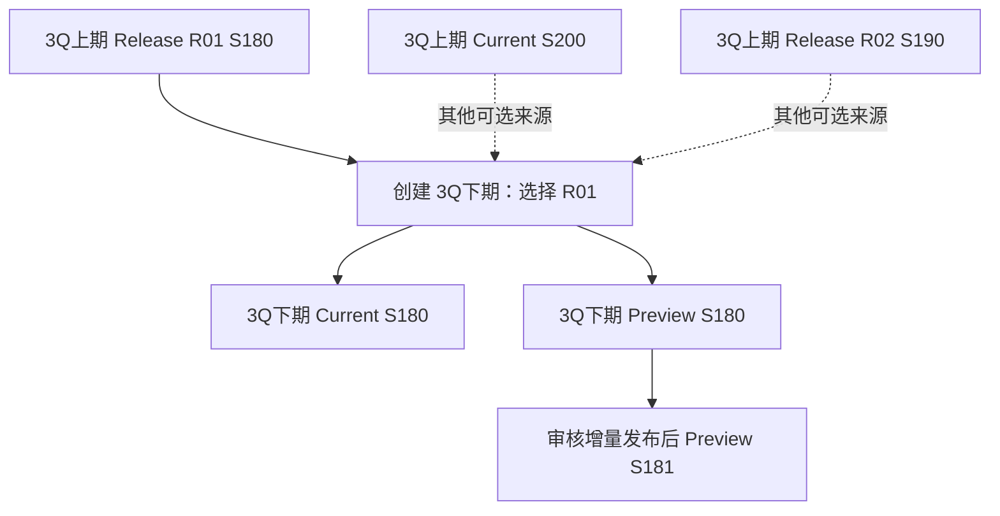

# 電力 Online 系统知识库本体详细设计 v0.4

> **文档定位**：描述知识库内部的知识内容、**五层设计书体系**、业务对象及 Graph 关系、RAG、来源证据、版本继承及增量维护。不是应用部署图、项目排期或 UI 清单。
>
> **修订原因**：v0.3 虽列出了五类 Graph 节点和五层设计书名称，却缺少设计书间的层次、横向关联、冲突处理、Graph 关系完整字典及证据/版本查询的细化。v0.4 补足这些核心设计。
>
> **状态**：现阶段确认的逻辑设计基线 + 标注的实现建议；关系抽取与 Excel 解析准确性仍需真实数据 PoC 验证。

## 0. 设计原则与知识边界

本系统是日本电力行业的大型既有 Online Java Web 系统，包含 300 多个機能和 1000 多个画面。知识源包括约款、要件定義書、基本仕様書、詳細仕様書、詳細設計書（多数为 Excel），以及 Java/JSP/JavaScript/配置等代码。资料可能缺失、过时、互相矛盾，且不一定与代码一致。

1. **文档层次和 Graph 关系是两套不同但相互配合的表达**：设计书保留原始层级和内容；Graph 只表达五类稳定对象间的重要关联，避免把每个章节、句子、Excel 单元格建成节点。
2. **记录证据而不是假设推导正确**：文档层次关系可缺失、可一对多、可跨层；有冲突时记录不同证据，不能机械按上下级覆盖。
3. **五类 Graph 节点不变**：`Document`、`SourceFile`、`Function`、`Screen`、`UIElement`。`KnowledgeEntry` 不进入 Neo4j。
4. **统一 Snapshot 版本语义**：大版本名是业务文字（如「3Q上期」「3Q下期」），每个大版本 `Current`、`Preview`，支持历史 `Release`；继承基线可选前一大版本 Current 或指定 Release。
5. **增量维护**：文档/Sheet/Chunk/Embedding/Graph 关系采用不可变版本和复用。候选知识必须人工审核后才能进入 Preview。
6. **Graph 不宣称覆盖全部系统依赖**：不构建全方法级调用图、不自动断言完整运行时画面迁移和全路径 UT 数据。

## 1. 知识结构的总图



**关键区别**：上图五层“上下游”是**设计书体系和追溯方向**，不是要求每份文件都具有完整的父子链。文件级关系可以在 Graph 中以 `Document → Document` 表达；章节、表格、条目级引用留在 PostgreSQL 的结构化定位和证据中。

---

# 第一篇：设计书的层次与内容设计

## 2. 五层设计书体系及各层信息职责

| 层级 | 日文名称 | 主要回答的问题 | 典型知识内容 | 常见关联目标 |
|---|---|---|---|---|
| L1 | **約款** | 哪些业务制度、契约规则必须遵守？ | 合同条件、供电服务规则、适用条件、期限、计算或例外原则 | 要件、业务 Function、相关文档 |
| L2 | **要件定義書** | 系统要满足哪些业务/非功能要求？ | 业务事件、功能要求、外部条件、业务约束、验收目标 | 基本规格、Function、Screen |
| L3 | **基本仕様書** | 业务与系统主要行为如何定义？ | 业务功能分解、处理概要、画面/接口框架、数据与状态的基础定义 | Function、Screen、详细规格、源码（必要时） |
| L4 | **詳細仕様書** | 业务规则、处理条件如何精确描述？ | 详细输入输出、校验、业务分支、数据库处理条件、画面交互规则 | Function、Screen、UIElement、详细设计 |
| L5 | **詳細設計書** | 哪些具体设计内容供程序修改和 UT 参考？ | Excel 画面项、入力チェック、DB 更新、控制/迁移逻辑、处理条件、消息 | Function、Screen、UIElement、SourceFile |

说明：上表是**知识库组织约定**，不是断言所有实际项目都严格按此划分。源文档本身是判断内容的第一依据。某份“基本仕様書”也可能包含非常细的条件，系统照实保留，而不强制重新分类到 L4/L5。

### 2.1 文档层次的边界

- L1 是制度/契约依据；不要自动把每条約款解释为 Java 代码规则。
- L2 是要求；要求与当前实现不一致时仍保留要求及其证据。
- L3/L4 负责由概要到细则的桥接，但实际文档可能合并或缺失其中一层。
- L5 以 Excel 为主，既需要完整原件，也需要结构化 Sheet、Block、Item 以支持差分和检索。
- **每个层级都允许包含多个 Document**。一个 Function 可以由多份文档描述，一份 Document 也可以覆盖多个 Function/Screen。

## 3. 文档层次不是简单树，而是可追溯的有向网络

设计上不应强制：`一份約款 → 一份要件 → 一份基本 → 一份詳細仕様 → 一份詳細設計`。

实际应支持：

1. **相邻层追溯**：某份要件文档依据某份約款；详细规格细化某份基本规格。
2. **跨层追溯**：详细设计直接引用約款条文，或详细规格直接对应要件定义。
3. **多对多**：一份詳細設計書对应多个 Screen，一项要件被多份设计书共同实现。
4. **缺失层**：从要件直接找到詳細設計書；不应生成虚构的基本规格文档填空。
5. **引用与版本差异**：文档里的“引用某版本”是事实证据；不能自动假定当前快照里两份文档已经互相一致。



这些箭头只有在**原文编号/引用、明确目录对应或人工确认**等证据支持时，才能进入 Graph 的已确认关系；算法推断先进入候选审核。

## 4. Document 对象模型（独立于 Graph 的完整文档元数据）

`Document` 在 Graph 中是**整份文档**，对应 `Artifact` 的文件逻辑身份。完整元数据与内容版本由 PostgreSQL 管理。

| 字段 | 示例 | 设计规则 |
|---|---|---|
| `artifact_id` | UUID | 文档稳定身份；重命名尽量不改变身份 |
| `artifact_version_id` | UUID | 某份文件固定内容版本 |
| `document_level` | `L4` | 枚举 L1–L5，允许 `UNKNOWN` 待人工确认 |
| `document_type` | `詳細仕様書` | 原始文档类别/显示名称 |
| `document_title` | `契約変更 詳細仕様書` | 原始标题，不必和文件名相同 |
| `document_number` | `DS-...` | 文档内有编号才填写 |
| `language` | `ja` | 来源语言 |
| `business_scope` | 选填 Function/Screen ID | 候选/确认来源需区分，不能当硬依赖 |
| `source_location` | SVN URL + Revision | 原始权威来源 |
| `blob_key` | Blob 路径 | 不可变源文件快照 |
| `content_hash` | SHA-256 | 文件内容去重和核验 |
| `document_status` | `CURRENT/OBSOLETE/UNKNOWN` | **源文档上的状态**，不同于知识库 Current Branch |
| `effective_context` | 适用日期/业务条件 | 仅在文件内容明确支持时记录 |

**避免术语混淆**：文档的“现行/废止”是业务状态；知识库分支的 `Current/Preview` 是版本引用；两者不得使用同一字段代替。

### 4.1 设计书层次登记规则

- 优先从有明确编号的元数据、目录、仓库分类、文档标题识别层级。
- 文件名不足以确定层级时标为 `UNKNOWN` 或候选，进入审核。
- 不要求文档命名一致；保存原始文档名与规范化类别。
- 文档拆分、合并和改名时保留原始身份变化及 `supersedes`/引用证据；不可假装只有文件路径变更。
- 同层文档之间也可以互相引用，不需强迫上下级关系。

## 5. 五层设计书如何进入 RAG

**所有层级都可作为 RAG 来源**，但 Chunk 划分单位不同。

| 层级 | 推荐 Chunk 划分 | 返回的定位与上下文 | 主要检索用途 |
|---|---|---|---|
| L1 約款 | 条文/款项与适用前提 | 条号、项号、版本、原文页 | 查业务制度依据 |
| L2 要件定義書 | 要件编号/业务规则段落 | 要件 ID、章节、页/段落 | 查业务要求与变更背景 |
| L3 基本仕様書 | 功能/业务处理/画面章节 | 機能编号、章节、表格位置 | 查功能全貌与业务联系 |
| L4 詳細仕様書 | 处理规则、条件、例外与表格逻辑块 | 章节、规则项、表格行/页 | 查详细业务规则 |
| L5 詳細設計書 | Excel Sheet → Block → Item（含表头） | Sheet 名、单元格范围、字段名 | 查实现设计与 UT 输入条件 |

Chunk 必须保存：`artifact_version_id`、`document_level`（通过文档元数据引用）、`chunk_type`、`content`、`chunk_source`（页码/章节/Sheet/单元格）及解析规则版本。相同文本但业务上下文不同，不能错误合并。向量与 Chunk 可跨大版本复用。

### 5.1 查询五层文档的优先级

- 用户问“法规/契约依据”，优先检索 L1，同时允许 L2–L5 补充执行细节。
- 问“业务要求”，优先 L2/L3，再检索 L4/L5 验证实现设计。
- 问“某画面的输入检查如何写”，优先 L4/L5、关联 Screen/UIElement，再回溯 L1/L2 的规则依据。
- **不把文档层级当权威冲突的自动裁判**。有不一致时并列展示来源和适用版本；由业务/设计负责人判定。

## 6. L5 Excel 詳細設計書：结构化层次

```text
Document（整份 Excel 设计书，Graph 的 Document 节点）
└── ArtifactVersion（特定原始文件版本，Blob 中有原件）
    ├── Sheet 画面項目   → ExcelSheetVersion（PostgreSQL JSONB）
    │   └── Block / Item → ChunkSource(cell range) → KnowledgeChunk
    ├── Sheet 入力チェック → ExcelSheetVersion
    │   └── Block / Item → ChunkSource(cell range) → KnowledgeChunk
    ├── Sheet DB更新     → ExcelSheetVersion
    └── Sheet 画面遷移   → ExcelSheetVersion
```

**Sheet、Block、Item、Chunk 不创建 Neo4j 节点。** 它们保存在 PostgreSQL 的结构、检索和来源定位表中。

建议 Sheet JSONB 表达必要的合并单元格、表头、表格行、逻辑块、原文与单元格范围。示例：

```json
{
  "sheet_name": "入力チェック",
  "sheet_index": 1,
  "blocks": [{
    "block_key": "INPUT_CHECK",
    "block_type": "INPUT_CHECK",
    "title": "入力チェック",
    "cell_range": "A8:F24",
    "columns": ["項目名", "必須", "桁数", "チェック内容"],
    "items": [{
      "item_key": "CONTRACT_START_DATE",
      "name": "契約開始日",
      "raw_values": {"必須": "○", "桁数": "8", "チェック内容": "過去日不可"},
      "normalized": {"required": true, "length": 8, "rule_text": "過去日不可"},
      "cell_range": "A10:D10"
    }]
  }]
}
```

- `raw_values` 保存原始文字；`normalized` 是解析/标准化结果，不能替代原文。
- **改变一张 Sheet**：新建对应 SheetVersion；未变 Sheet 重用；Chunk 和 Embedding 按实际完整内容复用。
- **插入行/列**：Chunk 文本可相同，来源定位更新，不能把移动误判为业务规则修改。
- **格式各异的旧 Excel**：模板识别失败时保留原文、标注低可信度、进入人工处理；不得伪装解析成功。

---

# 第二篇：Graph 的具体设计

## 7. Graph 为什么存在、与 RAG 的分工

**Graph 解决“重要对象之间谁和谁有关”**；RAG 解决“文档具体写了什么”。

| 问题 | Graph 负责 | RAG / 结构化内容负责 |
|---|---|---|
| 某 Function 有哪些 Screen | `Function -HAS_SCREEN-> Screen` | 屏幕流转的具体描述与证据 |
| 某 Screen 有哪些重要控件 | `Screen -HAS_ELEMENT-> UIElement` | 必填/桁数/输入条件全文 |
| 哪些设计书描述某 Function | `Function -DESCRIBED_BY-> Document` | 文档章节、表格、规则全文 |
| 某 Screen 由哪些源码实现 | `Screen -IMPLEMENTED_BY-> SourceFile`（有证据） | Java/JSP/JS 中具体逻辑与位置 |
| 詳細設計書与詳細仕様書关系 | `Document -DERIVED_FROM-> Document` 或 `REFERENCES` | 精确的引用位置/条目对应关系 |
| 某次变更影响哪些代码行 | Graph 仅提供文件级候选 | 结合源码/RAG/Agent 推断，不能保证完整 |

Graph 是**稀疏、证据驱动、可维护**的图，不是完整程序依赖图。

## 8. Graph 节点设计（严格五类）

| 节点 | 身份依据 | 必要属性 | 版本化/说明 |
|---|---|---|---|
| `Document` | `artifact_id` 对应的文档文件 | `object_id`, `artifact_id`, `document_level`, `title` | 仅整份文档；`document_level` 按有效对象属性版本解析；正文不存入 Graph |
| `SourceFile` | `artifact_id` 对应的源码文件 | `object_id`, `artifact_id`, `file_type`, `display_path` | Java/JSP/JS/properties 文件级；不建类/方法/变量节点 |
| `Function` | 已维护的機能 ID，或受控稳定 UUID | `object_id`, `function_code`, `name` | 可描述多个 Screen，允许跨文档多重关联 |
| `Screen` | 画面 ID/画面编号或稳定 UUID | `object_id`, `screen_code`, `name` | 一个 Screen 可属多个 Function（据事实，不强制独占） |
| `UIElement` | Screen + 稳定项目编号/受控 Key | `object_id`, `element_key`, `name`, `element_type` | 只挑重要控件；必填/格式/条件明细留在 PostgreSQL |

实体身份应**跨 Snapshot 稳定**，但显示名、文档级别、关联身份映射可随有效版本变化。如果 UIElement 被大幅改造到无法视为同一项目，可建立新身份并标注取代关系的证据，而不是强行沿用旧身份。

### 8.1 节点身份映射

- `Document` ↔ `kb_core.artifact(artifact_type=DOCUMENT)` 一一逻辑映射（实际文档拆分合并需审核）。
- `SourceFile` ↔ `kb_core.artifact` 的源文件类型映射。
- `Function`、`Screen`、`UIElement` 在 PostgreSQL 有独立对象身份、编号及别名表，以处理多种命名方式；不是从 Excel 文件名直接创建“已确认对象”。
- 关系候选可因名称不一致指向错误实体：身份消歧是审核流程的一部分。

## 9. Graph 关系字典（建议第一版受控集合）

下表分为**正式业务关系**和**文档追溯关系**。关系方向仅为 API/图谱标准方向，不表示运行时实际调用方向。

| 关系类型 | 起点 → 终点 | 语义 | 建立证据 | 限制与注意 |
|---|---|---|---|---|
| `HAS_SCREEN` | Function → Screen | 機能包含/使用画面 | 機能/画面一览表、受控登记 | 可多对多，不据目录猜测 |
| `HAS_ELEMENT` | Screen → UIElement | 画面拥有重要输入/显示控件 | 画面项定义、JSP 等 | 不要求所有控件入图 |
| `DESCRIBED_BY` | Function → Document | 文档描述该功能 | 機能 ID、章节或审核确认 | 可关联 L1–L5，多对多 |
| `DESCRIBED_BY` | Screen → Document | 文档描述该画面 | 画面 ID、详细设计表 | 一份 Excel 可对应多个画面 |
| `DESCRIBED_BY` | UIElement → Document | 文档描述控件定义 | 画面项设计表 | 仅重要控件；具体条件用 Sheet/Chunk 定位 |
| `IMPLEMENTED_BY` | Function → SourceFile | 源码参与实现功能 | 配置/路径、源码证据或人工确认 | 文件级；不等于全部调用链 |
| `IMPLEMENTED_BY` | Screen → SourceFile | 源码参与实现画面 | JSP/Action/配置等证据 | 文件可能服务多个画面 |
| `IMPLEMENTED_BY` | UIElement → SourceFile | 控件有可确认源码关联 | JSP/JS 对应标识 | 可选，不自动批量生成 |
| `REFERENCES` | Document → Document | 文档显式引用另一文档 | 引用标题/编号、章节/单元格 | 不代表“上下级”或内容一致 |
| `DERIVED_FROM` | Document → Document | 某设计书基于另一份设计书/规格细化 | 明确编号映射或人工确认 | 可跨层、可多对多；高置信度才确认 |
| `RELATED_TO` | Document ↔ Document（规范化有向存储） | 同级或横向关联 | 明确引用或人工确认 | 语义弱，不推断上下级 |
| `RELATED_TO` | Function ↔ Function（规范化有向存储） | 功能关联但关系性质暂不细分 | 证据/人工确认 | 不能直接推断调用关系 |
| `RELATED_TO` | Screen ↔ Screen（规范化有向存储） | 经确认的画面关联 | 设计书描述/人工确认 | 不等于自动生成的完整画面迁移图 |

**实施约束**：可先只落地高价值关系 `HAS_SCREEN`、`HAS_ELEMENT`、`DESCRIBED_BY`、`IMPLEMENTED_BY`、`REFERENCES`、`DERIVED_FROM`；`RELATED_TO` 作为受控弱关系，避免无约束泛化。正式新增关系类型需登记端点类型、语义、证据规则、审核策略。

### 9.1 文档层次如何落到 Graph

五层设计书本身不是五种节点，**它们统一是 `Document` 节点，用 `document_level` 区分**。

具体例子：

```text
Document(約款 A, L1)
  <- DERIVED_FROM - Document(要件定義 R, L2)
  <- DERIVED_FROM - Document(基本仕様 B, L3)
  <- DERIVED_FROM - Document(詳細仕様 S, L4)
  <- DERIVED_FROM - Document(詳細設計 D, L5)

Function(契約変更) -DESCRIBED_BY-> Document(要件定義 R, L2)
Function(契約変更) -DESCRIBED_BY-> Document(詳細設計 D, L5)
Function(契約変更) -HAS_SCREEN-> Screen(契約変更入力)
Screen(契約変更入力) -HAS_ELEMENT-> UIElement(契約開始日)
Screen(契約変更入力) -IMPLEMENTED_BY-> SourceFile(ContractChangeAction.java)
```

上例的 `DERIVED_FROM` 从**下游设计文档指向其依据的上游文档**。如果源文档只有“参照”而没有细化/继承事实，应使用 `REFERENCES`，不应擅自升级为 `DERIVED_FROM`。

**层次的语义检查**（建议）：
- `DERIVED_FROM` 常见为 L2→L1、L3→L2、L4→L3、L5→L4，但允许跨层；同层只有明确证据时才允许。
- **不能要求五层完整**，也不能仅因 L5 与 L1 同名就推断细化关系。
- `REFERENCES` 不限制层级方向，必须保留引用的出处。
- 文档可以同时被多份下游资料引用，不能做单一父节点约束。

### 9.2 关系粒度与不建图的对象

**不进入 Neo4j**：文档章节、条款、Excel Sheet、Block、Item、单元格、Chunk、Embedding、SQL 字符串、Java 类/方法/变量、KnowledgeEntry。

若想表达“L5 的 A10:D10 对应 L4 的某一条规则”，在 PostgreSQL 保存**细粒度 evidence/cross-document locator**；Neo4j 保留两份 Document 的 `DERIVED_FROM/REFERENCES` 文件级边。Graph 查询再链接到关系证据中定位，既避免节点爆炸，也保留精细追溯。

## 10. Evidence：关系的证据和审核设计

关系不能只有“source ID / target ID”两个字段。需要保存其依据。

### 10.1 PostgreSQL 权威模型

```text
GraphObject(object_id, object_type)
  └─ GraphObjectVersion(object_version_id, display_name, properties)
GraphRelation(relation_id, source_object_id, target_object_id, relation_type)
  └─ GraphRelationVersion(relation_version_id, relation_id, status, properties)
      └─ RelationEvidence(relation_version_id, evidence_id, role)
          └─ Evidence(evidence_id, artifact_version_id, locator, quote, source_revision,
                      extraction_method, confidence, created_at)
```

Evidence 中：

| 字段 | 用途 |
|---|---|
| `artifact_version_id` | 固定证据来自哪份不可变文件（可能为空：人工确认另记审核证据） |
| `locator` | JSONB：页/章节/条款、Sheet/单元格或源码行号 |
| `quote` / `excerpt` | 必要的短原文摘录，不能替代原始内容 |
| `extraction_method` | `EXPLICIT_ID`、`CROSS_REFERENCE`、`PARSER`、`LLM_SUGGESTED`、`MANUAL` |
| `confidence` | 系统判断可信度；不等于审核结论 |
| `review_reference` | 审核决定的 ID 或审计引用 |

多条 Evidence 可以支持同一关系；证据也可能证明关系已过时，需要由审核人员决定失效。不能因为原文件改版就直接硬删除历史关系。

### 10.2 候选、确认与冲突

- `CANDIDATE`：自动发现关联，但尚未人工批准。
- `REVIEW_REQUIRED`：来源变化、证据冲突或身份不确定，需要复核。
- `CONFIRMED`：人工审核/受控规则确认；发布之后才进入默认 Graph 查询。
- `REJECTED`：明确驳回的候选，保留审计，但不进入默认可见图。
- 关系在 Preview 中失效：提交 `DELETE` Tombstone；历史 Release 中保持此前有效关系。
- **文档冲突不自动消除**：例如 L4 写“过往日不可”，L5 写“当日也不可”，两份内容各自保留，关联处显示不一致风险，不能选一个覆盖另一份。

## 11. Graph 版本化设计

### 11.1 同一 Graph，在不同 Snapshot 中的有效关系不同

例：

| 关系 | 「3Q下期」Current S300 | 「3Q下期」Preview S315 |
|---|---|---|
| `Function F -HAS_SCREEN-> Screen S` | 有效 | 有效 |
| `Screen S -IMPLEMENTED_BY-> SourceFile A` | 有效 | 失效 |
| `Screen S -IMPLEMENTED_BY-> SourceFile B` | 无 | 新增已确认 |
| `Document L5 -DERIVED_FROM-> Document L4` | 有效 | 有效 |

知识提交只登记 `UPSERT`/`DELETE` 增量和对象版本引用。Snapshot 从父提交与继承基线解析每个对象的有效版本；不得简单查询 Neo4j “最新关系”。

### 11.2 版本一致的查询原则

1. `大版本名 + Current/Preview/Release` 先解析成固定 `snapshot_id`。
2. PostgreSQL 对该 Snapshot 解析有效的 GraphObjectVersion、GraphRelationVersion。
3. Neo4j 只作为这些有效版本的查询投影（查询结果仍带 object/relation ID）。
4. **遍历中的每一个节点和每条关系**都必须在同一 Snapshot 有效；不能先跨历史遍历、最后只过滤终点。
5. 对关系详情返回 Evidence 的不可变文件版本及页/Sheet/单元格/行定位。
6. Neo4j 数据出现缺口时应报告索引/投影异常，而不是退化为不受版本限制的查询。

### 11.3 物化与性能

第一版以 PostgreSQL 的有效版本解析为正确性基准；高频 Snapshot 可增加 `snapshot_object_index`、`snapshot_relation_index` 或检查点。局部 1–2 跳优先验证；大规模多跳可能需要 Neo4j 版本化有效性索引。**不建议每次 Commit 复制整张 Graph**。具体物化策略由 PoC 实测决定。

## 12. Graph 查询场景与响应形态

### 场景 A：从 Function 找五层设计文档

输入：`Function=契約変更` + `snapshot_id=S315`。执行：

1. `Function -DESCRIBED_BY-> Document` 获取直接已确认关联。
2. 按 `document_level` 分组返回 L1–L5；没有直接关联的层不伪造。
3. 沿 `DERIVED_FROM` / `REFERENCES` **受限扩展**更多候选文档，区分直接/间接来源。
4. 返回文档版本、层级、引用 Evidence 和层次缺口警告。

输出示意：

```json
{
  "snapshot_id": "S315",
  "function": "契約変更",
  "documents_by_level": {
    "L1": ["約款 A"],
    "L2": ["要件定義 R"],
    "L3": [],
    "L4": ["詳細仕様 S"],
    "L5": ["詳細設計 D.xlsx"]
  },
  "missing_levels": ["L3"],
  "note": "未找到已确认关联不等于文档不存在"
}
```

### 场景 B：从 Screen 找详细设计与源代码

`Function F -> Screen S -> UIElement U`，以及 `Screen S -> Document(L5)`、`Screen S -> SourceFile`。通过 L5 Sheet/Item JSONB 查询具体字段校验。结果保留已确认关系和证据来源；未解析到的 SourceFile 不断言不存在。

### 场景 C：从 SourceFile 找受影响的 Function/Screen

沿 `IMPLEMENTED_BY` 反向查询已确认对象，辅助代码改修范围候选。返回“已知关联”，不声称全量影响分析。

### 场景 D：检索与 Graph 联合

先根据业务或 Screen 确定已知文档，结合 RAG 从 L1–L5 查具体条件；如果 Graph 未覆盖某份文档，允许 RAG 另行检索并以候选归属提示。**RAG 命中不能自动转换为 Graph 已确认边**。

## 13. Graph 更新实例：一份詳細設計書变更

假设「3Q下期」Preview 新增了 `契約開始日` 的“当日不可”条件：

1. 从 SVN/Git 固定新详细设计 Excel 版本，上传 Blob。
2. Excel Sheet JSONB 局部更新；Chunk/Embedding 仅更新实际变化内容。
3. `Document` 节点**不新建另一份文档身份**，但有效 ArtifactVersion 更新。
4. 如果变更涉及已建立的 `Screen -DESCRIBED_BY-> Document` 证据位置，更新来源 Evidence / 标记复核；**不自动删除已确认关系**。
5. `Screen -HAS_ELEMENT-> UIElement` 的节点关系一般不变；字段校验规则变化保存在 Sheet JSONB/Chunk，而不是 Graph 边属性里堆放全文。
6. 审核通过后发布新 Commit/Snapshot；Current 仍查询旧条件，Preview 查询新条件。
7. 后续 Excel 差分引擎比较 Current/Preview，生成相应 Before/After；Graph 仅辅助确定 Function/Screen 范围。

---

# 第三篇：版本、知识生成与消费

## 14. 知识版本与设计书版本的区别



- **知识大版本**：`3Q上期`、`3Q下期` 是业务文字标签，内部 UUID 标识；明确记录前一大版本。
- **分支**：每个大版本 Current 和 Preview；创建时共同引用选定的来源 Snapshot。
- **Release**：不可变的 Snapshot 引用，独立于 Close。
- **Commit/ChangeSet**：审核通过的知识增量，不按分支全量复制内容。
- **Snapshot**：在一个时间点对 ArtifactVersion、KnowledgeEntryVersion、GraphObjectVersion、GraphRelationVersion 等的统一有效知识视图。
- **原始文档版本**：文件内容不可变版本，与“知识大版本”和“文档自身的业务发布日期”不同。

## 15. 文档、Graph 和 RAG 的统一增量机制

| 对象 | 改变时更新 | 未改变时复用 | Snapshot 生效依据 |
|---|---|---|---|
| Document 原文件 | 新 ArtifactVersion、Blob | Artifact 身份 | ARTIFACT UPSERT/DELETE |
| Excel Sheet | 新 SheetVersion + map | Sheet JSONB | 有效 ArtifactVersion |
| Chunk / Embedding | 新 Chunk、向量、位置 | 相同上下文内容与模型配置 | 有效 ArtifactVersion 与 ChunkSource |
| Function / Screen 等 | 对象属性新版本 | 稳定身份 | GRAPH_OBJECT UPSERT/DELETE |
| Graph 关系 | 关系新版本/DELETE | 已确认历史版本 | GRAPH_RELATION UPSERT/DELETE |
| KnowledgeEntry | 人工知识内容新版本 | 旧版本不变 | KNOWLEDGE_ENTRY UPSERT/DELETE |

**完整的文档层次追溯关系和 Graph 关系**都通过权威关系版本及证据参与 Snapshot 管理，不存在“文档换了而图直接静默覆盖”的捷径。

## 16. 候选入库与审核流程

```text
固定 Git/SVN Revision / 上传文件
  -> 文件增量 Manifest（新增/修改/删除/重命名）
  -> Blob 不可变快照 + 五层文档分类
  -> 解析 Excel Sheet JSONB / 其他文档章节
  -> Chunk / Embedding / Graph 候选关系和 Evidence
  -> 自动验证和 Staging
  -> 人工确认（按一致性依赖组）
  -> 构建 Commit + Snapshot + Neo4j 版本投影
  -> 校验数据与引用
  -> PostgreSQL 原子切换 Preview HEAD
```

两道审核不可混淆：**知识候选审核**决定数据进入 Preview；**Excel 差分审核**决定比较结果能否作为 Diff Package 交给 Agent。未经审核的 Staging 数据对普通查询不可见。Graph 不要求全部关系自动抽取成功，允许缺失或待复核。

## 17. 知识查询与证据呈现

| 输入需求 | 建议查询流程 | 返回重点 |
|---|---|---|
| 某条約款的实现依据 | L1 RAG → `Document` 追溯关系 → L2–L5 RAG | 制度原文、下游文档、可能缺口 |
| 某 Function 的相关资料 | Function Graph → L1–L5 Document → RAG | 文档分层清单、证据、版本 |
| 某 Screen 的输入检查 | Screen Graph → L5 Excel Sheet JSONB → Chunk | 项目/条件及 Sheet/单元格 |
| 某 Java 文件涉及哪些业务 | SourceFile ← IMPLEMENTED_BY ← Function/Screen | 已确认关联、非完整影响清单 |
| 设计与源码不一致 | 并列显示文档与源码来源版本 | 不自动把代码覆盖设计书 |
| 人工补充前置条件 | KnowledgeEntry 语义搜索 | 原始人工知识版本、范围 metadata |

所有查询使用同一 `snapshot_id`。默认返回来源文件、其有效文件版本、定位、Graph 关系证据与审核状态；缺失层级和未确认关联需显式说明。

## 18. Excel 詳細設計書差分与 PG/UT Agent

- 差分固定同一**文字大版本**的 Current 与已发布 Preview Snapshot。
- 从 `Function` / `Screen` Graph 关联及元数据获取相关 L5 文档；图谱关联不完整时标记范围缺失，允许候选发现但不可默默忽略。
- 对有效 L5 Excel 执行 **File → Sheet → Block → Item** 比较；插入行或移动不应误判业务改变。
- 保留 Before/After 原文、Sheet/单元格定位、归属、审核状态及不确定性。
- 审核通过生成不可变 Diff Package，经 VS Code 插件交付给**一个 PG/UT Agent**。
- VS Code 插件**只提供差分选择、预览、导出与交付**，不提供 Knowledge Search 或 Current File Context。
- MVP1 建立来源定位和版本化知识基础；完整语义差分及 Agent 集成属于 MVP2。

## 19. 技术存储边界

| 数据 | 权威位置 | Graph 中仅保存什么 |
|---|---|---|
| 文档/源码原件 | Git/SVN 源仓库；Azure Blob 不可变快照 | Document/SourceFile 身份与少量索引属性 |
| 文档层级、文档版本、章节、引用定位 | PostgreSQL | `document_level` 的有效投影和文件级关系 |
| Excel 全 Sheet 结构 | PostgreSQL JSONB | 不存 Sheet 或 Item 节点 |
| Chunk、Embedding、人工 KnowledgeEntry | PostgreSQL + pgvector | 不存这些内容 |
| Graph 对象、关系、Evidence、审核、版本 | PostgreSQL | Neo4j 保留可查询的版本化节点/边投影 |
| 大版本、Commit、Snapshot、Release | PostgreSQL | Neo4j 查询以 Snapshot 有效集合约束 |

## 20. 必须落实的验证用例（核心验收）

1. 「3Q下期」从「3Q上期」Current 或历史 Release 继承，五层文档和 Graph 关系均按所选基线复用，而非全量复制。
2. 不完整五层结构（例如缺 L3）仍可查询；显示缺失，不自动补造文档/关系。
3. 一份詳細設計書覆盖两个 Screen，Graph 两条 `DESCRIBED_BY` 关系及 Excel 来源定位正确。
4. 同一 Document 同时引用两份上游文档，证据保留，查询不强迫唯一父文档。
5. 明确 `REFERENCES` 与有证据的 `DERIVED_FROM`，算法不能将普通引用自动升级为继承/细化关系。
6. L4 与 L5 的输入检查规则矛盾时，两份原文可查且冲突可见，不静默覆盖。
7. Excel 插入行仅改变 ChunkSource 位置；不重复生成语义等价向量。
8. Preview 关系删除后，Current 和历史 Release 的关系仍保留；受限多跳遍历不会穿过失效关系。
9. 自动发现的候选 Graph 关系未经人工批准，不出现在默认 Graph 查询。
10. KnowledgeEntry 独立全文/语义检索，不产生 Neo4j 节点。
11. Neo4j 投影构建失败时，Preview HEAD 不变；重试后幂等发布。
12. 差分按 Function/Screen 覆盖相关 L5 文档，无法归属的变化不丢失。

## 21. 当前未决设计与 PoC 验证点

| 事项 | PoC 决策内容 |
|---|---|
| 文档分层识别 | 仓库/文件元数据、文档编号、人工审核的可信规则 |
| 设计书跨层追溯 | 显式引用匹配、候选提取与人工确认的准确率 |
| Document 身份 | 改名、合并、拆分文件时 Artifact 与 Graph 节点如何映射 |
| Function/Screen/UIElement 编号 | 多来源别名消歧及身份稳定性 |
| Graph 关系类型 | 采用本版字典中的最小集合并验证实际覆盖率 |
| Snapshot 图谱查询 | 多跳逐边有效性过滤和物化索引性能 |
| Excel 模板 | 不同格式的 Sheet/Block/Item 识别与定位可靠性 |
| 数据库 Schema | 合并正式 DDL、补充证据表、关系端点约束与版本有效索引 |
| 业务冲突 | 设计与源码、L4/L5 不一致的提示和人工裁决流程 |

---

## 附录 A：知识对象之间的层次关系速览

```text
知识大版本（3Q上期 / 3Q下期）
 ├── Current / Preview / Release → KnowledgeSnapshot
 │    ├── 有效 ArtifactVersion（五层 Document + SourceFile）
 │    │    ├── Document(L1–L4)：章节 / 条文 / 结构化位置 → Chunk
 │    │    └── Document(L5 Excel)：SheetVersion JSONB → Block/Item → Chunk
 │    ├── 有效 Function / Screen / UIElement
 │    ├── 有效 GraphRelationVersion + Evidence
 │    └── 有效 KnowledgeEntryVersion + Embedding
 └── Commit / ChangeSet（仅保存变化并继承历史）

Graph（只五类节点）
 Function --HAS_SCREEN--> Screen --HAS_ELEMENT--> UIElement
 Function/Screen/UIElement --DESCRIBED_BY--> Document(L1–L5)
 Function/Screen/UIElement --IMPLEMENTED_BY--> SourceFile
 Document(L5) --DERIVED_FROM/REFERENCES--> Document(L4/L3/L2/L1)
 Document(L4) --DERIVED_FROM/REFERENCES--> Document(L3/L2/L1)
 Document --RELATED_TO--> Document（有证据的横向关联）
```

## 附录 B：与 v0.3 的主要修订

- 完整定义五层设计书各层职责、数据粒度、RAG 策略以及缺层/跨层/多对多追溯。
- 正式区分文档层次**概念链**与**有证据的 Graph 文档关系**，不将五层强制建成树。
- 明确 `Document` 节点是整份文档，`document_level` 区分 L1–L5，Sheet/Block/Item 不建图。
- 给出五类节点身份、Graph 关系字典、合法端点、证据与审核状态、历史 Snapshot 查询规则。
- 通过 Excel 单元格校验变化实例说明 Graph、RAG 和结构化来源如何协作。
- 补足文档冲突、未确认关系、欠缺证据及回溯查询的业务约束。
