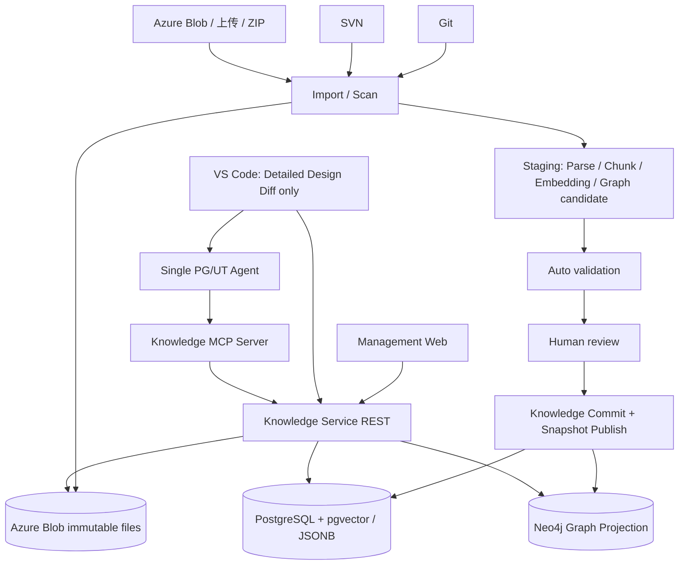

# 電力 Online 知识库平台——详细设计完整汇编 v0.2

> 整理日期：2026-11-21｜状态：PoC 开发基线（未经生产环境验证）  
> 本汇编以**最新确认规则**为准：文字大版本（如 3Q上期）、前版 Current/Release 继承、单一 PG/UT Agent、VS Code 仅详细设计书差分。

---

# 00 阅读指南与设计决策基线

- 文档集版本：v0.2，整理日期：2026-11-21。
- 状态：**设计讨论汇编／PoC 开发基线**，并非已验证的生产级规格。SQL 为**草案与约束说明**，统一 Migration 尚待完成。
- 业务对象：日本电力行业 Online Java Web 系统知识库；Batch 内部不在本期范围。
- 适用对象：知识库开发、评审、测试、PG/UT Agent 接口对接人员。

## 最新修正优先规则

1. **大版本是业务文字**，例如 `3Q上期`、`3Q下期`，不使用 V1/V2/V3 作为业务约束；数据库内部用 UUID。前后关系由 `previous_major_version_id` 记录，不按文字排序；若名称可跨年度重复，唯一键应包括年度／业务周期。
2. 新建后续大版本时，从**前一大版本的 Current 或任意允许继承的历史 Release**选择一个固定 READY Snapshot。新版本 Current 与 Preview 初始引用该 Snapshot，后续独立演进；不持续跟踪父版本 HEAD。
3. **PG/UT 是单一 Agent**。VS Code 插件仅负责 `Detailed Design Diff` 的选择、预览、导出及交付；没有 Knowledge Search、Current File Context 或 Graph 查询菜单。
4. `KnowledgeEntry` 仅在 PostgreSQL + pgvector 中管理，不生成 Neo4j 节点或强制关系。
5. PostgreSQL 是知识版本与关系权威；Neo4j 是重要关联的**版本化查询投影**；原始 Git/SVN 为来源系统，Azure Blob 保存导入时不可变文件快照。
6. **审核先于 Preview 入库**。Staging 写入不代表普通查询可见；只有验证通过的 READY Snapshot 经 HEAD 切换后可见。
7. Current/Preview 差分仅针对**同一个大版本**；所交付的 Diff Package 固定两个 Snapshot，PG/UT Agent 按需读取。
8. 不追求完整运行时调用链、Class/Method/Variable 级别 Graph，也不自动推断全部跨画面测试路径。

## 文档目录

| 文件 | 内容 |
|---|---|
| 01_业务背景与架构.md | 业务范围、总体架构、存储职责 |
| 02_统一对象与PostgreSQL.md | Artifact、Excel、Chunk、KnowledgeEntry、关系权威 |
| 03_版本模型与状态机.md | 大版本、继承、Commit、Snapshot、Release、Close |
| 04_Graph与Neo4j.md | 五类节点、历史关系、证据和版本化遍历 |
| 05_RAG与内容构建.md | Excel 解析、Chunk、Embedding、Snapshot 搜索 |
| 06_导入审核与发布.md | Git/SVN 增量、Staging、审核、并发与游标 |
| 07_详细设计书差分.md | File/Sheet/Block/Item、差分审核、Diff Package |
| 08_REST_MCP_VSCode.md | 接口组、MCP、单一 PG/UT Agent 交付 |
| 09_管理控制台.md | 菜单、关键页面、权限及交互约束 |
| 10_运维一致性与部署.md | Prepare/Validate/Publish、故障恢复、私有部署 |
| 11_集成验收与MVP.md | 端到端场景、MVP1/2、风险与出场标准 |
| 12_DDL整合与未决项.md | 草案表清单、已知设计冲突、开发前修正项 |

## 状态标识

- **已达成一致**：用户明确认可或连续讨论中已确定的设计方向。
- **建议方案**：可作为 PoC 实现路线，但待实测/确认。
- **未完成**：DDL、API 字段、存储索引或运行结果尚未完成验证。

## 数据与版本术语

`MajorVersion`（业务文字标签）→ `CURRENT / PREVIEW` Branch → `Snapshot`（固定逻辑视图）→ `Commit` + `ChangeSet`（不可变变更）；`ReleaseRecord` 引用已验证 Snapshot。Git Commit、SVN Revision 是**来源修订号**，不能与 Knowledge Commit 混淆。


---

# 01 业务背景、目标、边界与总体架构

## 1.1 业务背景

对象为日本电力行业大型 Online Web 系统，约 300+ 機能、1000+ 画面，历史 Struts/自研框架逐步迁移到 Spring Boot；Java、JSP、JavaScript、JDBC、Properties、Session、动态 SQL、反射等使得静态依赖提取不完整。业务资料包括约款、要件定義書、基本仕様書、詳細仕様書、詳細設計書；部分设计书为 Excel，且可能不完整、过时或与代码不一致。

## 1.2 目标和边界

- 构建可追溯、可按 Snapshot 查询的 RAG + Graph 混合知识库。
- 支持多期次/大版本增量继承，版本文字如 `3Q上期`、`3Q下期`。
- 通过人工审核吸收 Git/SVN、Azure Blob、浏览器上传、批量文件/ZIP 等来源的变更。
- 按 Function 或 Screen 输出**同一大版本 Current→Preview 詳細設計書差分**，供一个 PG/UT Agent 使用。
- IT/ST 可以读取授权知识，但系统不自动从代码生成 IT 用业务步骤、也不预存完整测试数据和全量执行路径。
- Batch 内部知识不在本阶段；不强行构建 Class/Method/Field/Variable 全图。

## 1.3 逻辑架构



## 1.4 数据职责

| 系统 | 职责 | 不负责 |
|---|---|---|
| Git/SVN | 原文件/源码来源权威 | Knowledge Snapshot HEAD |
| Azure Blob | 导入时的不可变原始 Excel/文档/源码快照 | Sheet 解析后的权威 JSONB |
| PostgreSQL | Artifact/Version、Sheet JSONB、Chunk/Embedding、KnowledgeEntry、关系权威、审核、版本、差分与审计 | 高效 Graph 遍历投影 |
| Neo4j | 五类节点及已确认关系的 Snapshot 可查询投影 | 知识版本权威、完整 Excel 内容 |
| Knowledge Service | 统一认证、版本解析、事务与 API | 让调用端自行决定查询快照 |
| VS Code 插件 | 选择和预览 Diff Package，交给单一 PG/UT Agent | Knowledge Search、Current File Context |

## 1.5 设计原则

- 内容引用去重、Copy-on-Write；继承不全量复制。
- 缺失 Graph 关系不等于不存在影响；不为追求完整而制造虚假关联。
- 从源文件/Sheet/单元格/代码行到知识记录始终保留出处。
- 所有读请求固定 Snapshot；普通查询不可见 Staging。
- 高影响操作有服务端权限、前置检查、审计。


---

# 02 统一对象模型与 PostgreSQL 表结构设计

## 2.1 Schema 划分

单一 PostgreSQL 数据库：`kb_core`（原始文件身份和业务对象）、`kb_version`（大版本/Commit/Branch/Snapshot）、`kb_content`（Sheet/Chunk/Embedding/人工知识）、`kb_graph`（Graph 权威与证据）、`kb_ingest`（导入/审核）、`kb_diff`（设计书差分）、`kb_admin`（操作/审计）。通用 Job 表可以归入 `kb_admin` 或独立 `kb_job`，PoC 以一致命名为先。

## 2.2 Artifact 与 ArtifactVersion

- `artifact`: `artifact_id UUID PK`、`artifact_type`（DOCUMENT/JAVA/JSP/JS/PROPERTIES...）、`repository_id`、`logical_path`、`display_name`、创建时间。Artifact 是原始文件的稳定身份；Function、Screen、KnowledgeEntry 不强制成为 Artifact。
- `artifact_version`: `artifact_version_id UUID PK`、`artifact_id FK`、`content_hash SHA256`、`source_revision`、`source_path`、`blob_key`、`file_size`、创建时间。不可变，引用 Azure Blob 文件内容。
- `source_revision` 与 `repository_id/source_id` 搭配使用，不能把来自不同仓库的 revision 视为同一个全局 ID。
- 文件重命名要有身份识别/审核规则；不能仅因路径变化无条件生成新 Artifact，也不能无依据把两个文件合并为同一 Artifact。

## 2.3 Excel Sheet JSONB

- `excel_sheet_version(sheet_version_id PK, content_hash, parser_version, content_jsonb JSONB, created_at)`；规范化内容 Hash 与解析器版本决定复用。
- `artifact_sheet_map(artifact_version_id FK, sheet_order, sheet_name, sheet_version_id FK)`；每个文件版本可以复用旧 SheetVersion。
- 原始 `.xlsx` 始终保留 Blob；JSONB 面向结构检索、差分和出处定位，**不保证还原 Excel 外观**。
- 示例：Current 文件 DV10 含 S001/S002/S003，Preview DV11 只更新第二 Sheet 到 S005，其余 Sheet 指向原版本。
- Sheet 解析应保留单元格坐标、合并区域、表头、区块/表格关系、原文及特殊业务格式；过大 Sheet 是否进一步分块待性能验证。

## 2.4 Chunk 与来源位置

- `knowledge_chunk(chunk_id, content, content_hash, chunk_type, chunker_version, created_at)`：完整上下文化内容去重；不在本表固定 `major_version/branch`。
- `chunk_source(chunk_source_id, chunk_id FK, artifact_version_id FK, sheet_order, cell_range, source_locator JSONB)`：定位 Excel Sheet/单元格或 Word 章节、Java/JSP 行范围。
- Excel 插入行但内容不变，可以复用 Chunk/Embedding，新增不同的 ChunkSource；**不能因文本相同而省略新版位置**。
- `chunk_embedding(chunk_id, model_id, embedding, created_at)`：向量按模型版本管理。示例 `vector(1536)` **仅供说明**；模型实际维度/索引方案待 PoC 定型。
- Chunk Hash 需包含业务检索上下文；相同短句在不同业务中并不必然表示同一可复用内容。

## 2.5 KnowledgeEntry

- `knowledge_entry(knowledge_id UUID PK, created_by, created_at)`；
- `knowledge_entry_version(knowledge_version_id UUID PK, knowledge_id FK, title, content, knowledge_type, scope_metadata JSONB, created_by, created_at)`。
- 可选 Function/Screen 范围元数据仅作检索过滤，不建立 Neo4j 关系；可独立 embedding，按 Snapshot 解析有效版本。
- 人工知识包括不足以从文档推导的业务经验、UT 前置条件等；普通文档中的每条描述不必升格为 KnowledgeEntry。

## 2.6 版本关联方式

Content 表不直接存 `branch='PREVIEW'`。Snapshot → 有效 ArtifactVersion / KnowledgeEntryVersion / GraphRelationVersion → Sheet/Chunk/Embedding。跨版本共享不可变内容。历史 Release 不能因新模型替换或物理清理而不受控地改变检索结果。

## 2.7 数据约束待补

- `artifact.repository_id` 的正式外键依赖 Source 表定型。
- 统一多态 `object_version_id` 注册/校验方式待定。
- Blob Hash 及文件版本去重的安全性、唯一性、Hash 碰撞策略待定。
- 需定义外部来源权限、文件级唯一范围、Chunk 规范化规则、向量模型升级策略。


---

# 03 Git-like 版本模型、继承与状态机

## 3.1 大版本：文字标签

例如 `3Q上期`、`3Q下期`。使用 UUID 主键与文本名称，不将版本解释为数字；顺序显式维护 `previous_major_version_id`。若名称跨年度复用，采用业务周期联合唯一键。

### 创建后续大版本

1. 选定**前一大版本**；
2. 来源类型选 `CURRENT` 或 `RELEASE`；如为 RELEASE 再选 ReleaseRecord；
3. 从来源 HEAD/ReleaseRecord 解析固定的 READY Snapshot；
4. 建立新大版本 `base_major_version_id/base_source_type/base_release_id/base_snapshot_id`（名称以统一 DDL 为准）；
5. 新 Current、Preview 初始引用相同基线 Snapshot；
6. 后续 Preview 增量独立发展，父版本更新或关闭不改变其基线。

## 3.2 核心表（DDL 草案）

| 表 | 核心字段与约束 |
|---|---|
| `major_version` | UUID、`version_name`、`previous_major_version_id`、来源类型/Release/Snapshot、`lifecycle_status`、创建关闭时间 |
| `knowledge_commit` | UUID、所属大版本、父 Commit、消息、创建人/时间、ReviewBatch |
| `commit_change` | Commit、对象类别和对象 ID、操作 `UPSERT/DELETE`、目标对象版本 ID；DELETE 是 tombstone |
| `knowledge_snapshot` | UUID、Commit、构建状态 `BUILDING/VALIDATING/READY/FAILED`、RAG/Graph readiness 与校验结果 |
| `knowledge_branch` | 大版本、分支类型 `CURRENT/PREVIEW`、HEAD Snapshot、更新时间；唯一(大版本,类型) |
| `release_record` | 大版本、Release 名称/编号、固定 Snapshot、发布人和时间 |

**重要**：新大版本可以直接继承**其他大版本所属的 Snapshot**。因此，原始的“Branch HEAD 必须引用同大版本 Commit”规则不能照搬；应校验它是继承基线或该大版本的合法后续 Commit。首次写入时新 Commit 父节点可跨大版本引用基线 Commit。

## 3.3 生命周期与操作

- `CREATED → ACTIVE → CLOSED → ARCHIVED`；`CLOSED → ACTIVE` 为受控 Reopen，ARCHIVED 默认不直接恢复。
- Release 是独立记录，不等于生命周期状态。
- Preview 审核发布：HEAD 从 S315 转到 S316，Current 不变。
- Release：检查通过后 Current 切换到已批准 Preview Snapshot，默认 Preview 同步到正式基线，并生成 ReleaseRecord；原有 Commit/Snapshot 保留。
- Close：检查未发布 Preview 差异、未完成任务、审批后禁止写入，但允许历史查询；不清理共用内容。
- Rollback：授权切换 Preview HEAD 至历史 READY Snapshot；不删除后续历史 Commit，之后基于新 HEAD 生成新提交。

## 3.4 有效版本解析

沿父 Commit 链向前，针对 `(object_type, object_id)` 选最近一个 Change；`UPSERT` 给出版本，`DELETE` 则该 Snapshot 下不存在。真实查询需通过 Snapshot 检查点/物化有效版本索引避免每次扫长历史。

```text
3Q上期 Release R02 → Snapshot S190
                           │
                           └── 3Q下期 Current = Preview = S190
                                                       │
                                                       ├── C201 (DOC-A→DV2)
                                                       └── C202 (REL-X→DELETE)
```

## 3.5 正确性约束

- Commit 与提交变更不可变；Snapshot READY 不得原地修改版本内容。
- HEAD 更新使用 `expected_head_snapshot_id` 的乐观并发检查，同时在数据库事务中锁定大版本生命周期，防止与 Close/Release 并发交错。
- 只有已验证、被合法分支/Release 引用且符合权限的 Snapshot 对普通知识查询可见。
- `source_revision`（Git/SVN）不同于 `knowledge_commit`。
- 建立可验证的父链继承合法性规则、跨对象版本注册表和防循环约束（尚未定稿）。


---

# 04 PostgreSQL Graph 权威记录与 Neo4j 版本化投影

## 4.1 节点范围

只使用五类节点：`Document`、`SourceFile`、`Function`、`Screen`、`UIElement`。业务重要关系如 `HAS_SCREEN`、`DESCRIBED_BY`、`IMPLEMENTED_BY`、`HAS_ELEMENT`、`REFERENCES`、`RELATED_TO`，需正式定义允许的端点类型组合。

不构建完整方法/变量/动态运行图；重要 UIElement 属性（必填、长度、输入限制、条件）主要在 PostgreSQL 内容中。`KnowledgeEntry` **不进入 Neo4j**。Document/SourceFile 的 Graph 身份须与 Artifact 身份一致映射。

## 4.2 PostgreSQL 表

- `graph_object(object_id, object_type, created_at)`：稳定逻辑身份。
- `graph_object_version(object_version_id, object_id, display_name, properties JSONB, created_at)`：历史名称和少量显示属性。
- `graph_relation(relation_id, source_object_id, target_object_id, relation_type, created_at)`：稳定关系身份。
- `graph_relation_version(relation_version_id, relation_id, review_status, properties JSONB, created_by, created_at)`：候选、确认、待复核、驳回。
- `relation_evidence` / Evidence 权威表：来源 ArtifactVersion/Sheet/单元格或代码行、抽取方式、审核证据与关系版本映射（DDL 待补）。

关系在某 Snapshot 下是否有效由 `commit_change` 及有效版本索引确定，不能简单使用 Graph 关系的最新状态。

## 4.3 Neo4j 投影

Neo4j 存逻辑节点及其版本关系的**不可变投影**，查询时由 Knowledge Service 固定 Snapshot。可对关系使用明确类型 Cypher 模板，禁止从用户输入拼接任意 Cypher。候选关系不能混入已确认查询结果。

## 4.4 Snapshot 历史隔离

- 当前 S300 有 `Document C → SourceFile D`；Preview S315 将该关系失效并新增 `C → E`；S300 仍可查 C→D，S315 只查 C→E。
- 第一版可用 PostgreSQL 解析有效关系版本集合 + Neo4j 局部查询；**不能**对全库结果事后过滤。
- 多跳遍历中每个中间节点和边都要符合目标 Snapshot；大范围遍历需有效性物化索引或专门投影，不应向 Neo4j 传入巨量 ID 列表。
- 历史节点显示名称也要按 Snapshot 解析，不能直接采用最新属性。
- Graph 删除为版本视图的 tombstone，不物理删除仍被历史 Snapshot 引用的关系。

## 4.5 Graph API

`get_related_objects(snapshot_id, object_id, relation_types)`、`traverse_relations(snapshot_id, start_object_id, max_depth, limit)`、`get_relation_detail(relation_id)`。Graph 缺边只能说明当前已确认知识不足，不能得出零影响结论。

## 4.6 PoC 验收

继承、Preview 新增/删除、候选审核、历史节点更名、多跳版本过滤、Neo4j 重建与发布失败时 HEAD 不变。多跳性能需真数据验证，不提前要求复制整图。


---

# 05 RAG 建构、检索与版本限定

## 5.1 处理链

源文件固定 Revision → Blob 快照 → 解析 → 标准结构 → Excel Sheet JSONB → 逻辑 Chunk → Embedding → 检索索引 → 自动验证 → 人工审核 → Preview Snapshot 可见。

## 5.2 解析策略

- Excel 按 Sheet/表格/处理区块解析，保留表头、合并单元格、项目名、条件、原文、单元格范围；不要将每个单元格变为独立 Graph 节点。
- Word/PDF/文本按章节/表格语义切块；Java/JSP/JS 文件级知识对象，内容 Chunk 可按合理代码片段，但不必构建方法级图。
- 文档不一致和缺失时保留来源及信心标识；人工补充知识独立进入 KnowledgeEntry。

## 5.3 Chunk / Embedding

- Chunk 必须包含检索时足以解释的业务上下文（例如 Function、Sheet 名、字段、校验规则）；Hash 覆盖规范化内容及 Chunker 版本。
- Embedding 按模型标识/版本复用；模型升级需有检索配置迁移策略。
- 新旧 Excel 只移动行时，新 `chunk_source` 指向新位置，Chunk 向量可复用。

## 5.4 检索

查询首先解析固定 Snapshot，构建该 Snapshot 下有效的文档版本、ChunkSource、KnowledgeEntryVersion 集合，再执行关键词+向量混合检索、必要的 Graph 关联补充。

**严禁**先对全部历史 Chunk 取 Top-K 再简单丢掉其他版本：可能使本版本命中永久缺席。初期可使用有效版本物化映射、候选过滤、分阶段召回与重排；方案需在真实数量级验证。

输出包含 Snapshot、来源 ArtifactVersion、Sheet/范围、证据与是否属于人工 KnowledgeEntry。缺少来源/权限不符合条件的记录不应进入返回集合。

## 5.5 质量指标

人工问答标注样本的 Recall@K、版本正确率、来源定位准确率、无答案时误答率、重复/矛盾证据处理。PoC 测基线后设上线门限；不预设虚构达标数值。


---

# 06 统一导入、Staging、人工审核与 Preview 发布

## 6.1 数据源与导入

支持 Git/SVN、Azure Blob、Web Upload、Local Batch/ZIP；固定 Git Commit/SVN Revision 作为 ImportJob 输入。扫描新增、修改、删除、重命名；原始文件写 Blob 不可变快照。每个来源及目标大版本独立管理扫描位置和已发布基线。

## 6.2 表结构草案

| 表 | 关键字段 |
|---|---|
| `data_source` | source_id、source_type、source_config（无明文密钥）、enabled |
| `source_cursor` | source_id、major_version_id、scanned_revision、published_revision、未解决变更引用 |
| `import_job` | source_id、major_version_id、base_snapshot_id、from/to_revision、status |
| `import_file` | import_job_id、path、previous_path、ADD/MODIFY/DELETE/RENAME、hash、staged_version、状态 |
| `staging_change` | import_job_id、object_type/id、target_object_version、UPSERT/DELETE、summary、validation_status |
| `review_batch` | import_job_id、状态、创建时间 |
| `review_item` | batch_id、staging_change_id、dependency_group_id、审核状态 |
| `review_decision` | item_id、APPROVE/REJECT/REQUEST_CORRECTION/REOPEN、人员、时间、理由 |
| `publish_batch / publish_item` | 幂等键、基线/目标 Snapshot、Commit、批准组、发布状态 |

## 6.3 审核与部分批准

扫描/解析完成 ≠ 进入 Preview。Staging 对普通查询不可见。按依赖完整的变更组确认；审核项可 PENDING、APPROVED、REJECTED、NEEDS_CORRECTION、PUBLISHED。文件内 Sheet 变化用于审核展示，第一版以**文件级 ArtifactVersion 原子发布**；如允许只采纳部分 Sheet，必须生成反映批准内容的全新正式文件版本。

Graph 候选关联经审核才可作为确认关系发布；Evidence 保存原始版本与位置。修正 Staging 时不要原地覆盖已审核内容，应创建新候选并重新验证。

## 6.4 发布协议

1. 固定预计 Preview HEAD，选择已批准且依赖完整的变更组。
2. 生成不可变 Commit/ChangeSet 和候选 Snapshot。
3. Blob 文件引用、Excel JSONB、Chunk/Embedding、Neo4j 版本投影全部准备完成。
4. 检查目标 Snapshot 必要 RAG/Graph 一致，标记 READY。
5. PostgreSQL 事务锁定大版本、Preview 分支，检查 ACTIVE/预期 HEAD/审核权限/依赖，CAS 切换 Preview HEAD。
6. 同事务写入发布项与审计、Outbox；成功后更新任务状态及安全同步游标。

`READY` 表示 Snapshot 构建验证通过，不等于它已被 Branch 发布。`PUBLISHED` 属于 publish_batch 状态。

## 6.5 并发与同步缺口

两个 Job 基于同一 HEAD：先发布者成功，后发布者须比较冲突及依赖，在新 HEAD 上重建候选 Snapshot；不能静默覆盖。扫描游标与安全发布游标分离，部分批准时仍跟踪驳回/待修正的文件，防止跳过。

## 6.6 恢复与测试

每任务/步骤幂等，固定来源 Revision；验证 Blob 上传失败、Graph 构建失败、HEAD 事务前后进程崩溃、重复请求、部分批准、审核未完成时 Preview 不变。知识不应因单项候选失败而混入未审核版本。


---

# 07 Excel 詳細設計書 Current/Preview 差分与 Diff Package

## 7.1 边界

只比较**同一文字大版本**的 Current 和 Preview 两个固定、可见的 Snapshot。差分范围按 Function 或 Screen 多选；差分是 PG/UT Agent 的输入，不是整套知识库/源码导出，也不是 Neo4j 节点。

## 7.2 差分层次

`File → Sheet → Logical Block → Item`。结构比较为主、LLM 辅助语义归纳；支持 ADDED、REMOVED、MODIFIED、MOVED、RENAMED、UNCERTAIN。纯插入行/移动位置原则上不产生业务改修项；整个 Block/Sheet 删除不能漏检。

匹配依据：Artifact 身份/重命名→Sheet 名/内容指纹→业务标题/表头/区块特征→Item Key/规范化字段及原文。对没有稳定编号的旧 Excel 标记匹配置信度，保留 Before/After 原文与单元格范围。

LLM 只能辅助解释变化、业务类别与不确定语义，不可捏造源码位置、替换原文证据、未经审核确认重要变更。

## 7.3 表

- `design_diff_job`：major_version_id、current_snapshot_id、preview_snapshot_id、engine_version、job 状态。**Current=Preview 合法**，代表已验证空差分；最终迁移脚本不得出现禁止相同 Snapshot 的 CHECK。
- `design_diff_scope`：Function/Screen 选择与解析覆盖度 `RESOLVED/PARTIAL/UNRESOLVED`。
- `design_diff_item`：文件 Before/After、diff_level、diff_type、category、logical_key、before/after_value JSONB、locator、置信度、解释、审核状态。
- `design_diff_item_scope`：差分项与多个 Function/Screen 的多对多映射；无法归属的差分必须保留。
- `design_diff_review`：CONFIRM/EXCLUDE/REQUEST_CORRECTION/REOPEN 与审核人/时间/理由。
- `diff_package` + `diff_package_item`：固定 Snapshot 对、范围、审核内容、格式版本、内容 Hash、不可变修订号。

## 7.4 状态与审核

生成 Job：QUEUED/RUNNING/REVIEW_REQUIRED/READY/FAILED。Package：GENERATING/REVIEW_REQUIRED/READY/FAILED/EXPIRED。只有审核满足规则、范围风险已明确、引用可访问时才 READY。重要 `UNCERTAIN` 和不完整覆盖不可静默隐藏。

Package READY 后明细集合与内容不再改变；重新审核生成新 Revision，旧包可追溯。旧包固定 Current S300→Preview S315，即使 Preview 后来 S320 也不改变旧输出。

## 7.5 输出例

```json
{
  "package_id": "<UUID>",
  "major_version_name": "3Q下期",
  "current_snapshot_id": "<UUID>",
  "preview_snapshot_id": "<UUID>",
  "scope": {"functions": ["FUNC-001"], "screens": []},
  "coverage_status": "RESOLVED",
  "items": [{
    "change_type": "MODIFIED", "category": "INPUT_CHECK",
    "item_name": "契約開始日", "before": "過去日不可",
    "after": "過去日及当日不可",
    "source": {"sheet": "入力チェック", "before_cell": "A10:D10", "after_cell": "A12:D12"},
    "review_status": "CONFIRMED"
  }]
}
```

上例标识非真实 UUID，仅供理解字段。

## 7.6 质量验证

标准 Excel 样本含新增/删除整块、输入必填/长度/格式变动、DB 条件、画面迁移、Sheet 重命名、插入空行、不同措辞等价、跨多个业务/画面归属。记录关键变更召回、误报率、原始单元格定位、覆盖率与包可复现性。上线阈值需真样本基线确定。


---

# 08 Knowledge Service REST、MCP Server 与 VS Code 交付接口

## 8.1 统一服务

REST 前缀 `/api/v1`；HTTPS、JSON、UUID、带时区时间、Cursor 分页、Idempotency-Key、请求审计。每个读取操作最终固定 Snapshot；写入操作携带预期 HEAD。通过服务端授权，不允许浏览器/VS Code 直连数据库。

## 8.2 REST 分组

| 模块 | 典型路径 |
|---|---|
| Version | `GET/POST /versions`、`GET /versions/{id}/branches`、`GET /versions/{id}/releases` |
| Snapshot | `POST /snapshots/resolve` |
| Source/Import | `/sources`、`POST /imports`、`GET /imports/{id}`、`POST /imports/{id}/retry` |
| Review | `/reviews/batches`、`POST /reviews/items/{id}/decisions`、`POST /reviews/batches/{id}/publish` |
| Knowledge | `POST /knowledge/search`、`GET /knowledge/artifacts/{id}/sheets`、`GET /knowledge/entries/{id}` |
| Graph | `POST /graph/related`、`POST /graph/traverse`、`GET /graph/relations/{id}` |
| Design Diff | `/design-diff/versions`、`/scopes`、`/packages/resolve`、`/packages/{id}/items`、`/export` |
| Operations | `POST /operations`（RELEASE/CLOSE/REOPEN/ROLLBACK） |
| Quality | `/quality` 核验与报告 |

创建后续大版本示例：

```json
{
 "version_name":"3Q下期",
 "previous_major_version_id":"<UUID>",
 "base":{"source_type":"RELEASE","release_id":"<UUID>"}
}
```

若 `source_type=CURRENT`，不填 release_id；服务端创建时固定对应 READY Snapshot，并初始化 Current、Preview。

## 8.3 VS Code 插件（严格限定）

仅 `Detailed Design Diff`：选择大版本文字名、Function/Screen；查询同大版本 Current→Preview 的 READY Package，查看 Before/After 与证据，按需导出 JSON/Markdown，把差分包引用交给单一 PG/UT Agent。插件**无 Knowledge Search / Current File Context / Graph Explorer**。

查找 Package 与生成/审核 Package 分离：插件只读，未找到 READY 时不能将候选直接交付。已验证空差分包与 `NOT_FOUND` 有不同含义。

## 8.4 PG/UT Agent handoff

```json
{
 "handoff_version":"1.0",
 "task_type":"PG_UT",
 "diff_package_id":"<UUID>",
 "major_version_name":"3Q下期",
 "current_snapshot_id":"<UUID>",
 "preview_snapshot_id":"<UUID>"
}
```

通过 `AgentHandoffAdapter` 对接实际 PG/UT Agent（扩展 API / 命令 / 可复制的 Package 引用），不假定 VS Code 可注入任意 Agent。Agent 只在授权范围内通过 MCP 获取差分；其程序修改/UT 执行逻辑不属于知识库平台。

## 8.5 MCP 权限

必须：`get_detailed_design_diff(package_id)`、`get_diff_detail(package_id, diff_item_id)`、`list_diff_items`。服务器可以另外实现 `search_knowledge`、`resolve_knowledge_snapshot`、`get_related_objects` 等**单独授权**工具；不因此扩大 VS Code 插件功能，也不默认向 PG/UT Agent 开放所有读取能力。

## 8.6 错误与并发

`INVALID_REQUEST 400`、`UNAUTHENTICATED 401`、`PERMISSION_DENIED 403`、`NOT_FOUND 404`、`SNAPSHOT_CONFLICT 409`、`INVALID_STATE 409`、`REVIEW_INCOMPLETE 422`、`DEPENDENCY_INCOMPLETE 422`、`KNOWLEDGE_NOT_READY 503`。公开错误避免泄漏未授权对象存在性。重复创建/发布请求使用幂等键返回同一操作记录。

完整 OpenAPI 3.x、字段级校验、OAuth/OIDC、分页 Cursor 格式、Agent 真实 SDK 对接仍待实现。


---

# 09 Knowledge Management Console 画面规格

## 9.1 菜单

Dashboard；Version Management；Data Sources；Import & Sync；Review Center；Knowledge Explorer；Graph Explorer；Detailed Design Diff；Operations Management；Operations & Quality；Settings。

顶部固定版本上下文显示如 `3Q下期 / Preview / <Snapshot>`。切换上下文时清除旧选择与未提交写操作；长时间打开页面执行修改前再次检查 HEAD。

## 9.2 页面字段、操作与 API

| 页面 | 重点字段/列表 | 操作 | 关联接口 |
|---|---|---|---|
| Version List | 业务文字名、生命周期、继承来源、Current/Preview、Release | 查看、创建 | `/versions` |
| Create Major | 名称、前一大版本、CURRENT/RELEASE、Release 选择、固定来源 Snapshot | 创建 | `POST /versions` |
| Version Detail | Commit 链、Snapshot、Release、审计 | 查看 | `/versions/{id}/...` |
| Data Sources | 连接配置、凭据引用、最近 Revision | 新增、验证、停用 | `/sources` |
| Import & Sync | 来源/目标 Preview、固定 Revision、扫描文件、任务日志 | 导入/重试/取消 | `/imports` |
| Review Center | 审核批次、文件/Sheet/关系证据、依赖组、决定 | 批准/驳回/修正/发布 | `/reviews` |
| Knowledge Explorer | ArtifactVersion、Excel Sheet JSONB、ChunkSource、KnowledgeEntry | 查询、提交人工知识候选 | `/knowledge` |
| Graph Explorer | 五类节点、已确认关系、证据、历史 | 查询、提交修正候选 | `/graph` |
| Detailed Design Diff | Scope、Current/Preview、Before/After、置信度、风险 | 差分审核、Package 创建、导出 | `/design-diff` |
| Operations Management | Release/Close/Reopen/Rollback 及审批、前置检查 | 受控执行 | `/operations` |
| Operations & Quality | Jobs、Version Health、Quality、Audit & Recovery | 监控、授权重试/恢复 | `/quality` |

## 9.3 重要交互规则

- Create Major：只能从前一大版本 Current 或指定 Release 固定 READY Snapshot；新版本 Current/Preview 同指该快照，不复制全部知识。
- Import：任务开始固定 Git/SVN Revision，成功扫描只生成 Staging，不自动生效。
- Review：文件/Sheet/Graph 关系显示原始位置与证据，变更组依赖完整才允许确认入库。
- Publish：用户点击发布后异步准备，只有 HEAD CAS 成功才显示“已发布”。
- Graph：历史 Snapshot 只读；空结果提示“未发现已确认关联”，不声称无业务影响。
- Diff：管理端可审核和生成 Package；VS Code 插件仅只读选择/预览/交付。
- Release：列出 Current/Preview 差异、准备状态、审核与授权；Close 是独立操作。

## 9.4 权限

Viewer 只读授权资料；Editor 发起导入及候选编辑；Reviewer 知识及差分审核、批准组发布；Release Manager 负责正式 Release/Close 等；Admin 管理数据源/权限/受控恢复；Agent 为独立只读服务身份。所有权限由服务端再次检查，并叠加业务/大版本范围控制。

## 9.5 MVP1 页面

最先交付四页：Version Management、Import & Sync、Review Center、Knowledge Explorer。Graph 可先以受限查询/简单视图验证；完整 Detailed Design Diff 管理与 VS Code 插件排入 MVP2。


---

# 10 运行一致性、故障恢复、质量与私有部署

## 10.1 发布一致性

不引入三存储分布式事务。采用 `Prepare → Validate → Publish`：Blob/JSONB/Chunk/Embedding/Neo4j 投影先构建且校验；在 PostgreSQL 事务中检查生命周期、Review、预期 HEAD 后原子切换 Preview HEAD；`publish_batch` 记录 PUBLISHED，`knowledge_snapshot` 状态仍 READY，可被多个引用复用。

普通查询只允许访问授权的 Branch/Release 所引用的 READY Snapshot；已构建但尚未发布的 READY 快照也不可自动公开。

## 10.2 查询隔离

所有 RAG/Excel/Graph 查询先解析相同 Snapshot。Neo4j 中不能使用 latest 关系或仅最终结果过滤；多跳中间边必须适用于 Snapshot。Graph 版本数据不可覆盖，已发布历史节点/关系可追溯。

## 10.3 失败恢复

- Blob 上传、Excel 解析、Embedding、Graph 投影失败：HEAD 不变，重试失败步骤或文件。
- 发布前宕机：根据持久任务与构建状态继续；发布后通知前宕机：按幂等键查询既有成功记录。
- HEAD 切换和 Outbox 事件在同一 PostgreSQL 事务，异步通知允许重复投递，消费者幂等。
- 并行发布：HEAD CAS 冲突后在新 HEAD 上重建/复核，不静默覆盖。
- Snapshot 回滚不等于删除历史 Commit；Release 仅引用已验证 Snapshot，不全量复制。

## 10.4 数据保留与恢复

根据所有 Current/Preview/Release、历史证据和未完成 Staging 的可达性保留内容，不根据 CLOSED 或 created_at 直接删数据。PostgreSQL 备份+日志恢复；Blob 不可变保护/备份；Neo4j 可备份或从权威关系记录/版本规则重建。恢复后校验各可见 Snapshot 才开放查询。RPO/RTO 由实际业务和运维要求确定。

## 10.5 私有部署

内部 HTTPS Gateway/SSO → Knowledge Service（REST）与受限 MCP；异步 Worker 处理 Import/Embedding/Graph/Diff/验证；PostgreSQL、Neo4j、Azure Blob 位于私有网络。Management Web 与 VS Code 插件不直连数据库，凭据由企业密钥管理，Agent 最小授权。PoC 可先采用 Docker Compose，不要求部署六个微服务。

## 10.6 运维与质量

Job Manager；Snapshot Consistency Validator；Quality Evaluator；Release Gate；Audit & Recovery。监控同步积压、错误/重试、RAG/Graph 一致、差分关键变更漏检、人工审核等待、API/MCP 响应、存储成本。Blocker 与 Warning 分开管理，禁止跳过一致性阻断项。


---

# 11 集成验证、开发验收与 MVP 路线

## 11.1 端到端测试链

`3Q上期` Current/Release → 创建 `3Q下期` → 固定 Git/SVN Revision → Blob/Sheet/Chunk/Embedding/Graph 候选 → 自动验证 → 人工审核 → Preview READY Snapshot → CAS 发布 → Current/Preview RAG/Graph 版本查询 → Excel 差分审核 → READY Diff Package → VS Code → 单一 PG/UT Agent → Release/Close 历史查询。

## 11.2 重点测试用例

| 编号 | 场景 | 预期 |
|---|---|---|
| V01 | 从前一大版本 Current 继承 | Current/Preview 初始同基线，不复制全套内容 |
| V02 | 从历史 Release 继承 | 指定历史快照固定，不随来源 Current 变化 |
| V03 | 来源大版本 Close | 后续大版本独立可用 |
| V04 | 大版本业务文字名 | `3Q上期/3Q下期`，不用名称字典序确定继承 |
| I01 | Excel 只修改一个 Sheet | 其余 Sheet/Chunk/向量尽可能复用，定位正确 |
| I02 | 未审核导入 | Preview 不改变 |
| I03 | 部分批准 | 独立且依赖完整的变更组可发布 |
| I04 | Graph 投影失败 | HEAD 不切换 |
| I05 | 并发发布 | CAS 检测并发，重建/复核 |
| I06 | 部分发布后游标前移 | 未解决文件不丢失 |
| R01 | Current/Preview RAG/Graph | 不跨 Snapshot 混用 |
| R02 | 历史 Release Graph 多跳 | 中间节点/边按历史有效性过滤 |
| D01 | Excel 插空行 | 不生成业务差分 |
| D02 | 删除整个区块 | 必须检测 |
| D03 | 字段必填/长度/DB 条件变化 | Before/After、原始位置完整 |
| D04 | Current=Preview | 允许验证空差分 |
| D05 | Package 后 Preview 更新 | 旧包不变 |
| A01 | Agent 读取 READY 包 | 按固定包 ID 分页、授权且可重复 |
| O01 | Release/Close/Rollback | 历史不破坏、权限与前置条件检查 |
| O02 | 发布事务成功但响应丢失 | 重试不重复 Commit |

## 11.3 MVP1 范围（已讨论确认的建议）

**MVP1：版本继承 + 增量入库 + 人工审核 + Snapshot 隔离 + 基础 RAG/Graph。**

- 基础：Docker Compose、PostgreSQL/pgvector、Neo4j、Flyway Migration、Spring Boot 服务。
- 版本：文字大版本创建；从前一大版本 Current 或 Release 继承；Current/Preview/Release 历史查询。
- 内容：Excel Sheet JSONB、Java/JSP 文件、Chunk/Embedding 基础检索、五类 Graph 节点和必要已确认关系。
- 导入：固定来源 Revision、增量、Staging、人工审核、Snapshot 发布及幂等重试。
- 最小 Web：Version、Import、Review、Knowledge Explorer。
- 验收：未审不可见、无历史污染、Sheet 去重、重复导入幂等、服务重启数据正确。

## 11.4 MVP2 范围

**MVP2：详细设计书语义差分 + 差分审核 + Diff Package + VS Code / 单一 PG/UT Agent 集成。** 包括复杂 Excel File/Sheet/Block/Item 匹配、分类与证据、按 Function/Screen 范围、Package REST/MCP、授权与 Agent handoff。

## 11.5 PoC 建议技术与非目标

建议 Java 21 + Spring Boot、PostgreSQL+pgvector、Neo4j、Apache POI、Flyway、React+TypeScript、Docker Compose，Azure Blob 可由适配器接入私有存储。具体选型待现有运行环境和版本兼容性验证。

第一版不做全系统全量静态依赖图、复杂分支合并、跨站多租户权限体系、完整 IT/ST 自动步骤生成，也不将 PG/UT Agent 内部改码/UT 成功率作为知识库核心功能验收。

## 11.6 性能与质量指标

先采集实际文件数量、Sheet 大小、Chunk/向量/关系数量、版本链长度、导入耗时、复用率、Graph 一跳/多跳 P95、RAG Recall@K、Excel 差分关键漏检率，再决定阈值与检查点规模；不虚构性能或准确率承诺。


---

# 12 DDL 统一清单、已知冲突与开发前事项

## 12.1 草案核心表目录

| Schema | 表 |
|---|---|
| kb_core | artifact、artifact_version、Function/Screen/UIElement 等业务身份表（完整 DDL 待定） |
| kb_version | major_version、knowledge_commit、commit_change、knowledge_snapshot、knowledge_branch、release_record |
| kb_content | excel_sheet_version、artifact_sheet_map、knowledge_chunk、chunk_source、chunk_embedding、knowledge_entry、knowledge_entry_version |
| kb_graph | graph_object、graph_object_version、graph_relation、graph_relation_version、evidence / relation_evidence（待定） |
| kb_ingest | data_source、source_cursor、import_job、import_file、staging_change、review_batch、review_item、review_decision、publish_batch、publish_item |
| kb_diff | design_diff_job、design_diff_scope、design_diff_item、design_diff_item_scope、design_diff_review、diff_package、diff_package_item |
| kb_admin | operation、approval、audit_log、job_execution、job_step、job_error、snapshot_validation、outbox_event 等（具体归属待定） |

## 12.2 必须修正的历史草案点

1. **大版本不使用 `version_code=V3`** 作为业务编号；改为文字名称与显式前置版本关系。名称在可跨年度复用时需业务周期联合唯一。
2. `major_version.base_snapshot_id` 只记录固定基线不够，还应保存来源大版本、CURRENT/RELEASE、被选 ReleaseRecord。
3. `knowledge_branch.head_snapshot_id` 允许引用从前一大版本继承来的 Snapshot；不能只允许本大版本 Commit。
4. `design_diff_job` 的 `current_snapshot_id <> preview_snapshot_id` CHECK **必须取消**；空差分合法。
5. `knowledge_snapshot` 的 `READY` 与发布批次 `PUBLISHED` 是不同状态，不要把 Snapshot 改为全局 PUBLISHED。
6. `graph_object_version` 和 `graph_relation_version` 如何通过统一 CommitChange 解析、怎样保证外键，需要对象版本注册或类型安全的关联机制。
7. `knowledge_chunk` 与 `chunk_source` 分开；同内容不同单元格位置不能丢失出处。
8. `source_cursor` 扫描游标与安全发布游标分开；部分批准时不得跳过未处理文件。
9. `diff_package` 必须固定 Snapshot、所选 Scope 集合、审核结果/格式版本与内容 Hash；READY 后不可变。
10. 审核 item 与 staging_change 必须属于同一 import_job；跨表约束需数据库事务/触发器落实。
11. 外部 `source_revision` 不能混作 Knowledge Commit；文件身份/仓库/路径唯一规则待定。
12. 历史 Neo4j 属性/多跳遍历必须固定 Snapshot；不能全图遍历后只过滤终点。

## 12.3 还未完成的可开发规格

- 一套可执行的 Flyway Migration（真实 FK、CHECK、索引、约束、回滚策略）。
- Snapshot 有效版本映射、Commit 长链检查点、版本授权 SQL。
- Neo4j 完整 Constraints/Indexes、投影规则与多跳 Cypher PoC。
- OpenAPI 3.x 完整 schema、错误码、Cursor 和认证。
- Excel 原始与规范化规则、Sheet/Block/Item 稳定匹配算法及真实标注数据。
- 真实 AgentHandoffAdapter 与 VS Code 目标 Agent 的可编程接口验证。
- 自动化测试、私有部署配置、备份恢复演练、性能基线。

## 12.4 开发起点建议

先实现一组可运行 Migration + Snapshot 继承/切换 API + 文件/S​​heet 导入 PoC，使用 `3Q上期` Release → `3Q下期`，验证不复制旧知识；再增加审核发布和基础 RAG/Graph，最后进入 MVP2 Diff Package/Agent。
